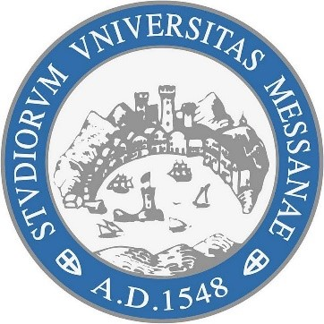

**Software Engineering Project Report**

{width=2.1in}

**University of Messina**

**Department of Mathematics, Computer Sciences, Physical Sciences and Earth Sciences (MIFT)**

**Bachelor's Degree in Data Analysis**

&nbsp;

**DEICMS**

**Digital Evidence Integrity & Chain-of-Custody Management System**

**Agile Incremental Model - Scrum**

&nbsp;

&nbsp;

Prof. Salvatore Distefano

&nbsp;

Vidhya Harini Vijayarajan Sangeetha

533994

&nbsp;

A.Y. 2025 / 2026

```{=openxml}
<w:p><w:r><w:br w:type="page"/></w:r></w:p>
```

# Abstract

DEICMS is a web application for managing digital forensic evidence, built so
that tampering with an exhibit is either impossible or evident, every action
is attributable to the person who performed it, and the system's own history
cannot be rewritten.

The system is organized around **five guarantees**: an exhibit's content can
be shown unchanged since intake or shown precisely where it changed; a person
sees only the investigations they are assigned to, in every view without
exception; the record of what happened is complete and unalterable; an exhibit
moves only as its procedure permits; and exhibits can be prioritized by the
attention they need, with the reasoning exposed.

Its functionality is categorized across the three required categories and
**self-assessed for balance on four independent measures**. Thirty
data-oriented functionalities realize the entity model and its formulae.
Eleven third-party integrations are consumed as they are, with the boundary
stated in each case. **Five algorithms are designed and implemented in this
project**: chain integrity verification over a directed acyclic graph of
custody events, multi-factor risk assessment with per-indicator normalization
and bounded interaction effects, heuristic custody-chain reconstruction that
declines to infer below a plausibility threshold, a role-gated
precondition-constrained lifecycle automaton, and a six-stage orchestration
pipeline around a language model. By estimated effort these account for 43% of
the project and by source size 42%; the whole of the third-party category is
439 lines, less than any two of the five algorithm modules combined.

Development followed **Scrum**, an agile incremental framework, across six
sprints. Three delivered the planned system; the remaining three each arose
from a defect found after acceptance, by adversarial testing, by structured
code reading, and by audit against the specification respectively. The report
is organized with **one chapter per sprint**, each carrying that sprint's
backlog, tasks, UML models, tests, burndown, review and retrospective, with a
dedicated chapter describing each complex algorithm through UML behavioral
diagrams.

The delivered system comprises approximately 4,700 source lines across ten
blueprints and six entities, verified by **216 automated tests** reaching 78%
statement coverage overall and 80% across the five algorithms, with every one
of the twenty-one system quality requirements carrying a measurement, an
acceptance value and a named test. Twenty-six UML diagrams are produced from text
descriptions stored in the repository beside the code they illustrate, and the
Definition of Done requires both to change together.

```{=openxml}
<w:p><w:r><w:br w:type="page"/></w:r></w:p>
```

# Table of Contents

```{=openxml}
<w:sdt><w:sdtPr><w:docPartObj><w:docPartGallery w:val="Table of Contents"/><w:docPartUnique/></w:docPartObj></w:sdtPr><w:sdtContent><w:p><w:r><w:fldChar w:fldCharType="begin" w:dirty="true"/><w:instrText xml:space="preserve">TOC \o "1-2" \h \z \u</w:instrText><w:fldChar w:fldCharType="separate"/></w:r><w:r><w:t>Right-click and choose "Update Field" to build the table of contents.</w:t></w:r><w:r><w:fldChar w:fldCharType="end"/></w:r></w:p></w:sdtContent></w:sdt>
```

```{=openxml}
<w:p><w:r><w:br w:type="page"/></w:r></w:p>
```
