::: {custom-style="TitlePage"}
University of Messina

Department of Mathematics, Computer Sciences,
Physical Sciences and Earth Sciences (MIFT)

Bachelor's Degree in Data Analysis

**DEICMS**

Digital Evidence Integrity & Chain-of-Custody Management System

Agile Incremental Model - Scrum

Software Engineering Project Report

Submitted to: Prof. Salvatore Distefano

Prepared by: Vidhya Harini Vijayarajan Sangeetha

Student ID: 533994

Academic Year: 2025 / 2026

Revised Submission - November 2026
:::

```{=openxml}
<w:p><w:r><w:br w:type="page"/></w:r></w:p>
```

# Abstract

DEICMS is a web application for managing digital forensic evidence, built so
that tampering with an exhibit is either impossible or evident, every action
is attributable to the person who performed it, and the system's own history
cannot be rewritten.

The system is organised around **five guarantees**: an exhibit's content can
be shown unchanged since intake or shown precisely where it changed; a person
sees only the investigations they are assigned to, in every view without
exception; the record of what happened is complete and unalterable; an exhibit
moves only as its procedure permits; and exhibits can be prioritised by the
attention they need, with the reasoning exposed.

Its functionality is categorised across the three required categories and
**self-assessed for balance on four independent measures**. Thirty
data-oriented functionalities realise the entity model and its formulae.
Eleven third-party integrations are consumed as they are, with the boundary
stated in each case. **Five algorithms are designed and implemented in this
project**: chain integrity verification over a directed acyclic graph of
custody events, multi-factor risk assessment with per-indicator normalisation
and bounded interaction effects, heuristic custody-chain reconstruction that
declines to infer below a plausibility threshold, a role-gated
precondition-constrained lifecycle automaton, and a six-stage orchestration
pipeline around a language model. By estimated effort these account for 43% of
the project and by source size 42%; the whole of the third-party category is
439 lines, less than any two of the five algorithm modules combined.

The project followed **Scrum**, an agile incremental framework, across six
sprints. Three delivered the planned system. The remaining three exist because
something was found wrong - by adversarial testing, by structured code
reading, and by external review respectively - and each is described here at
the same length as the sprints that went to plan. This report is organised
with **one chapter per sprint**, each carrying that sprint's backlog, tasks,
UML models, tests, burndown, review and retrospective, and with a dedicated
chapter describing each complex algorithm through UML behavioural diagrams.

The delivered system comprises approximately 4,700 source lines across ten
blueprints and six entities, verified by **216 automated tests** reaching 78%
statement coverage overall and 80% across the five algorithms, with every one
of the twenty-one system quality requirements carrying a measurement, an
acceptance value and a named test. Twenty-six UML diagrams are generated from
versioned source, so no figure in this report can contradict the code it
describes.

```{=openxml}
<w:p><w:r><w:br w:type="page"/></w:r></w:p>
```

# Table of Contents

```{=openxml}
<w:sdt><w:sdtPr><w:docPartObj><w:docPartGallery w:val="Table of Contents"/><w:docPartUnique/></w:docPartObj></w:sdtPr><w:sdtContent><w:p><w:r><w:fldChar w:fldCharType="begin" w:dirty="true"/><w:instrText xml:space="preserve">TOC \o "1-2" \h \z \u</w:instrText><w:fldChar w:fldCharType="separate"/></w:r><w:r><w:t>Right-click and choose "Update Field" to build the table of contents.</w:t></w:r><w:r><w:fldChar w:fldCharType="end"/></w:r></w:p></w:sdtContent></w:sdt>
```

```{=openxml}
<w:p><w:r><w:br w:type="page"/></w:r></w:p>
```


# Chapter 1 - Introduction

---

## 1.1 The Problem

Digital evidence is trivially copyable and silently alterable. A photograph
from a seized device, a server log, a transaction export - each can be changed
without visible trace, and a court has no way to inspect bytes and tell.

What makes digital evidence admissible is therefore not the evidence but the
**record of its handling**: an unbroken, documented account of who held it,
when, and what was done to it. Break that chain and the evidence is worthless
however genuine it is. The requirement is procedural, and it is exactly the
kind of requirement software is good at enforcing and humans are bad at
remembering.

DEICMS - the Digital Evidence Integrity and Chain-of-Custody Management
System - manages digital forensic evidence so that tampering is either
impossible or evident, every action is attributable, and the system's own
history cannot be rewritten.

## 1.2 Why This Project

The project had to satisfy two conditions simultaneously: be a credible
software system, and provide honest material for all three feature categories
the guidelines require.

Forensic evidence management does both without strain. It has a genuine
relational model with real constraints (Category A). It needs cryptographic,
metadata and machine-learning components that would be irresponsible to
reimplement (Category B). And it poses problems that no library solves -
verifying a chain of custody, ranking exhibits by the attention they need,
reconstructing a history with gaps in it (Category C).

**The domain was chosen because its hardest problems are algorithmic rather
than merely procedural.** Chapter 2 gives the full categorisation and assesses
whether the balance was actually achieved.

## 1.3 The Five Guarantees

Everything the system does serves one of five guarantees. They are stated
here because the chapters that follow refer to them, and because a system's
claims are easier to judge when they are enumerated.

**Table 1.1 - The guarantees, and what would falsify each**

| | Guarantee | Falsified by |
|---|--------------------------------------|-------------------------------|
| **G1** | An exhibit's content can be shown to be unchanged since intake, or shown precisely where and how it changed | A change that verification does not detect, or a verdict that names no location |
| **G2** | A person sees only the investigations they are assigned to, in every view without exception | Any surface - detail, aggregate, export, generated answer - returning data from an unassigned investigation |
| **G3** | The system's record of its own history is complete and cannot be amended | An action that leaves no record, or a record that can be altered |
| **G4** | An exhibit moves only as its procedure permits, at the hands of someone entitled | A transition that succeeds when the procedure forbids it |
| **G5** | Exhibits can be prioritised by the attention they need, with the reasoning exposed | A ranking its user cannot interrogate |

G2 is the guarantee this project failed twice and repaired twice, in Sprints 4
and 6. That history is in Chapters 9 and 10, told as what it is rather than
minimised.

## 1.4 Objectives

**Table 1.2 - Objectives and where each is assessed**

| | Objective | Assessed in |
|---|-----------------------------------------------------------|---------|
| O1 | A working system managing the full evidence lifecycle | Ch. 6-10 |
| O2 | Access controlled by both function and case membership, on every route and aggregate | Ch. 9 |
| O3 | A cryptographically verifiable chain of custody with an append-only history | §11.2 |
| O4 | At least three non-trivial algorithms designed and implemented in this project | **Ch. 11 - five delivered** |
| O5 | Third-party services consumed correctly, with the boundary stated honestly | Ch. 2, §11.7 |
| O6 | A genuine agile incremental project with per-iteration artefacts | Ch. 4, 6-10 |
| O7 | An automated test suite of meaningful coverage | Ch. 12 |
| O8 | Quality attributes implemented **and demonstrably enforced** | Ch. 10, §3.7 |

O8 is stated in the form it reached after Sprint 6. Its original wording asked
only that the system be hardened; the word *demonstrably* was added when an
external review observed that enforcement without verification is a claim
rather than a property.

## 1.5 Scope

**Table 1.3 - In and out of scope**

| In scope | Out of scope, and why |
|--------------------------------|---------------------------------------|
| Investigation and exhibit management, custody recording, integrity verification, lifecycle enforcement, risk assessment, natural-language querying, audit, export | Production deployment behind a multi-process server - an operational concern, not an engineering demonstration |
| Four roles plus case-level membership | Notifications - no engineering content |
| A single-host deployment with an external model service | Full-text search over exhibit *content* rather than metadata |
| An automated suite running without network access | A mobile client; a multi-language interface |
| | Fine-tuning of the language model - would move Category B work into the project without adding design |

The exclusions are recorded in the product backlog's *won't have* list
(Section 4.4), so the boundary is a decision rather than an omission.

## 1.6 Relationship to the Accepted Proposal

The project proposal approved before implementation specified the Agile
Incremental Model, three increments, five entities, three core algorithms plus
a state machine and an orchestration workflow, and a report structured with
one section per increment.

**Table 1.4 - Deviations from the accepted proposal**

| Proposed | Delivered | Why |
|------------|-------------------|---------------------------------------|
| Agile Incremental Model | **Scrum**, an agile incremental framework, with its artefacts implemented | The proposal named the family; §4.1.3 names the member and commits to its artefacts |
| Three increments | **Six sprints** - three planned, three arising from findings | Sprints 4, 5 and 6 each exist because something was found wrong (Ch. 9, 10) |
| Five entities | **Six** - `CaseAccess` added | Case-level membership proved to need its own associative entity (Sprint 4) |
| Six risk signals, three risk levels | **Eight signals, four levels** | Two further signals proved discriminating; a fourth band separated the genuinely critical |
| A named commercial language-model API | **A different hosted model** | The named service was unavailable on terms the project could meet. The requirement never named a vendor, so this changed the design and not the requirements (§3.1.1, §11.6.1) |
| Test coverage above 70% | **78%**, 216 tests | - |

**Every deviation is an addition or a substitution forced by circumstance;
none removes something promised.** They are collected here rather than
scattered, so that a reader holding the proposal can check the delivery
against it in one place.

## 1.7 How to Read This Report

The report is organised according to the development process it used, as the
guidelines require of an incremental model: **one chapter per sprint**, each
containing that sprint's own backlog, tasks, models, tests, burndown, review
and retrospective.

**Table 1.5 - Structure**

| Chapters | Content |
|-----|------------------------------------------------------------------|
| 1-2 | The problem, and the feature categorisation with its balance self-assessment |
| 3-5 | Requirements at two levels, the process and its justification, the architecture |
| **6-10** | **The six sprints, one chapter each** |
| 11 | The five Category C algorithms, each with pseudocode and UML |
| 12-13 | Verification and validation; conclusions |

Three things are deliberately *not* in this report. There is no restatement of
software-engineering theory: the process is described where it was used, not
in a chapter of its own. There is no diagram that is not UML, and every one is
generated from versioned source so it cannot drift from the code. And there is
no claim of a flawless result - the three maintenance sprints are described at
the same length as the three that went to plan, because a process is
demonstrated by what it catches, not by what it avoids.

---

```{=openxml}
<w:p><w:r><w:br w:type="page"/></w:r></w:p>
```


# Chapter 2 - Feature Categorisation and Balance

---

The project guidelines require the system's functionalities to be listed under
three categories, the categorisation to be motivated - particularly for the
complex features - and the result to be **self-assessed for balance**, with
functionality added wherever a category is thin. This chapter does all three,
and records what the self-assessment changed.

## 2.1 The Three Categories, and the Test Used

**Table 2.1 - The categories as the guidelines define them, and the test applied**

| | Category | Guideline definition | Test applied in this report |
|---|----------|-------------------------|----------------------------------|
| **A** | Data / repository / DB-oriented | CRUD operations, formulae | Is the behaviour obtained by storing, retrieving or arithmetically combining records? |
| **B** | Third-party services | Libraries, APIs, tools, pre-trained models | Is the behaviour obtained by calling something that implements it? |
| **C** | Complex application logic | Algorithm and workflow mostly implemented by the author; may exploit third-party services inside an elaborated logic | Does the behaviour require a data structure, control flow or search that this project designed? |

The guidelines warn specifically that pre-trained models are *"mainly a 3rd
party service, unless you propose a complex logic workflow from the
information gathered"*. This report takes that warning as the governing rule
and applies it in both directions:

- The language model is **B**. The six-stage pipeline around it is **C**, and
  Section 11.6 shows the boundary is real rather than claimed.
- The Isolation Forest is **B and stays B**, even though it feeds the same
  dashboard as a Category C algorithm, because the library *is* the algorithm
  there.

**The decisive question is not "does it call a library?" but "if the library
were replaced by an equivalent, would anything this project designed have to
change?"** For the hash function inside the integrity verifier the answer is
no, so the verifier stays C. For the Isolation Forest the answer is yes, so it
is B.

## 2.2 Category A - Data, Repository and Formula Functionalities

Thirty functionalities. The complexity here lives in the data model and its
constraints, not in any algorithm.

**Table 2.2 - Category A functionalities**

| # | Functionality | Entity | Realises |
|----|-----------------------------------------------|-------------|------|
| A1 | Create an investigation | Case | SR-07 |
| A2 | Search and list investigations | Case | SR-07 |
| A3 | Amend an investigation | Case | SR-07 |
| A4 | Close an investigation without data loss | Case | SR-08 |
| A5 | Confine the investigation list to the viewer's memberships | Case, CaseAccess | SR-09 |
| A6 | Register an exhibit | EvidenceItem | SR-10, SR-11 |
| A7 | Amend an exhibit's description and classification | EvidenceItem | SR-15 |
| A8 | Classify an exhibit by kind | EvidenceItem | SR-15 |
| A9 | Remove an exhibit without destroying its history | EvidenceItem | SR-55 |
| A10 | Create an investigator account | Investigator | SR-21 |
| A11 | Assign and change an account's function | Investigator | SR-04 |
| A12 | Suspend and restore an account | Investigator | SR-04 |
| A13 | Release a locked account | Investigator | SR-47 |
| A14 | List accounts | Investigator | SR-04 |
| A15 | Record a custody handover | CustodyLog | SR-16 |
| A16 | Record an access event | CustodyLog | SR-16 |
| A17 | Restrict handover to the present custodian | CustodyLog | SR-17 |
| A18 | View an exhibit's custody log | CustodyLog | SR-16 |
| A19 | Record system events with actor, origin, moment, outcome | AuditRecord | SR-18 |
| A20 | Record integrity-check outcomes | AuditRecord | SR-18 |
| A21 | View the audit trail per exhibit | AuditRecord | SR-18 |
| A22 | View the global audit trail (administrator) | AuditRecord | SR-18 |
| A23 | Grant case membership | CaseAccess | SR-09 |
| A24 | Revoke case membership | CaseAccess | SR-09 |
| A25 | **Formula:** interval between consecutive handovers above a threshold | CustodyLog | SR-20 |
| A26 | **Formula:** repeated log entries by actor, exhibit and moment | CustodyLog | SR-20 |
| A27 | **Formula:** acts inconsistent with the actor's function | AuditRecord | SR-20 |
| A28 | Scoped aggregates: counts, charts, rankings | all | SR-51 |
| A29 | Role-composed overview with an explanatory empty state | all | SR-52 |
| A30 | Paginated listings | Case, EvidenceItem, AuditRecord | SR-57 |

**Motivation.** Every row is a persistence operation or arithmetic over stored
fields. A25 to A27 are the "formulae" the guidelines name: timestamp
subtraction against a configurable threshold, equality over three columns, and
set membership of a role in a permitted list. None requires a data structure
or a search, which is precisely why none is claimed as C.

## 2.3 Category B - Third-Party Services

Eleven integrations, consumed as they are.

**Table 2.3 - Category B functionalities**

| # | Functionality | Component | What it provides | What this project supplies |
|---|-----------------|----------|----------------|-------------------------|
| B1 | Content fingerprinting | Hash library | The digest function | When to compute it, and what to compare it with |
| B2 | Custody-record signing | Signature library | Key generation, sign, verify | The canonical payload and when to sign |
| B3 | Embedded metadata extraction | Imaging library | EXIF parsing | Which fields to keep and persist |
| B4 | Content-type detection | Magic-byte library | Type identification from bytes | The allow-list and the refusal policy |
| B5 | Object-relational mapping | ORM | Mapping and query generation | The schema and its constraints |
| B6 | Natural-language generation | Hosted language model | The sentence | Everything around it (Section 11.6) |
| B7 | Statistical outlier detection | Isolation Forest | **The algorithm itself** | The feature vector only |
| B8 | Printable report generation | PDF library | Layout and serialisation | The report's content and structure |
| B9 | Content encryption at rest | Cryptography library | The cipher | What to encrypt, and key handling |
| B10 | Second-factor codes | TOTP library | Code generation and validation | Enrolment and the lockout policy |
| B11 | Request rate limiting | Limiter | Counting and refusal | Which endpoints, and at what rates |

**Motivation.** In every row the behaviour named in column three is
implemented elsewhere. B7 is the row that proves the categorisation is applied
honestly: anomaly detection is visible in the interface beside a Category C
algorithm and could have been presented as a sixth complex feature. It is not,
because the library is the algorithm and this project supplies only its input.

## 2.4 Category C - Complex Application Logic

Five algorithms, each designed and implemented in this project. Each is given
a full section in **Chapter 11** with pseudocode, UML behavioural diagrams,
complexity analysis and the design decision that defines it. Summarised here
with the motivation the guidelines require.

**Table 2.4 - Category C functionalities, with motivation**

| # | Algorithm | What makes it complex | Why not A | Why not B |
|---|------|--------------------------------|------------------|------------|
| **C1** | **Chain integrity verification** (§11.2) | Builds a directed acyclic graph of custody events and traverses it depth-first, applying three independent checks at every node and **accumulating all failures in one pass** rather than halting at the first | No query answers "where and in what way is this chain unsound"; the predecessor relation and the branching are structure, not rows | Hash and signature libraries are used as primitive operations inside the traversal; replacing either changes nothing in the design |
| **C2** | **Multi-factor risk assessment** (§11.3) | Eight indicators, each normalised by a curve chosen for its own distribution, combined by weighted sum, amplified by five interaction rules, with the total amplification capped | A weighted sum is arithmetic; the per-indicator normalisation choice, the interaction model and the cap are design | No library models this domain's notion of risk |
| **C3** | **Custody chain reconstruction** (§11.4) | Heuristic best-first search: detects discontinuities, generates candidates, scores each on four criteria, selects above a threshold and **declines below it** | There is no correct answer to retrieve; the algorithm evaluates possibilities and reports confidence | No library infers missing custody |
| **C4** | **Evidence lifecycle state machine** (§11.5) | A formal automaton declared as data: six states, fourteen transitions, each gated by permitted function and preconditions, with a four-gate validation pipeline and audited refusals | A status column is data; a role-gated, precondition-constrained automaton with explained refusals is control | No library knows this domain's procedure |
| **C5** | **Assistant orchestration** (§11.6) | Six stages: intent classification over seven intents, **access-scoped** retrieval, template selection, budgeted invocation with fallback, context-only degradation, and reference validation against the retrieved records | Retrieval is queries; the pipeline that decides what to retrieve and what to do with the answer is not | **The model is B.** The pipeline is C, and the substitution of one model for another changed no stage, no requirement and no test |

**The guidelines' own example, answered directly.** They note that an ML model
is usually a third-party service *"unless you propose a complex logic workflow
from the information gathered, maybe including multiple ML steps and
workflow"*. C5 is exactly that workflow, and C1 is invoked **inside** it:
an integrity question causes the assistant to run a fresh verification and
include its result in the retrieved context. Two Category C algorithms compose,
with a Category B model producing only the final sentence.

## 2.5 Self-Assessment: Is the Project Balanced?

Counting functionalities alone would be misleading - thirty CRUD operations
are not thirty times the work of one graph algorithm. The balance is therefore
assessed on four measures.

**Table 2.5 - Balance across four measures**

| Measure | A | B | C | Reading |
|-------------------|-------|------|--------|--------------------------------|
| Functionalities | 30 (66%) | 11 (24%) | 5 (11%) | A dominates by count, as CRUD always will |
| System requirements | 30 (50%) | 11 (18%) | 19 (32%) | C requires three to four requirements each |
| **Story points** (130 planned) | 47 (36%) | 27 (21%) | **56 (43%)** | **C is the largest share of estimated effort** |
| **Source lines** (4,711) | 2,302 (49%) | 439 (9%) | **1,970 (42%)** | C is 4.5 times the size of B |

**Table 2.6 - Category C by module**

| Module | Lines | Algorithm |
|--------------------------------------------------|------------|---------|
| `ai_assistant.py` | 662 | C5 |
| `risk_scoring.py` | 445 | C2 |
| `chain_reconstruction.py` | 331 | C3 |
| `graph_integrity.py` | 323 | C1 |
| `state_machine.py` | 209 | C4 |
| **Total** | **1,970** | |

The whole of Category B is **439 lines**, less than any two Category C
modules combined. That single comparison is the most direct answer to the
question the guidelines pose: this is not a project in which libraries do the
work.

**The verdict.** The project is balanced, with the qualification that it is
balanced *by effort* rather than *by count*. Category A is the largest by
functionality count and will be in any system with a real data model;
Category C is the largest by estimated effort and nearly the largest by code
size. Category B is deliberately the smallest, because a project judged on
engineering should not be mostly borrowed.

## 2.6 What the Self-Assessment Changed

The guidelines ask for functionality to be added where a category is thin. It
was, twice, and both occasions are recorded rather than presented as original
design.

**Table 2.7 - Functionality added after a balance assessment**

| When | Category found thin | Added | Effect |
|---------|---------------------|---------------------------|--------------|
| Proposal revision, before implementation | **C** - the first draft offered rule-based checks that were really formulae in disguise | C1, C2 and C3 replaced them; C4 and C5 were re-argued at the level of their workflow rather than their output | C went from a contested claim to five defensible algorithms |
| Sprint 6, after external review | **A and the quality attributes** - enforcement existed but was unverified | A30 (paginated listings) implemented; 21 system quality requirements given measurements, acceptance criteria and tests | 8 of 18 quality requirements verified became 21 of 21 |

The first change is the one the guidelines anticipate. An earlier version of
the proposal claimed as "complex" a set of threshold checks over stored
fields. They were honestly re-categorised as Category A formulae - where they
remain, as A25 to A27 - and three genuine algorithms were designed to replace
them.

**A categorisation that never demotes anything is not a categorisation**, and
this one demoted its own first attempt before the professor had to.

## 2.7 Mapping to the Delivery Sequence

**Table 2.8 - Category by sprint**

| Sprint | A | B | C | Character |
|------------------|-----|----|-----|--------------------------------------|
| 1 - Foundation | 35 pts | 5 pts | - | The data layer the algorithms operate on |
| 2 - Integrity | 4 pts | 5 pts | **29 pts** | C1, C3, C4 |
| 3 - Assessment | 3 pts | 17 pts | **22 pts** | C2, C5, plus most third-party work |
| 4 (M1) - Scoping | 5 pts | - | 5 pts | Access scoping, including inside C5 |
| 5 (M2) - Defects | - | - | - | Eleven findings, no new scope |
| 6 (M3) - Quality | 23 pts | - | - | Verification of what the other five built |

The ordering is not accidental: Category A first because the algorithms need
records to operate on, Category C concentrated in Sprints 2 and 3, and
Category B spread across both because each integration attaches to the feature
that needs it. Section 4.4.1 gives the four rules that produced this order.

---

```{=openxml}
<w:p><w:r><w:br w:type="page"/></w:r></w:p>
```


# Chapter 3 - Requirements Engineering

---

## 3.1 How Requirements Are Expressed in This Project

Requirements in DEICMS are recorded at two levels of abstraction, following the
distinction Sommerville draws between user requirements and system
requirements. The two levels serve different readers and answer different
questions, and conflating them is the commonest way a requirements document
becomes unusable.

**Table 3.1 - The two levels of requirement**

| | User requirements (UR, UNF) | System requirements (SR, SNF) |
|-------|-------------------------------|---------------------------------|
| Reader | The investigating authority commissioning the system | The developer building it, and the tester verifying it |
| Question answered | What must we be able to do, and what must be true of the system? | What exactly must the software do, and how will we know it does? |
| Language | The reader's own vocabulary - exhibit, custody, investigation | Precise, bounded, countable |
| Abstraction | One statement covers a whole capability | One statement covers one checkable behaviour |
| Count | 22 functional + 9 quality | 61 functional + 21 quality |
| Testable directly? | No - too coarse | **Yes - each carries an acceptance criterion and a named test** |

Every system requirement derives from exactly one user requirement, and every
user requirement is realised by at least one system requirement. The
traceability runs forward from there: requirement to user story, user story to
sprint, sprint to module, module to test. The full chain is given in
Section 3.9 and carried in the right-hand columns of Tables 3.3 and 3.7.

### 3.1.1 Requirements state problems, not solutions

A requirement that names a technology has stopped being a requirement and
become a design decision wearing a requirement's clothes. It forecloses
alternatives before they have been weighed, and it cannot survive the
technology being replaced.

The first version of this requirements set made this mistake repeatedly. The
correction is recorded here rather than hidden, because the difference between
the two columns is the whole point.

**Table 3.2 - Requirements restated as problems**

| Originally written as (a solution) | Restated as (a problem) | Where the technology now lives |
|---------------|--------------------------------------------|------------|
| "compute a SHA-256 fingerprint at upload" | **UR-06 / SR-13:** the system shall be able to determine, at any later time, whether the stored content of an exhibit differs in any way from the content registered at intake | §5.3 - cryptographic hash function selection |
| "sign every transfer with the outgoing investigator's Ed25519 private key" | **UR-09 / SR-23:** the system shall enable any holder of a custody record to establish which investigator created it and whether it has been altered since | §5.4 - signature scheme selection |
| "flag outliers with an Isolation Forest" | **UR-13 / SR-44:** the system shall identify exhibits whose handling pattern differs markedly from the rest of the population | §11.7 - anomaly detection approach |
| "encrypt stored files with AES-256-GCM" | **UR-18 / SR-48:** the system shall ensure that evidence content is unintelligible to anyone obtaining the storage medium without authorisation | §5.5 - encryption scheme selection |
| "support TOTP two-factor authentication" | **UR-01 / SR-47:** the system shall allow an account to require a second, independently held factor before granting access | §5.6 - second-factor mechanism |
| "fit the model via the NVIDIA NIM endpoint" | **UR-15 / SR-40:** the system shall answer questions posed in ordinary language using only the records the questioner is entitled to see | §11.6 - language model procurement |

The last row matters for an additional reason. The accepted project proposal
named a particular commercial language-model API. That service proved
unavailable on the terms the project could meet, and a different hosted model
was used instead. **Because the requirement asks for an answer in ordinary
language rather than for a named vendor, the substitution changed the design
and not the requirements.** Had the requirement named the vendor, a commercial
fact outside the project's control would have invalidated a requirement.
Section 11.6.1 records the substitution as a design decision with its rationale.

## 3.2 Stakeholders

**Table 3.3 - Stakeholders and their primary concern**

| Stakeholder | Role in the system | Primary concern |
|---------------|----------------|---------------------------------------|
| Administrator | Operates the system | Nothing is lost; everything is attributable |
| Lead Investigator | Owns investigations | Her team's exhibits are sound and court-admissible |
| Forensic Analyst | Examines exhibits | Analysis is not invalidated by a procedural gap |
| Read-Only Viewer | Reviews after the fact | The record can be inspected but not disturbed |
| The court (indirect) | Consumes the output | The chain of custody is unbroken and demonstrably so |
| Opposing counsel (adversarial) | Attacks the output | Any weakness in the chain is found and exploited |

The last stakeholder is the reason several requirements are phrased
negatively. A system of this kind is specified as much by what it must make
impossible as by what it must allow, and the adversarial reader is the one who
determines whether a negative requirement was written broadly enough. This
proved to be exactly where the project's own defects lay (Section 3.10).

## 3.3 User Requirements - Functional

Stated in the language of the investigating authority. No statement here names
a mechanism.

**Table 3.4 - User requirements**

| ID | Requirement | Realised by |
|---|------------------------------------------------------------|--------|
| UR-01 | Investigators must identify themselves before using the system, and the system must not help an outsider discover which accounts exist | SR-01 to SR-03, SR-47 |
| UR-02 | A person's access must be confined to what their function requires | SR-04 to SR-06 |
| UR-03 | A person must see only the investigations they have been assigned to, in every part of the system without exception | SR-07, SR-09, SR-51, SR-52 |
| UR-04 | Investigators must be able to open, find, amend and close investigations, and no act of closure may destroy information | SR-07, SR-08 |
| UR-05 | Investigators must be able to register a digital exhibit, describe it, and classify it | SR-10 to SR-12, SR-15 |
| UR-06 | The system must be able to establish, at any time, whether an exhibit still holds exactly the content it held when collected | SR-13, SR-25 to SR-27, SR-56 |
| UR-07 | Every passage of an exhibit from one person to another must be recorded with who, when, where and why | SR-16, SR-17 |
| UR-08 | The record of what has happened must not be alterable by anyone, including the administrator | SR-18, SR-19 |
| UR-09 | Anyone holding a custody record must be able to establish who created it and whether it has since been altered | SR-23, SR-24 |
| UR-10 | Where a custody history is unsound, the system must say where and in what way, not merely that it is | SR-25 to SR-27, SR-34 |
| UR-11 | Where parts of a custody history are missing, the system must offer the most plausible reconstruction, and must never present a reconstruction as a fact | SR-31 to SR-33, SR-35 |
| UR-12 | An exhibit must pass only through the states its procedure permits, and only at the hands of someone entitled to move it | SR-28 to SR-30 |
| UR-13 | Investigators must be able to tell which exhibits most need attention without reading every record | SR-36 to SR-38, SR-44 to SR-46 |
| UR-14 | The authority must be able to change what it considers risky without the software being rebuilt | SR-39 |
| UR-15 | Investigators must be able to ask about a case in ordinary language and receive answers drawn from the actual records | SR-40 to SR-42, SR-53 |
| UR-16 | An answer must never assert anything not present in the records it was drawn from | SR-43 |
| UR-17 | Accounts must be created only by a person authorised to create them | SR-21, SR-22 |
| UR-18 | Evidence content must remain unintelligible to anyone who obtains the storage medium without authorisation | SR-48 |
| UR-19 | An investigator must be able to hand a complete case to an outside party who can verify it without access to this system | SR-49, SR-50 |
| UR-20 | The system must remain useful, in reduced form, when an external service it depends on is unavailable | SR-42 |
| UR-21 | The system must remain usable as the number of cases and exhibits grows | SR-57, SR-58 |
| UR-22 | Each role must be shown the information its work requires, and never a blank or unexplained screen | SR-52, SR-59 |

## 3.4 User Requirements - Quality

**Table 3.5 - User quality requirements**

| ID | Requirement | Quality attribute |
|-----|-------------------------------------------------------|------------|
| UNF-01 | Confidentiality between investigations must hold absolutely | Security |
| UNF-02 | Tampering with evidence must be detectable | Integrity |
| UNF-03 | Actions must be attributable to the person who performed them | Non-repudiation |
| UNF-04 | The history of the system must be complete and permanent | Auditability |
| UNF-05 | The system must respond quickly enough not to interrupt an investigator's work | Performance |
| UNF-06 | A failure in one part must not make the whole system unusable | Robustness |
| UNF-07 | The system must be maintainable by a developer who did not write it | Maintainability |
| UNF-08 | The system must not be tied to one database product | Portability |
| UNF-09 | Claims the system makes about itself must be independently checkable | Verifiability |

These are deliberately unmeasurable. That is what distinguishes a user quality
requirement from a system one: "quickly enough not to interrupt an
investigator's work" is the right thing to say to a customer and the wrong
thing to hand a tester. Section 3.7 converts each into statements that can
pass or fail.

## 3.5 System Requirements - Functional

Each row is a single checkable behaviour, traced back to its user requirement
and forward to the sprint that delivered it, the user story that carried it,
and the test that verifies it. Category is the feature categorisation of
Chapter 2: **A** data/repository, **B** third-party, **C** complex custom logic.

**Table 3.6 - System functional requirements**

| ID | Requirement | From | Cat | Pri | Sprint | Story | Verified by |
|---|------------------------------------------------------|---|---|---|---|---|-------|
| SR-01 | The system shall grant access only on presentation of an identifier and a secret known to the account holder, and shall return an identical failure message whether the identifier is unknown or the secret wrong | UR-01 | A | Must | 1 | US-01 | `test_increment1` |
| SR-02 | The system shall store authentication secrets only in a form from which the original cannot be recovered | UR-01 | A | Must | 1 | US-01 | `test_increment1` |
| SR-03 | The system shall end a session after a bounded period without activity | UR-01 | A | Must | 1, 3 | US-01, US-24 | `test_nfr`, `test_increment3` |
| SR-04 | The system shall assign each account exactly one of four functions: administration, investigation leadership, analysis, or review | UR-02 | A | Must | 1 | US-02 | `test_increment1` |
| SR-05 | The system shall verify the required function on every operation, refusing with an explanation rather than failing silently | UR-02 | A | Must | 1 | US-02 | `test_increment1`, `test_scoping` |
| SR-06 | The system shall prevent an account limited to review from causing any change of state | UR-02 | A | Must | 1 | US-02 | `test_scoping` |
| SR-07 | The system shall allow an authorised account to create, search, amend and close an investigation | UR-04 | A | Must | 1 | US-03 | `test_increment1` |
| SR-08 | The system shall treat closure as a reversible marking that destroys no data | UR-04 | A | Must | 1 | US-03 | `test_increment1` |
| SR-09 | The system shall confine each account's view of investigations to those it is assigned to | UR-03 | A | Must | 1, M1 | US-02, US-28 | `test_scoping` |
| SR-10 | The system shall accept for registration only content of permitted kinds, and refuse all others | UR-05 | A | Must | 1 | US-04 | `test_increment1` |
| SR-11 | The system shall allocate each exhibit an identifier unique across the system and record its registrar as first custodian | UR-05 | A | Must | 1 | US-04 | `test_increment1` |
| SR-12 | The system shall create the first custody record in the same indivisible operation as the exhibit, so that no exhibit can exist without a custody history | UR-05 | A | Must | 1 | US-04 | `test_increment1` |
| SR-13 | The system shall derive from the content at registration a value that changes if the content changes, store it, and never alter it thereafter | UR-06 | B | Must | 1 | US-05 | `test_increment1` |
| SR-14 | The system shall determine the actual kind of registered content from the content itself, and refuse it where this contradicts its declared kind | UR-05 | B | Must | 1, 3 | US-06, US-25 | `test_increment1`, `test_increment3` |
| SR-15 | The system shall allow an authorised account to amend an exhibit's description and classification while leaving its content and derived values untouched | UR-05 | A | Must | 1 | US-07 | `test_increment1` |
| SR-16 | The system shall record each passage of an exhibit with the parties, the moment, the place and the reason | UR-07 | A | Must | 1 | US-08 | `test_increment1` |
| SR-17 | The system shall permit only the present custodian or an administrator to pass an exhibit on | UR-07 | A | Must | 1 | US-08 | `test_increment2` |
| SR-18 | The system shall record every access, attempt, amendment and administrative act with actor, origin, moment and outcome | UR-08 | A | Must | 1 | US-09 | `test_increment1` |
| SR-19 | The system shall make amendment and removal of its own history impossible at the point of data access, not merely absent from the interface | UR-08 | A | Must | 1 | US-09 | `test_increment1` |
| SR-20 | The system shall identify custody intervals exceeding a configured duration, repeated records, and acts inconsistent with the actor's function | UR-10 | A | Should | 1 | US-10 | `test_increment1` |
| SR-21 | The system shall offer no route by which an account may be created other than by an administrator | UR-17 | A | Must | 1 | US-11 | `test_increment1` |
| SR-22 | The system shall furnish each new account with a secret meeting a stated strength policy and with the means to establish authorship of its future acts | UR-17 | B | Must | 1 | US-11 | `test_increment1` |
| SR-23 | The system shall attach to every custody record a value, derived from the record's content and the creator's private means, by which both authorship and subsequent alteration can be established | UR-09 | B | Must | 2 | US-12 | `test_increment2` |
| SR-24 | The system shall make a custody record without that value impossible to store | UR-09 | B | Must | 2 | US-12 | `test_increment2` |
| SR-25 | The system shall assemble an exhibit's custody records into a connected structure and examine it from the registration event onward | UR-06, UR-10 | **C** | Must | 2 | US-13 | `test_increment2` |
| SR-26 | The system shall apply to every element three independent examinations - content consistency, authorship validity, and chronological order - and shall continue after a failure so that all failures are found in one pass | UR-10 | **C** | Must | 2 | US-13 | `test_increment2` |
| SR-27 | The system shall report an overall finding, a proportion of the history examined successfully, an ordered list of failures with their nature, and the sequence of events that did verify | UR-06, UR-10 | **C** | Must | 2 | US-13 | `test_increment2` |
| SR-28 | The system shall express the permitted progression of an exhibit as data, each permitted step naming the function entitled to take it and the conditions that must hold | UR-12 | **C** | Must | 2 | US-14 | `test_increment2` |
| SR-29 | The system shall refuse an impermissible step, naming the precise condition unmet, and shall record the refusal in its history | UR-12 | **C** | Must | 2 | US-14 | `test_increment2` |
| SR-30 | The system shall require a stated reason for every permitted step and shall reassess the exhibit's attention level immediately afterwards | UR-12 | **C** | Must | 2, 3 | US-14, US-18 | `test_increment2` |
| SR-31 | The system shall identify discontinuities between confirmed custody records and assemble candidate records capable of filling them | UR-11 | **C** | Must | 2 | US-15 | `test_increment2` |
| SR-32 | The system shall choose among candidates by ranked search against stated criteria, and shall leave a discontinuity unresolved where no candidate reaches a stated minimum | UR-11 | **C** | Must | 2 | US-15 | `test_increment2` |
| SR-33 | The system shall mark every link confirmed, inferred or unresolved, and shall never present an inferred link in the manner of a confirmed one | UR-11 | **C** | Must | 2 | US-15 | `test_increment2` |
| SR-34 | The system shall present a verification finding in a form a reader can act on, and in a form another program can consume | UR-10 | A | Should | 2 | US-16 | `test_increment2` |
| SR-35 | The system shall present a reconstruction as a sequence distinguishing link kinds and exposing the reasoning behind each inference | UR-11 | A | Should | 2 | US-17 | `test_increment2` |
| SR-36 | The system shall derive for each exhibit a fixed set of independent indicators and bring each to a common scale by a transformation suited to its distribution | UR-13 | **C** | Must | 3 | US-18 | `test_increment3` |
| SR-37 | The system shall combine the indicators by weighted summation, amplified where stated combinations co-occur, with the amplification bounded | UR-13 | **C** | Must | 3 | US-18 | `test_increment3` |
| SR-38 | The system shall place the combined value in a band and accompany it with the contribution of each indicator and the actions it suggests | UR-13 | **C** | Must | 3 | US-18 | `test_increment3` |
| SR-39 | The system shall allow an administrator to alter the indicator weights and the band boundaries, restoring the weights to a unit total and requiring the boundaries to increase strictly | UR-14 | **C**/A | Should | 3 | US-19 | `test_increment3` |
| SR-40 | The system shall determine the purpose of a question posed in ordinary language among a closed set of purposes, and shall recognise when it cannot | UR-15 | **C** | Must | 3 | US-20 | `test_intent_classifier` |
| SR-41 | The system shall gather the records relevant to the determined purpose, confined to the investigations the questioner is assigned to, before any answer is composed | UR-15, UR-03 | **C** | Must | 3, M1 | US-20, US-29 | `test_scoping` |
| SR-42 | The system shall answer from the gathered records alone when no external service is available, stating that it has done so | UR-20 | **C** | Must | 3 | US-20 | `test_nfr`, `test_increment3` |
| SR-43 | The system shall check every identifier and name appearing in an answer against the records gathered, and shall mark any that does not appear | UR-16 | **C** | Must | 3 | US-21 | `test_increment3` |
| SR-44 | The system shall characterise each exhibit by a fixed set of measurements and identify those whose pattern departs markedly from the population | UR-13 | B | Could | 3 | US-22 | `test_increment3` |
| SR-45 | The system shall present such identifications as warranting review and never as findings | UR-13 | B | Could | 3 | US-22 | `test_increment3` |
| SR-46 | The system shall present exhibits ordered by attention level, a view of departures from the norm, and a detailed account for any single exhibit | UR-13 | A | Should | 3 | US-23 | `test_increment3` |
| SR-47 | The system shall allow an account to require a second, independently held factor; shall suspend an account after a stated number of consecutive failures for a stated period | UR-01 | B | Should | 3 | US-24 | `test_increment3`, `test_nfr` |
| SR-48 | The system shall store evidence content, and the private means of establishing authorship, in a form unintelligible without a key held separately from the data | UR-18 | B | Should | 3 | US-25 | `test_increment3` |
| SR-49 | The system shall assemble a complete investigation into a single transferable package carrying the means for a recipient to establish that it is unaltered without access to this system | UR-19 | B | Should | 3 | US-26 | `test_increment3` |
| SR-50 | The system shall render an exhibit's custody history in a form suitable for printing and filing | UR-19 | B | Could | 3 | US-27 | `test_increment3` |
| SR-51 | The system shall compute every total, ranking, chart and export over only the investigations the viewer is assigned to | UR-03 | A | Must | M1 | US-28 | `test_scoping` |
| SR-52 | The system shall compose each role's overview from the elements its work requires, and shall explain the situation rather than show an empty screen when the viewer is assigned to nothing | UR-22, UR-03 | A | Must | M1 | US-28 | `test_scoping`, `test_nfr` |
| SR-53 | The system shall answer questions about the questioner's own identity and assignments from the authenticated session | UR-15 | **C** | Must | M1 | US-29 | `test_intent_classifier` |
| SR-54 | The system shall attribute retained conversation to its owner and discard it both on entry and on departure | UR-03 | A | Must | M1 | US-29 | `test_scoping` |
| SR-55 | The system shall treat removal of an exhibit as a marking that preserves its custody and audit history, and shall omit such exhibits from every listing and total | UR-04 | A | Must | M2 | D1 | `test_integration` |
| SR-56 | The system shall record the outcome of a verification against the exhibit, so that a failed verification raises its attention level | UR-06 | **C** | Must | M2 | D2 | `test_integration` |
| SR-57 | The system shall divide every listing into pages of bounded size | UR-21 | A | Must | M3 | US-33 | `test_nfr` |
| SR-58 | The system shall examine a custody history in time proportional to its size | UR-21 | **C** | Must | M3 | US-34 | `test_nfr` |
| SR-59 | The system shall compose four distinguishable overviews, one per function, none of them without content | UR-22 | A | Must | M1, M3 | US-28, US-35 | `test_nfr` |
| SR-60 | The system shall transmit with every response the directives that constrain where a browser may load content from and how it may frame or interpret the response | UNF-01 | A | Must | M2, M3 | D5, US-31 | `test_nfr` |
| SR-61 | The system shall refuse to begin serving in a production configuration whose secrets are absent or known-weak, and shall warn when they are weak in development | UNF-01 | A | Must | M2, M3 | D6, US-32 | `test_nfr` |

## 3.6 Why Some System Requirements Are Negative

Seven system requirements say what the system must make impossible: SR-01
(identical failure messages), SR-06, SR-08, SR-12, SR-19, SR-21, SR-24, SR-33,
SR-45. These are harder to satisfy than positive requirements, because a
positive requirement is met by one correct path while a negative one is met
only when **every** path is correct.

This is not a theoretical observation. Both maintenance iterations of this
project were caused by negative requirements applied to fewer surfaces than
they governed - SR-09 was enforced on record access but not on aggregates, and
SR-55 was enforced in the interface but not in the listing queries. Section
3.10 records the lesson.

## 3.7 System Requirements - Quality

This is the table the first version of the report lacked. Every row carries
the three things a quality requirement needs to be real: **how it is
measured**, **what value constitutes a pass**, and **the test that applies
the measurement**. A quality requirement without all three is an aspiration.

**Table 3.7 - System quality requirements**

| ID | From | Requirement | Measurement | Acceptance criterion | Verified by |
|---|---|--------------------------|------------------|-------------------|----|
| SNF-01 | UNF-01 | No account shall obtain data from an investigation it is not assigned to, by any route | Adversarial request against every aggregate and detail route as each of four roles | Zero records from unassigned investigations in any response | `test_scoping` (14) |
| SNF-02 | UNF-02 | Any difference between stored content and registered content shall be detected | Alter one byte of a stored exhibit, then verify | Verification reports a failure naming the affected element | `test_increment2` |
| SNF-03 | UNF-03 | A custody record's author shall be establishable, and alteration detectable | Verify each record against the author's public means; then alter one field and repeat | Unaltered records verify; altered records fail | `test_increment2` |
| SNF-04 | UNF-04 | The system's history shall admit insertion only | Attempt amendment and removal of an audit record through the data-access layer | Both raise; the record is unchanged | `test_increment1` |
| SNF-05 | UNF-06 | An unavailable external service shall not prevent an answer | Pose a question with no service configured | An answer is returned, drawn from records, and says so | `test_nfr`, `test_increment3` |
| SNF-06 | UNF-06 | A slow external service shall not hold a request open indefinitely | Substitute a service that exceeds its budget | Request completes under 30 s; per-call budget at most the total, total at most 90 s | `test_nfr` |
| SNF-07 | UNF-05 | Examination of a custody history shall grow linearly with its size | Time examination at 20 and 200 elements, best of three | Tenfold size costs under thirtyfold time | `test_nfr` |
| SNF-08 | UNF-05 | Assessment of attention level shall grow linearly with the records considered | Time assessment at 20 and 200 records, best of three | Tenfold records cost under thirtyfold time | `test_nfr` |
| SNF-09 | UNF-05 | Examination of a hundred-element history shall complete within an investigator's tolerance | Time a single examination of 100 elements | Under 5 seconds | `test_nfr` |
| SNF-10 | UNF-05 | No listing shall render in time proportional to the whole collection | Create 45 investigations and 45 exhibits; request each listing | At most 20 rendered per page; navigation present | `test_nfr` |
| SNF-11 | UNF-07 | Business logic shall not depend on the request cycle | Static examination of every logic module's imports | No module imports request, session, redirect, url_for, render_template, flash or abort | `test_nfr` |
| SNF-12 | UNF-07 | Business logic shall not depend on the interface layer | Static examination for route imports | No logic module imports from the routes package | `test_nfr` |
| SNF-13 | UNF-08 | No database-product-specific construct shall appear in logic, models or routes | Static examination for dialect keywords | No occurrence of PRAGMA, AUTOINCREMENT, sqlite_master or SERIAL | `test_nfr` |
| SNF-14 | UNF-08 | Values written to constrained columns shall lie within the declared domain | Assess an exhibit, persist, compare against the column's declared values | Persisted value is within the declared set | `test_nfr` |
| SNF-15 | UNF-01 | The session token shall be unreadable by page scripts, sent only over a protected transport, and resistant to cross-origin submission | Inspect effective configuration | Script-inaccessible, transport-restricted, and same-site constrained | `test_nfr` |
| SNF-16 | UNF-01 | Every response shall carry directives restricting content origin, framing, interpretation and referrer disclosure | Request an unauthenticated and an authenticated page; inspect response directives | All four present on both; content origin defaults to the application's own | `test_nfr` |
| SNF-17 | UNF-01 | Text originating outside the system shall never be interpreted as markup | Store markup in an investigation title and in a conversation; render both | Markup appears escaped; no element boundary can be closed by stored text | `test_nfr` |
| SNF-18 | UNF-01 | A production configuration with an absent or known-weak secret shall not start | Apply validation to absent, weak and sound configurations | Absent raises; weak raises; sound passes | `test_nfr` |
| SNF-19 | UNF-01 | Authentication secrets shall meet a stated minimum strength, and repeated failure shall suspend the account | Inspect effective policy | Minimum length at least 12; suspension at no more than 5 failures for at least 15 minutes | `test_nfr` |
| SNF-20 | UNF-09 | The whole verification suite shall run without reaching any external service | Execute the suite with no network configuration | All tests pass; no external call attempted | Suite execution |
| SNF-21 | UNF-09 | Each role's overview shall be distinguishable from every other | Render the overview as each of four roles and compare | Four distinct renderings; administrative panels absent from the other three | `test_nfr` |

**Coverage.** Every one of the twenty-one system quality requirements names a
test. Section 3.11 records what this table looked like before the revision and
why the difference matters.

## 3.8 Domain Requirements

Constraints arising from the forensic domain rather than from any stakeholder's
wish. They are separated because they are not negotiable and not traded off.

**Table 3.8 - Domain requirements**

| ID | Constraint | Consequence if violated |
|---|-------------------------------------|-------------------------------|
| DR-01 | An exhibit's custody history must begin at the moment of collection | The chain has no established origin and the exhibit is inadmissible |
| DR-02 | No gap in custody may be silently closed | A reconstruction presented as fact misleads the court |
| DR-03 | The record of handling must outlive the exhibit's deletion | Deleting an exhibit would erase the evidence of its own mishandling |
| DR-04 | Closure of an investigation must not destroy its contents | Later challenge cannot be answered |
| DR-05 | A person must not both perform an act and be the sole attestor to it | Attribution becomes unverifiable |
| DR-06 | An exhibit whose integrity has failed must not re-enter normal handling unnoticed | Compromised material is treated as sound |
| DR-07 | An inference must be visibly distinguishable from an observation | The distinction between evidence and supposition collapses |

## 3.9 Traceability

The chain is complete in both directions and is carried inline rather than in
an appendix, so that a reader checking any single requirement need not turn
pages. Its six links are: a **user requirement** is derived into one or more
**system requirements**; each system requirement is carried by a **user
story**; each user story is scheduled into a **sprint**; each sprint
implements it in a **module**; and each module is verified by a named
**test**. The relationships between these artefacts are modelled formally as a
UML class diagram in Figure 3.1, so that the traceability structure is itself
expressed in the notation the rest of the report uses.

**Table 3.9 - Coverage**

| Check | Result |
|----------------------------------------------------------------|-------|
| User requirements realised by at least one system requirement | 22 of 22 |
| System functional requirements traced to a user requirement | 61 of 61 |
| System functional requirements carried by a user story | 61 of 61 |
| System quality requirements with a measurement and acceptance criterion | 21 of 21 |
| System quality requirements with a named automated test | 21 of 21 |
| Requirements naming a technology rather than a problem | 0 |

## 3.10 What the Requirements Process Got Wrong

Two failures are recorded here because the report's account of its own process
is worth more than a claim of having had none.

**Negative requirements were scoped to the surfaces their author had in mind.**
UR-03 and SNF-01 were stated correctly from the start, but the system
requirements realising them addressed record access alone. Aggregates -
counts, charts, rankings, exports, generated answers - were not enumerated, and
so were not protected. The requirement was right; its scope of application was
incomplete. SR-51 exists because of this, and the maintenance iteration M1 is
its consequence. **A negative requirement must enumerate the surfaces it
governs, or it will be applied only to those its author pictured.**

**Quality requirements were stated without the means to check them.** The first
version of Table 3.7 gave each quality requirement a property and a sentence
of justification, but nine of eighteen named only "code review", "configuration
inspection", "manual check" or an analytical argument as their verification. A
verification method that does not re-run cannot fail, and a requirement that
cannot fail is not a requirement. The most pointed instance: the requirement
that untrusted text never be rendered as markup (now SNF-17) arose from a
defect found and fixed in maintenance iteration M2 - and was given no test, so
the fix could have been removed without a single failure anywhere in the suite.
**A fixed defect without a regression test is an unfixed defect with a delay
built in.**

Both failures share a shape: the requirement was correct and the verification
was not. This is why Section 3.7 now treats the measurement and the acceptance
criterion as part of the requirement rather than as commentary on it.

---

```{=openxml}
<w:p><w:r><w:br w:type="page"/></w:r></w:p>
```


# Chapter 4 - The Software Development Process

---

## 4.1 Choosing a Process

A development process is chosen for a project's particular shape, not adopted
because it is current. This section states the shape, evaluates the
candidates against it, and records the decision with its reasoning, so that
Chapter 11 can judge the decision against what actually happened rather than
against what was hoped.

### 4.1.1 The shape of this project

**Table 4.1 - Project characteristics bearing on the choice**

| Characteristic | Value | Bearing on the choice |
|------------|----------------------|------------------------------------|
| Team size | One developer | Collaborative ceremonies must be adapted or honestly abandoned |
| Customer availability | None - no external client | On-site customer is impossible; the acceptance criterion must substitute |
| Requirements volatility | Low for the data layer, **high for the algorithms** | The algorithms resist being specified fully in advance |
| Technical risk | Concentrated in five custom algorithms | Risk must be attacked early, not deferred |
| Dependency structure | Strongly ordered: data → integrity → assessment | Later work genuinely needs earlier work running |
| Delivery horizon | Fixed academic deadline | Scope must flex; the date cannot |
| Required evidence | Planning and reflection artefacts | The process must produce documents as a by-product |

The third and fourth rows dominate. The data layer could have been specified
completely before a line was written: six entities, their relationships, their
constraints. The five algorithms could not. The traversal semantics of the
integrity verifier, the normalisation curve for each risk indicator, the
plausibility criteria for reconstruction - none of these could be settled
honestly on paper, because settling them required running them against data.

### 4.1.2 Candidates

**Table 4.2 - Process models evaluated**

| Model | Fit to this project | Verdict |
|----|-----------------------------------------------------|--------------|
| **Waterfall** | Requires requirements frozen before design. Would have frozen the algorithms' design at the point of least knowledge, and the integrity verifier's semantics did in fact change under implementation | **Rejected** - the known-volatile part is the part it freezes hardest |
| **V-model** | Waterfall's discipline with test levels paired to construction phases. The pairing is valuable and was retained (Chapter 9); the rigid sequencing was not | **Rejected as a lifecycle, adopted as a test strategy** |
| **Incremental** | Builds in slices, each adding capability. Matches the dependency order well. But prescribes no artefacts for planning or reflection | **Necessary but not sufficient** |
| **Spiral** | Risk-driven, with explicit risk analysis each cycle. Well matched to the algorithmic risk, but its ceremony is calibrated for large systems with real stakeholder negotiation | **Rejected as disproportionate** |
| **Extreme Programming** | Test-first development, refactoring, small releases, simple design. All directly applicable and all adopted as practices | **Adopted as practices within the chosen framework** |
| **Scrum** | An incremental framework with defined artefacts - product backlog, sprint backlog, increment - and defined events. Provides exactly the planning and reflection structure incremental development lacks | **Selected** |

### 4.1.3 The decision, and its relation to the project proposal

The accepted project proposal named the **Agile Incremental Model** and
undertook to structure the report with one section per increment, each
carrying its own user stories, diagrams and retrospective.

Scrum is an agile incremental framework. The proposal named the family; this
chapter names the member of that family and, more importantly, commits to
implementing its artefacts rather than borrowing its vocabulary. **That
distinction is the substance of the revision.** An earlier version of this
report used Scrum terms - sprint, backlog, retrospective - over a process that
had no prioritised product backlog, no refinement between sprints, and no
decomposition of stories into tasks. Using the vocabulary without the
artefacts is worse than not using it, because it claims a discipline that was
not practised.

**Table 4.3 - Four reasons Scrum was selected**

| # | Reason | Why the alternatives fail it |
|---|---------------------------------------|-------------------------------|
| R1 | Technical risk sits in work that cannot be specified in advance; Scrum commits only one sprint at a time | Waterfall and the V-model commit the whole design at the point of least knowledge |
| R2 | The three capability tiers have a genuine dependency order that rewards building in slices | A single big-bang delivery would leave integration untested until the end |
| R3 | Feedback between sprints should change the next sprint's plan, through a retrospective whose actions are binding | Incremental development alone prescribes no reflection step |
| R4 | The process must leave behind backlogs, burndowns, reviews and retrospectives as evidence | Spiral produces risk analyses rather than these; plain incremental produces none |

Chapter 13 returns to this table and assesses each reason against the outcome.

## 4.2 Scrum With One Developer - What Was Kept, Adapted and Abandoned

Scrum assumes three roles and five events, all of which presuppose more than
one person. Reporting them as though they were performed would be false. This
section states exactly what was done.

**Table 4.4 - Scrum roles**

| Role | Scrum's definition | How it was discharged here | Honest assessment |
|----|-------------|----------------------------------|-------------------|
| Product Owner | Owns and orders the product backlog; represents stakeholder value | Discharged by the developer wearing a separate hat, with ordering decided against the stakeholder concerns of Table 3.3 and the domain requirements of Table 3.8 rather than by preference | **Adapted.** The ordering is defensible but was never contested by a real stakeholder |
| Scrum Master | Removes impediments; guards the process | Discharged by the developer, with the retrospective's actions treated as binding commitments on the next sprint rather than as suggestions | **Adapted.** Nobody independent enforced the process |
| Development Team | Builds the increment | The developer | **Unchanged in function, absent in plurality** |

**Table 4.5 - Scrum events**

| Event | Performed? | Form it took |
|-------|----------|-----------------------------------------------------|
| Sprint | **Yes, unchanged** | Six fixed-length sprints, each ending in a working increment |
| Sprint Planning | **Yes, adapted** | Backlog items selected against a capacity figure, then decomposed into tasks (Section 4.7) |
| Daily Scrum | **No - abandoned honestly** | A daily stand-up with oneself synchronises nothing. Replaced by a daily written progress note feeding the burndown, which serves the *tracking* purpose but not the *coordination* purpose |
| Sprint Review | **Yes, adapted** | Increment demonstrated against each story's acceptance criteria; outcome recorded per sprint |
| Sprint Retrospective | **Yes, unchanged in substance** | Process examined, actions recorded, actions carried into the next sprint's plan |
| Backlog Refinement | **Yes** | Performed between sprints; the backlog's version history is in Table 4.9 |

**The honest conclusion.** Four of Scrum's five events survive adaptation
because they operate on *artefacts*, which exist regardless of team size. The
Daily Scrum does not, because it operates on *communication between people*.
Claiming to have held it would be the clearest possible example of vocabulary
without substance, which is the fault this revision exists to correct.

## 4.3 Sprint 0 - Initial Planning

Before the first sprint, a planning phase established what Scrum calls the
initial product backlog, and what Sommerville would call the plan-driven
portion of a hybrid process. The two descriptions are compatible: Scrum does
not forbid up-front analysis, it forbids *committing the whole design* up
front.

**Table 4.6 - Sprint 0 outputs**

| Output | Where it lives | Why it was done up front |
|----------------------------|---------|---------------------------------|
| Stakeholder and concern analysis | Table 3.3 | Backlog ordering needs a basis |
| User requirements (22) and user quality requirements (9) | Tables 3.4, 3.5 | The product backlog is derived from them |
| System requirements (61) and system quality requirements (21) | Tables 3.6, 3.7 | Acceptance criteria come from here |
| Domain requirements (7) | Table 3.8 | Non-negotiable; must constrain every sprint |
| Conceptual data model | Figure 5.2 | Six entities stable from the outset; no benefit in discovering them incrementally |
| Architectural decision: layered, with business logic isolated | Chapter 5 | A structural decision expensive to reverse later |
| Definition of Ready and Definition of Done | Tables 4.7, 4.8 | A sprint cannot start or finish without them |

**The division of labour between plan-driven and agile work in this project is
therefore explicit:** what was stable was specified up front; what was
volatile was left to the sprint that would build it. The data layer belongs to
the first group and the five algorithms to the second, which is precisely the
distinction drawn in Section 4.1.1.

### 4.3.1 Definition of Ready

**Table 4.7 - A backlog item may enter sprint planning only when all hold**

| # | Condition |
|----|-------------------------------------------------------------------|
| 1 | Written as a user story: as a *role*, I want *capability*, so that *benefit* |
| 2 | Traced to at least one system requirement in Table 3.6 or 3.7 |
| 3 | Carries acceptance criteria that can be judged true or false |
| 4 | Estimated in story points |
| 5 | Small enough to complete within one sprint |
| 6 | Its dependencies are already delivered or are in the same sprint |

### 4.3.2 Definition of Done

**Table 4.8 - An item is done only when all hold**

| # | Condition |
|---|--------------------------------------------------------------------|
| 1 | Every acceptance criterion demonstrably satisfied |
| 2 | Automated tests written and passing, including at least one negative case |
| 3 | The whole suite passes, not only the new tests |
| 4 | Business logic contains no interface-layer dependency (SNF-11) |
| 5 | The action is recorded in the audit trail where it changes state |
| 6 | Authorisation enforced at the route, not only hidden in the interface |
| 7 | Diagrams affected by the change updated in the same commit |

Condition 7 was added after Sprint 1, where diagrams drifted from the code
within days. Condition 2's negative-case clause was added after Sprint 5, for
reasons Chapter 9 records.

## 4.4 Product Backlog, Version 1.0

The initial backlog as it stood at the end of Sprint 0, before any sprint
began. It is ordered by priority, and that order - not the identifier - is
what sprint planning consumed.

Priority is MoSCoW. Estimation is story points on a Fibonacci scale, which
measures *relative size*, not duration, and is deliberately independent of
priority: US-13 is the largest item in the backlog at 13 points and is a Must,
while US-11 is a 1-point Must and US-22 is a 5-point Could.

**Table 4.9 - Product backlog v1.0 (end of Sprint 0)**

| Rank | ID | User story | Traces to | Cat | MoSCoW | Pts |
|---|---|-------------------------------------------------------|-----|---|---|---|
| 1 | US-01 | As an investigator, I want to sign in securely, so that only authorised people reach case data | SR-01 to SR-03 | A | Must | 3 |
| 2 | US-02 | As an administrator, I want access limited by function, so that nobody exceeds their remit | SR-04 to SR-06, SR-09 | A | Must | 5 |
| 3 | US-11 | As an administrator, I want to be the only one who can create accounts, so that access is controlled at source | SR-21, SR-22 | A | Must | 1 |
| 4 | US-03 | As a lead investigator, I want to open, find and close investigations, so that work is organised | SR-07, SR-08 | A | Must | 5 |
| 5 | US-04 | As an investigator, I want to register an exhibit, so that it enters the system under control | SR-10 to SR-12 | A | Must | 5 |
| 6 | US-05 | As an auditor, I want each exhibit fingerprinted at intake, so that later change is detectable | SR-13 | B | Must | 2 |
| 7 | US-08 | As an investigator, I want every handover recorded, so that the chain is unbroken | SR-16, SR-17 | A | Must | 5 |
| 8 | US-09 | As an auditor, I want an unalterable history, so that the record can be trusted | SR-18, SR-19 | A | Must | 5 |
| 9 | US-06 | As an analyst, I want content checked against its declared type, so that disguised files are refused | SR-14 | B | Must | 3 |
| 10 | US-07 | As an analyst, I want to describe and classify an exhibit, so that it can be found and understood | SR-15 | A | Must | 3 |
| 11 | US-10 | As an auditor, I want obvious handling anomalies surfaced, so that gaps are noticed early | SR-20 | A | Should | 3 |
| 12 | US-12 | As a court, I want custody records attributable to their author, so that authorship is beyond dispute | SR-23, SR-24 | B | Must | 5 |
| 13 | US-13 | As an investigator, I want the whole custody history verified, so that tampering anywhere is found | SR-25 to SR-27 | **C** | Must | **13** |
| 14 | US-14 | As a lead investigator, I want exhibits to move only through permitted states, so that procedure is enforced | SR-28 to SR-30 | **C** | Must | 8 |
| 15 | US-15 | As an investigator, I want missing custody links reconstructed, so that incomplete histories remain usable | SR-31 to SR-33 | **C** | Must | 8 |
| 16 | US-16 | As an investigator, I want to read a verification result, so that I can act on it | SR-34 | A | Should | 2 |
| 17 | US-17 | As an investigator, I want to read a reconstruction, so that I can judge its inferences | SR-35 | A | Should | 2 |
| 18 | US-18 | As a lead investigator, I want exhibits ranked by attention needed, so that effort goes where it matters | SR-36 to SR-38 | **C** | Must | 8 |
| 19 | US-20 | As an investigator, I want to ask questions in ordinary language, so that I need not learn the schema | SR-40 to SR-42 | **C** | Must | 8 |
| 20 | US-21 | As an investigator, I want unsupported statements flagged, so that I do not act on invention | SR-43 | **C** | Must | 3 |
| 21 | US-24 | As an administrator, I want a second authentication factor and lockout, so that stolen passwords are insufficient | SR-47 | B | Should | 5 |
| 22 | US-25 | As a custodian, I want evidence unreadable without authorisation, so that losing the medium is not losing the case | SR-48 | B | Should | 3 |
| 23 | US-19 | As an administrator, I want to tune what counts as risky, so that the system matches our practice | SR-39 | **C**/A | Should | 3 |
| 24 | US-23 | As a lead investigator, I want ranked and anomalous views, so that I can survey a caseload | SR-46 | A | Should | 3 |
| 25 | US-26 | As an investigator, I want a verifiable export, so that a third party can check our work | SR-49 | B | Should | 2 |
| 26 | US-22 | As an analyst, I want statistical outliers surfaced, so that unusual handling is noticed | SR-44, SR-45 | B | Could | 5 |
| 27 | US-27 | As an investigator, I want a printable custody report, so that the file can be lodged on paper | SR-50 | B | Could | 2 |
| | | **Total committed scope at v1.0** | | | | **120** |

**Won't have this time** (recorded so the boundary is explicit): production
deployment behind a multi-process server; notifications; full-text search over
exhibit *content*; a multi-language interface; a mobile client; fine-tuning of
the language model. None adds to the engineering demonstration.

### 4.4.1 How the order was decided

Four rules, applied in sequence, produced the ranking:

1. **Domain requirements first.** DR-01 (custody begins at collection) makes
   US-04 and US-08 prerequisites for everything else, whatever their MoSCoW
   value.
2. **Dependency before preference.** US-13 cannot be built before US-12, which
   cannot be built before US-08. The dependency graph, not desirability, fixes
   large parts of the order.
3. **Risk early within a tier.** Among items of equal priority and satisfied
   dependencies, the one carrying the most uncertainty goes first - which is
   why the 13-point US-13 opens Sprint 2 rather than closing it.
4. **MoSCoW breaks remaining ties.** Musts before Shoulds before Coulds.

Rule 3 is the one that distinguishes a risk-aware ordering from an arbitrary
one, and it is the rule that paid off: the traversal-semantics change
described in Chapter 7 was discovered on day two of Sprint 2 rather than at
its end.

## 4.5 Backlog Refinement Across the Project

A product backlog that does not change between sprints is not being managed.
Refinement was performed between every pair of sprints: re-ordering on new
knowledge, splitting items found too large, adding items discovered during
review, and re-estimating where the first estimate proved wrong.

**Table 4.10 - Backlog version history**

| Version | At | Change | Cause |
|---|------|---------------------------|------------------------------------|
| v1.0 | End of Sprint 0 | 27 stories, 120 points | Initial planning |
| v1.1 | Before Sprint 2 | US-13 re-estimated 8 → **13**; US-16, US-17 split out of US-13 as separate reporting stories | The design spike showed presentation was distinct work from traversal |
| v1.2 | Before Sprint 3 | US-22 lowered from Should to **Could**; US-24 raised from Could to **Should** | Review of Sprint 2 showed authentication hardening mattered more than statistical anomaly detection |
| v2.0 | After Sprint 3 review | **US-28, US-29 added** (10 points) | Adversarial testing found aggregates unscoped - a change request, not a defect, because no stated requirement had been broken |
| v2.1 | After Sprint 4 | **D1 to D6, H1 to H3, R1, R2 added** as defect items, not stories | Structured code review found 11 issues; a defect restores an accepted requirement rather than adding one |
| v3.0 | After Sprint 5 | **US-30 to US-36 added** (23 points) | External review found quality requirements stated without the means to verify them |
| | | **Final scope: 36 stories, 153 points, 11 defects** | |

**Table 4.10a - Items added to the backlog after v1.0**

| ID | User story | Traces to | Added at | Pts |
|---|---------------------------------------------------------|--------|---|---|
| US-28 | As an administrator, I want every total and ranking confined to the viewer's own investigations, so that aggregates cannot leak what detail views protect | SR-51, SR-52, SR-59 | v2.0 | 5 |
| US-29 | As an investigator, I want the assistant confined to my investigations, so that a question cannot retrieve what a page would refuse | SR-41, SR-53, SR-54 | v2.0 | 5 |
| US-30 | As an assessor, I want every quality requirement to carry a measurement and a pass value, so that a claim about quality can fail | SR-57 to SR-61, Table 3.7 | v3.0 | 5 |
| US-31 | As an administrator, I want transport and session hardening verified rather than asserted, so that removing it breaks a test | SR-60, SNF-15, SNF-16 | v3.0 | 3 |
| US-32 | As an administrator, I want an unsafe production configuration refused, and the refusal itself exercised | SR-61, SNF-18 | v3.0 | 3 |
| US-33 | As an investigator, I want listings to stay responsive as a case grows, so that a large case remains workable | SR-57, SNF-10 | v3.0 | 3 |
| US-34 | As an assessor, I want algorithmic cost measured rather than argued, so that a regression in complexity is caught | SR-58, SNF-07 to SNF-09 | v3.0 | 5 |
| US-35 | As an investigator, I want each role's overview demonstrably distinct, so that scoping is visible and not merely claimed | SR-59, SNF-21 | v3.0 | 2 |
| US-36 | As an auditor, I want the injection repair guarded by a test, so that a fixed defect cannot silently return | SNF-17 | v3.0 | 2 |
| | **Added after v1.0** | | | **33** |

Two entries in Table 4.10 deserve comment.

**v2.0 records a change request, not a defect.** The aggregates leaked data
across cases, but no requirement then in force said they must not - UR-03
existed, but the system requirements realising it addressed record access
only. Calling this a defect would blame the implementation for a gap in the
specification. It was the requirement's scope that was incomplete, so it
entered the backlog as new scope.

**v2.1 records defects, which do not carry story points.** Points estimate
*new capability*. Repairing a defect restores capability already accepted and
already paid for; estimating it in points would inflate velocity by counting
the same work twice.

## 4.6 Sprint Planning and the Sprint Backlog

Sprint planning answers two questions: *what* can be delivered, and *how* will
it be done. Scrum's answer to the second is that selected stories are
decomposed by the developers into tasks. A sprint backlog that lists only
stories has skipped this step, and cannot support a burndown at useful
resolution.

**Table 4.11 - From product backlog to task, with one worked example**

| Level | Artefact | Example | Owned by |
|---|---------------|---------------------------------------|-------------|
| 1 | Product backlog item | US-13: *verify the whole custody history* (13 pts) | Product Owner |
| 2 | Acceptance criteria | Reports a verdict; locates **every** failure, not the first; gives a completeness proportion | Product Owner |
| 3 | Sprint backlog item | Selected into Sprint 2 | Development Team |
| 4 | **Tasks** | See Table 4.12 | Development Team |

**Table 4.12 - US-13 decomposed into tasks (Sprint 2)**

| Task | Description | Est. (h) | Traces to |
|------|-------------------------------------------------------|----|-----|
| T-13.1 | Design spike: decide the structure the custody records build into | 4 | SR-25 |
| T-13.2 | Build records into that structure, rooted at registration | 6 | SR-25 |
| T-13.3 | Implement the content-consistency examination | 4 | SR-26 |
| T-13.4 | Implement the authorship examination | 5 | SR-26 |
| T-13.5 | Implement the chronological examination | 3 | SR-26 |
| T-13.6 | Accumulate failures without halting the walk | 4 | SR-26 |
| T-13.7 | Compute the completeness proportion | 2 | SR-27 |
| T-13.8 | Assemble the finding object and its serialised form | 3 | SR-27 |
| T-13.9 | Write failing tests for all three examination kinds first | 6 | DoD 2 |
| T-13.10 | Update the sequence and activity diagrams | 2 | DoD 7 |
| | **Total** | **39 h** | |

Task T-13.6 is the one that justified the design spike. The first design
halted the walk at the first failure, which satisfied a naive reading of the
story but violated its second acceptance criterion. **The task decomposition
is where that mismatch surfaced**, because writing T-13.6 as a separate task
forced the question of what happens after a failure to be answered explicitly
rather than by default.

### 4.6.1 Capacity and the point of a velocity figure

The first sprint had no velocity history, so its capacity was set by available
hours and an assumed rate, and was deliberately conservative. From Sprint 2
onward, capacity was set by the previous sprint's observed velocity.

**Table 4.13 - Capacity basis per sprint**

| Sprint | Capacity basis | Committed |
|----|----------------------------------------------------------------|----|
| 1 | Estimated from available hours; no history | 40 |
| 2 | Sprint 1 velocity (40), reduced for the 13-point unknown | 38 |
| 3 | Mean of Sprints 1-2 (39), raised on two sprints of stable delivery | 42 |
| 4 (M1) | Change-request sprint; scope fixed by the two stories | 10 |
| 5 (M2) | Defect sprint; no point commitment (see Section 4.5) | - |
| 6 (M3) | Mean of Sprints 1-3 (40), reduced for a short fixed window | 23 |

**A caution that Chapter 13 develops.** Velocity is meaningful when the
estimator and the implementer are different people, because then the estimate
is an independent prediction. Here they are the same person, so an estimate
can be - and unconsciously is - adjusted to the implementer's known pace.
Every sprint delivering exactly its commitment should therefore be read as
*weak* evidence about estimation accuracy and *strong* evidence only about
scope stability. This is risk R-10 in the register, rated high-probability and
**accepted rather than mitigated**, because no mitigation is available to a
single developer.

## 4.7 The Six Sprints

**Table 4.14 - Sprint overview**

| Sprint | Name | Stories | Pts | Delivered | Chapter |
|----|---------------------------------|------------------|----|-------|----|
| 1 | Foundation: cases, exhibits, custody, audit | US-01 to US-11 | 40 | 40 | 6 |
| 2 | Integrity: verification, lifecycle, reconstruction | US-12 to US-17 | 38 | 38 | 7 |
| 3 | Assessment: risk, assistant, reporting | US-18 to US-27 | 42 | 42 | 8 |
| 4 (M1) | Access scoping | US-28, US-29 | 10 | 10 | 9 |
| 5 (M2) | Defect repair | D1-D6, H1-H3, R1-R2 | - | 11 findings | 9 |
| 6 (M3) | Quality enforcement | US-30 to US-36 | 23 | 23 | 10 |
| | **Total** | **36 stories** | **153** | **153 + 11** | |

Each of Chapters 6 to 10 follows the same structure: sprint goal, refined
backlog, sprint backlog with tasks, design and UML for what that sprint built,
implementation, tests, burndown, review against acceptance criteria, and
retrospective with binding actions.

**Sprints 4, 5 and 6 are the ones worth attention.** Sprints 1 to 3 delivered
the planned system; they demonstrate that the process functions. Sprints 4, 5
and 6 each exist because something was found wrong - by adversarial testing, by
structured reading, and by external review respectively - and each therefore
demonstrates something the first three cannot: that the process **detects and
responds**, which is the property an incremental model is chosen for.

---

```{=openxml}
<w:p><w:r><w:br w:type="page"/></w:r></w:p>
```


# Chapter 5 - Architecture and Design

---

## 5.1 The Decision Made Before Sprint 1

One architectural decision was taken in Sprint 0 and never revisited:
**business logic is separated from the web interface, and depends on nothing
in it.**

The reason is specific to this project rather than general good practice. Five
Category C algorithms had to be designed, and an algorithm entangled with a
request cycle cannot be tested without one. The separation is what makes the
suite of Chapter 12 runnable without a browser or a network, and what made the
assistant pipeline testable without calling a model.

By Sprint 6 the convention had become a tested requirement - SNF-11 and
SNF-12 - rather than a habit.

## 5.2 Layers

**Figure 8** (package diagram) gives the structure: five layers, dependencies
downward only, no cycle.

**Table 5.1 - The layers**

| Layer | Contents | Depends on | May not depend on |
|--------------|----------------------------------|------------|----------|
| Presentation | Templates | - | anything |
| Interface | Routes, guards, form handling | Logic, Models, Presentation | - |
| Application logic | The five algorithms, formulae, validators | Models, Libraries | **Interface** |
| Domain and persistence | Six entities, constraints, ORM listeners | Libraries | Interface, Logic |
| Libraries | Framework, ORM, cryptography, model client | - | - |

The one prohibition that is enforced rather than merely stated is the third
row's: a static test asserts that no logic module imports `request`,
`session`, `redirect`, `url_for`, `render_template`, `flash` or `abort`.

### 5.2.1 An honest correction to this rule

The first version of this requirement claimed business logic contained **no**
framework imports. That was never true: four logic modules import the
application-context object to read configuration.

The requirement was corrected in Sprint 6 to the boundary that is both true
and meaningful - logic never touches the **request cycle** - rather than
leaving a stricter claim that the code contradicted. **A requirement the code
violates is worse than a weaker requirement the code honours**, because the
first teaches a reader to distrust the document.

## 5.3 Cryptographic Hash Function

*Design decision realising SR-13 and UR-06.*

The requirement asks that a later difference in content be detectable. It
names no mechanism.

| Option | Assessment |
|-----------|-------------------------------------------------------------|
| Checksum (CRC32) | Fast, but collisions are constructible; useless against deliberate alteration |
| MD5 / SHA-1 | Collision attacks are practical; unacceptable in a forensic context |
| **SHA-256** | **Chosen.** Standardised, no practical collision attack, available in the standard library |

The fingerprint taken at intake is stored once and **never updated**; the
current fingerprint is a separate column. Verification is the comparison of
the two, so collapsing them into one column would destroy the capability
rather than optimise it.

## 5.4 Signature Scheme

*Design decision realising SR-23, SR-24 and UR-09.*

The requirement asks that a custody record's author be establishable and
alteration detectable.

| Option | Assessment |
|-------------|----------------------------------------------------------|
| Shared secret (HMAC) | Anyone able to verify can also forge; defeats non-repudiation |
| RSA | Works; larger keys and signatures |
| **Ed25519** | **Chosen.** Small keys and signatures, strong margin, misuse-resistant |

The design decision that mattered more than the scheme is the **canonical
payload**: six fields serialised with deterministic ordering, fixed before any
signing code was written (retrospective action A2, task T-12.1). The bytes
signed at creation must be byte-identical to those reconstructed at
verification. Settling this first eliminated an entire defect class.

The signature column is **non-nullable**, so an unsigned custody record cannot
be represented - a constraint rather than a convention.

## 5.5 Encryption at Rest

*Design decision realising SR-48 and UR-18.*

Evidence content is encrypted with an authenticated scheme (AES-256-GCM), so
that modification of the stored ciphertext is detected on decryption rather
than producing plausible garbage. Private keys are encrypted separately under
a key derived from a master secret held outside the data.

**The limitation is recorded rather than glossed:** there is no key-rotation
procedure. Rotating the master secret would require re-encrypting the whole
store, and doing so after data exists without that procedure would make
content unrecoverable. This is in Section 13.3 and in the deployment notes.

## 5.6 Second Factor

*Design decision realising SR-47 and UR-01.*

Time-based one-time codes were chosen over the alternatives: SMS is
interceptable and requires a telephone number; hardware tokens cannot be
assumed; email as a second factor usually shares a compromise with the first.
The secret is stored encrypted under the same derived key as private keys.

Account lockout is **time-bounded as well as administratively releasable**
(Figure 16), so an attacker cannot make a denial of service permanent by
deliberately failing an account's logins.

## 5.7 Components and Interfaces

**Figure 9** (component diagram) shows nine components and the interfaces
between them. One is worth drawing attention to.

**Every component that reads case-scoped data depends on a single provider of
`IAccess`.** This is the abstraction whose absence caused the Sprint 4 defect:
the rule "which investigations may this account see" was expressed inline in
each route, and so was omitted by six of them. One provider, one rule, one
place to change it.

**Figure 10** (composite structure) opens the integrity engine, and **Figure
11** (deployment) places the components on hosts, with the model service as
the only element outside the trust boundary.

## 5.8 Design Patterns Used

**Table 5.2 - Patterns, and the problem each solved here**

| Pattern | Where | Problem solved |
|-------------|-------------|---------------------------------------------|
| Application factory | Application setup | Lets a test build an isolated application with its own database |
| Repository (via ORM) | Models | Keeps queries out of the algorithms |
| **State machine** | Lifecycle | Policy as data rather than branching code (§11.5) |
| **Strategy** | Risk normalisation | Each indicator's curve chosen independently (§11.3) |
| Template method | Prompt construction | A common shape with per-intent variation |
| Observer | Audit listeners | History recorded without each route remembering to |
| Facade | Logic modules | One entry point per algorithm |
| Guard clause | Routes | Authorisation refused early and uniformly |

The Observer row is the one that carries a guarantee. Audit records are
written by listeners at the data-access layer, so **the append-only history
binds code that has not been written yet**: a route added later cannot omit
auditing by forgetting to.

## 5.9 Data Model

**Figure 6** gives the persistent model as a UML class diagram with `«table»`
stereotypes; **Figure 5** gives the design model with behaviour; **Figure 7**
gives one instance snapshot.

**Table 5.3 - Constraints that carry domain meaning**

| Table | Constraint | Why it matters |
|---------|------------------------|-------------------------------------|
| `evidence_items` | `original_hash` NOT NULL, never updated | The ground truth all verification compares against (G1) |
| `evidence_items` | `current_hash` separate from `original_hash` | Verification is the comparison; one column would destroy it |
| `evidence_items` | `is_deleted` with no DELETE path | Removal preserves custody and audit history (DR-03) |
| `custody_logs` | `digital_signature` NOT NULL | An unsigned custody record cannot exist (SR-24) |
| `custody_logs` | At least one row per exhibit | Enforced by atomic creation at registration (DR-01) |
| `audit_records` | Insert-only, enforced by listeners | Not expressible in DDL; history cannot be rewritten (G3) |
| `case_access` | UNIQUE (case, investigator) | The associative entity resolving the many-to-many |
| `cases` | `is_archived` with no DELETE path | Closure destroys nothing (DR-04) |

### 5.9.1 A portability caveat found by testing

The risk assessment classifies into four bands including CRITICAL, while the
`risk_level` column is a three-value enumeration. A deliberate mapping
collapses CRITICAL onto High before persistence, so the stored value is always
within the column's domain.

This was invisible under the development database, which does not enforce
enumerations, and would have failed under the production database the
portability requirement anticipates. A test now asserts that the persisted
value lies within the declared domain (SNF-14). **The mapping was correct; the
absence of a test for it was not.**

---

```{=openxml}
<w:p><w:r><w:br w:type="page"/></w:r></w:p>
```


# Chapter 6 - Sprint 1: Foundation

*15 working days · 40 points committed · 40 delivered*

---

## 6.1 Sprint Goal

**A working system in which an investigation can be opened, evidence
registered under control, custody recorded, and every action written to a
history that cannot be rewritten.**

The goal names an end state rather than a list of features, because the test
of this sprint is whether the later algorithms have something real to operate
on. An integrity verifier with no custody records to verify is untestable.

## 6.2 Backlog Going In

Product backlog **v1.0** (Table 4.9). The top eleven ranked items were taken,
which exhausted the dependency-free portion of the backlog: US-12 at rank 12
requires signing credentials that US-11 issues, and US-13 requires the custody
records US-08 creates.

**Table 6.1 - Sprint 1 backlog**

| ID | Story | Pts | Realises |
|-------|------------------------------------------|-----|----------------|
| US-01 | Sign in securely | 3 | SR-01 to SR-03 |
| US-02 | Access limited by function | 5 | SR-04 to SR-06, SR-09 |
| US-11 | Administrator-only account creation | 1 | SR-21, SR-22 |
| US-03 | Open, find and close investigations | 5 | SR-07, SR-08 |
| US-04 | Register an exhibit | 5 | SR-10 to SR-12 |
| US-05 | Fingerprint at intake | 2 | SR-13 |
| US-08 | Record every handover | 5 | SR-16, SR-17 |
| US-09 | Unalterable history | 5 | SR-18, SR-19 |
| US-06 | Content checked against declared type | 3 | SR-14 |
| US-07 | Describe and classify an exhibit | 3 | SR-15 |
| US-10 | Surface handling anomalies | 3 | SR-20 |
| | **Total** | **40** | |

## 6.3 Sprint Backlog: Stories Decomposed Into Tasks

Only the two stories whose decomposition proved consequential are given in
full; the remaining nine followed the same pattern.

**Table 6.2 - US-09 (unalterable history) decomposed**

| Task | Description | Est. (h) | Realises |
|------|--------------------------------------------------------|----|-----|
| T-09.1 | Design the audit record: actor, origin, moment, outcome | 3 | SR-18 |
| T-09.2 | Write the failing test: an audit record cannot be updated | 2 | DoD 2 |
| T-09.3 | Write the failing test: an audit record cannot be deleted | 1 | DoD 2 |
| T-09.4 | Block update and delete at the data-access layer | 5 | SR-19 |
| T-09.5 | Emit audit records from every state-changing route | 8 | SR-18 |
| T-09.6 | Verify origin and outcome are captured on failures too | 3 | SR-18 |
| | **Total** | **22 h** | |

**T-09.4 is the task that carries the requirement.** Hiding the operations in
the interface would have satisfied a casual reading; blocking them at the
data-access layer makes the guarantee bind code that has not been written yet.
A route added in Sprint 3 by an author who never read this chapter still
cannot rewrite history.

**Table 6.3 - US-04 (register an exhibit) decomposed**

| Task | Description | Est. (h) | Realises |
|--------|----------------------------------------------------|----|------|
| T-04.1 | Accept an upload and reject disallowed kinds | 4 | SR-10 |
| T-04.2 | Allocate a system-unique identifier | 2 | SR-11 |
| T-04.3 | Derive and store the intake fingerprint | 3 | SR-13 |
| T-04.4 | Extract embedded metadata | 4 | SR-14 |
| T-04.5 | **Create the first custody record in the same transaction** | 5 | SR-12 |
| T-04.6 | Test that a failure leaves neither record behind | 3 | DR-01 |
| | **Total** | **21 h** | |

T-04.5 and T-04.6 together realise DR-01. If the exhibit could be written and
the custody record fail, an exhibit would exist with no established origin -
inadmissible, and silently so.

## 6.4 Design and Models

**Table 6.4 - Models produced or revised in this sprint**

| Figure | Kind | What it settled |
|----|------------------|------------------------------------------------|
| 1 | Use case, overview | Four actors, the specialisation hierarchy, 41 operations |
| 3 | Use case, reading | The base actor's 20 use cases |
| 4 | Use case, analysis | What each role adds |
| 5 | Class, domain | Six entities with behaviour |
| 6 | Class, persistent | The schema as stereotyped classes |
| 8 | Package | Five layers, dependencies downward only |
| 19 | Activity, partitions | Registration across the layers, including both refusal paths |
| 21 | Profile | The stereotypes the model uses |

**Figure 19** is the one to read for this sprint. It shows registration
crossing four partitions and, crucially, the two paths that end in refusal -
function not entitled, content not matching its declared kind - each of which
writes to the audit trail before stopping. A refusal that is not recorded is
indistinguishable from an attempt that never happened.

## 6.5 Implementation

Ten blueprints and six model modules. Two decisions made here constrained
everything after.

**Business logic was separated from the interface from the first commit**, not
retrofitted. The layering in Figure 8 was a Sprint 0 decision and this sprint
honoured it; by Sprint 6 that separation had become a tested requirement
(SNF-11, SNF-12) rather than a convention.

**Authorisation was placed at the route, never only in the template.** Hiding
a button does not protect an operation. This was the right instinct and it
was still applied incompletely - the gap it left is the subject of Chapter 9.

## 6.6 Verification

**Table 6.5 - Tests written in Sprint 1**

| Area | Cases | Notable |
|-----------------|----|--------------------------------------------------|
| Authentication | 6 | Identical failure message for unknown account and wrong secret |
| Authorisation by function | 7 | One per role per protected operation |
| Investigation lifecycle | 5 | Closure destroys nothing |
| Registration | 8 | Includes a disguised executable, and the atomicity case |
| Custody | 5 | First record created with the exhibit |
| Audit | 4 | Update and delete both raise at the data layer |
| Formula checks | 4 | Interval, repetition, function mismatch |

## 6.7 Burndown

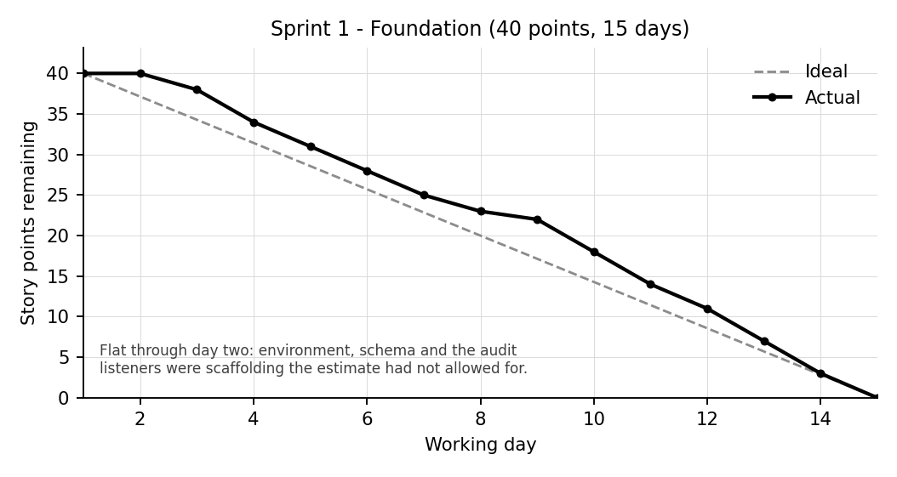

**Figure 6.1 - Sprint 1 burndown.**

The line is flat through day two and only meets the ideal from day nine. The
cause is not estimation error in the stories themselves but **work the
estimate did not contain**: environment setup, the schema, and wiring the
audit listeners. Scaffolding is real work.

## 6.8 Sprint Review

**Table 6.6 - Acceptance against the stories' criteria**

| Story | Criterion | Outcome |
|-------|------------------------------------------------------------|----|
| US-01 | Failure reveals nothing about which field was wrong | Met |
| US-02 | Every protected operation refuses the wrong function | Met |
| US-03 | Closure destroys no data | Met |
| US-04 | No exhibit can exist without a custody record | Met |
| US-05 | Intake fingerprint stored and never altered | Met |
| US-06 | Content contradicting its declared kind is refused | Met |
| US-07 | Description editable, content and fingerprints not | Met |
| US-08 | Handover records parties, moment, place, reason | Met |
| US-09 | History cannot be amended or removed | Met |
| US-10 | Interval, repetition and mismatch surfaced | Met |
| US-11 | No route creates an account except an administrator's | Met |

All forty points accepted.

## 6.9 Retrospective

**What worked.** Writing the audit listeners before the routes that would
depend on them. Treating authorisation as a route concern.

**What did not.** The estimate contained the features and not the foundation
they stand on. And the models drifted from the code within days of being
drawn, because nothing required them to move together.

**Table 6.7 - Actions carried into Sprint 2**

| # | Action | Where it shows |
|---|------------------------------------------------------|--------------|
| A1 | Reserve a day-zero design spike for the graph algorithm, estimated separately | Table 4.12, task T-13.1 |
| A2 | Fix the canonical signature payload before any signing code is written | §7.5 |
| A3 | **Add "diagrams updated in the same commit" to the Definition of Done** | Table 4.8, condition 7 |

Action A3 is the one with the longest reach: it is why the diagrams in this
report are generated from versioned source rather than redrawn, and therefore
why no figure here can contradict the code it describes.

---

```{=openxml}
<w:p><w:r><w:br w:type="page"/></w:r></w:p>
```


# Chapter 7 - Sprint 2: Integrity

*15 working days · 38 points committed · 38 delivered*

---

## 7.1 Sprint Goal

**A custody history that can be proved sound or shown precisely where it is
not, and an exhibit that can move only as its procedure permits.**

This is the sprint in which the project stops being a records system and
becomes the thing it was proposed as. Three of the five Category C algorithms
are built here.

## 7.2 Backlog Refinement Before Planning

Refinement produced backlog **v1.1** (Table 4.10), with two changes:

| Change | Cause |
|------------------|-----------------------------------------------------|
| US-13 re-estimated from 8 to **13** | The day-zero spike (retrospective action A1) showed the traversal was larger than a first reading suggested |
| US-16 and US-17 **split out** of US-13 and US-15 | Presenting a result is distinct work from computing one, and bundling them hid two points of interface work inside an algorithm story |

**The re-estimate is the retrospective working.** A1 existed because Sprint 1
underestimated foundation work; applying it to US-13 caught a second
underestimate before it became a plateau.

**Table 7.1 - Sprint 2 backlog**

| ID | Story | Pts | Realises | Category |
|------|-----------------------------------------|----|--------------|----|
| US-12 | Custody records attributable to their author | 5 | SR-23, SR-24 | B |
| US-13 | Verify the whole custody history | **13** | SR-25 to SR-27 | **C** |
| US-14 | Exhibits move only through permitted states | 8 | SR-28 to SR-30 | **C** |
| US-15 | Reconstruct missing custody links | 8 | SR-31 to SR-33 | **C** |
| US-16 | Read a verification result | 2 | SR-34 | A |
| US-17 | Read a reconstruction | 2 | SR-35 | A |
| | **Total** | **38** | | |

## 7.3 Sprint Backlog: Tasks

US-13's decomposition is given in full in **Table 4.12** as the worked example
of the product-backlog-to-task chain. Two further decompositions matter here.

**Table 7.2 - US-12 (attributable custody records) decomposed**

| Task | Description | Est. (h) | Realises |
|------|-------------------------------------------------------|----|------|
| T-12.1 | **Fix the canonical payload: six fields, deterministic ordering** | 3 | A2 |
| T-12.2 | Sign at creation using the creator's private means | 4 | SR-23 |
| T-12.3 | Verify against the signer's public means | 3 | SR-23 |
| T-12.4 | Make the signature column non-nullable | 1 | SR-24 |
| T-12.5 | Test that an altered field fails verification | 3 | DoD 2 |
| | **Total** | **14 h** | |

T-12.1 is retrospective action A2 discharged. **The bytes signed at creation
must be identical to the bytes reconstructed at verification**, so the
serialisation is fixed with deterministic key ordering before any signing code
exists. Settling this first avoided the class of defect where signatures
verify in tests and fail in production because a field order changed.

**Table 7.3 - US-14 (lifecycle enforcement) decomposed**

| Task | Description | Est. (h) | Realises |
|-------|-------------------------------------------------------|----|-----|
| T-14.1 | Express the policy as a transition table, not as branching code | 5 | SR-28 |
| T-14.2 | Gate 1: the pair must exist | 2 | SR-28 |
| T-14.3 | Gate 2: the function must be permitted | 3 | SR-28 |
| T-14.4 | Gate 3: every precondition must hold | 5 | SR-29 |
| T-14.5 | Gate 4: a justification must be supplied | 2 | SR-30 |
| T-14.6 | Name the exact unmet condition in every refusal | 3 | SR-29 |
| T-14.7 | **Audit refusals as readily as successes** | 2 | SR-29 |
| T-14.8 | Re-assess risk immediately after a successful transition | 3 | SR-30 |
| T-14.9 | Tests: every permitted transition, and one refusal of each kind | 6 | DoD 2 |
| | **Total** | **31 h** | |

## 7.4 Design and Models

**Table 7.4 - Models produced in this sprint**

| Figure | Kind | Algorithm |
|------|------------------|-----------------------------------------------|
| 12 | Sequence | Integrity verification |
| 23 | Activity | Integrity verification |
| 10 | Composite structure | Internals of the verification engine |
| 15 | State machine | The evidence lifecycle |
| 24 | Activity | The transition validation pipeline |
| 18 | Activity | Chain reconstruction |
| 25 | Sequence | Chain reconstruction |

The algorithms themselves are described in **Chapter 11**, sections 11.2, 11.4
and 11.5, rather than repeated here. This chapter records what the sprint
*cost* and what it *learned*; Chapter 11 records what the algorithms *are*.

## 7.5 The Design Change That Defined the Sprint

On day five the verification engine was complete and passing its tests. It
stopped at the first failure.

That satisfied US-13's first acceptance criterion and violated its second,
which required **every** failing node to be located. The discovery occurred
because T-13.6 had been written as a separate task - "accumulate failures
without halting the walk" - which forced the question of what happens after a
failure to be answered explicitly rather than by default.

The rework consumed days five to seven and is visible as the plateau in the
burndown. It cost three days and was discovered on day five rather than at
delivery. **A plan-driven process would have frozen the stop-at-first design
in the specification phase and discovered the mismatch during acceptance
testing**, with the whole dependent interface built on top of it.

This is the single clearest piece of evidence for the process choice of
Section 4.1.3, and Chapter 13 returns to it.

## 7.6 Verification

**Table 7.5 - Tests written in Sprint 2**

| Area | Cases | Notable |
|---------------------|---|----------------------------------------------|
| Signing and verification | 4 | An altered field fails; an unsigned record cannot be stored |
| Integrity: clean chain | 2 | Intact at 100% completeness |
| Integrity: single failures | 3 | One per check kind: content, authorship, order |
| Integrity: **multiple failures** | 1 | Three failures, all three reported in one run |
| Lifecycle: permitted | 5 | Representative transitions across all six states |
| Lifecycle: refused | 3 | Pair absent, function denied, precondition unmet |
| Lifecycle: auditing | 1 | A refusal appears in the audit trail |
| Reconstruction | 4 | Complete chain, resolvable gap, no candidate, below threshold |

The multiple-failure test is the acceptance criterion made executable. It is
the test that would have failed on day five.

## 7.7 Burndown

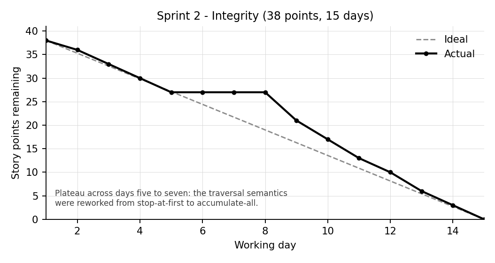

**Figure 7.1 - Sprint 2 burndown.**

Flat across days five to seven - the traversal rework - then steeper than
ideal to the end. The shape says something the totals cannot: **the work was
not uniformly difficult, and the difficulty was not where it was expected.**
The cryptographic signing that looked hard was library calls; the traversal
semantics that looked simple were the real work.

## 7.8 Sprint Review

**Table 7.6 - Acceptance against the stories' criteria**

| Story | Criterion | Outcome |
|-------|---------------------------------------------------------|------|
| US-12 | Authorship establishable; alteration detectable | Met |
| US-12 | An unsigned custody record cannot exist | Met |
| US-13 | Reports a verdict and a completeness proportion | Met |
| US-13 | **Locates every failure, not the first** | Met *after rework* |
| US-14 | Only permitted transitions succeed | Met |
| US-14 | A refusal names the exact unmet condition | Met |
| US-14 | Refusals are audited | Met |
| US-15 | Gaps detected; candidates scored; threshold respected | Met |
| US-15 | An inferred link is never presented as confirmed | Met |
| US-16, US-17 | Results readable, and available as data | Met |

All thirty-eight points accepted.

## 7.9 Retrospective

**What worked.** The day-zero spike (A1). Fixing the canonical payload before
writing signing code (A2) - no signature defect occurred in this sprint or
any later one.

**What did not.** The acceptance criteria for US-13 were written in prose and
read loosely. Had the second criterion existed as a *test* before the
implementation, the stop-at-first design would have failed immediately rather
than passing for five days.

**Table 7.7 - Actions carried into Sprint 3**

| # | Action | Where it shows |
|---|--------------------------------------------------|------------------|
| B1 | **Write acceptance criteria for Category C stories as failing tests before implementation** | §8.3; the normalisation and cap tests |
| B2 | Keep the external model behind a testable seam from the start | §8.5 |
| B3 | Estimate presentation work separately from the algorithm that produces it | Backlog v1.1, already applied |

Action B1 is the most consequential action taken in the project. Sprint 3's
burndown is the direct result, and Section 8.9 assesses it.

---

```{=openxml}
<w:p><w:r><w:br w:type="page"/></w:r></w:p>
```


# Chapter 8 - Sprint 3: Assessment

*15 working days · 42 points committed · 42 delivered*

---

## 8.1 Sprint Goal

**An investigator with a caseload can tell which exhibits need attention
without reading every record, and can ask about a case in ordinary language
and be answered from the records themselves.**

## 8.2 Backlog Refinement Before Planning

Refinement produced backlog **v1.2**, with two priority changes and no
re-estimates:

| Change | Cause |
|-----------------------|------------------------------------------------|
| US-22 (statistical outliers) lowered Should → **Could** | Sprint 2's review showed the deterministic assessment would carry the ranking; an uninterpretable second signal was a nice-to-have |
| US-24 (second factor, lockout) raised Could → **Should** | The same review noted that every guarantee in the system rests on the account being who it claims to be |

**The second change is a priority decision made on evidence rather than on
taste.** Nothing in Sprint 2 failed; the reasoning was that the integrity
guarantees built there are worth exactly as much as the authentication
protecting them.

**Table 8.1 - Sprint 3 backlog**

| ID | Story | Pts | Realises | Category |
|-------|-------------------------------------------|-----|----------|-----|
| US-18 | Exhibits ranked by attention needed | 8 | SR-36 to SR-38 | **C** |
| US-20 | Ask questions in ordinary language | 8 | SR-40 to SR-42 | **C** |
| US-21 | Unsupported statements flagged | 3 | SR-43 | **C** |
| US-24 | Second factor and lockout | 5 | SR-47 | B |
| US-19 | Tune what counts as risky | 3 | SR-39 | **C**/A |
| US-25 | Evidence unreadable without authorisation | 3 | SR-48 | B |
| US-23 | Ranked and anomalous views | 3 | SR-46 | A |
| US-22 | Statistical outliers surfaced | 5 | SR-44, SR-45 | B |
| US-26 | Verifiable export | 2 | SR-49 | B |
| US-27 | Printable custody report | 2 | SR-50 | B |
| | **Total** | **42** | | |

## 8.3 Action B1 Applied: Criteria as Tests, Written First

Sprint 2's retrospective required acceptance criteria for Category C stories
to exist as failing tests before implementation. US-18's criteria were
therefore written as six tests on day one, before any scoring code:

**Table 8.2 - US-18 acceptance criteria, written as tests before the code**

| Criterion | Test written first | Why it would have been missed |
|----------------------|-----------------|--------------------------------|
| The eight weights sum to exactly 1.0 | Assert the sum | A later weight edit silently breaks the scale |
| Administrator overrides are re-normalised | Set weights summing to 1.4, assert 1.0 | The interface would accept an unusable configuration |
| Each indicator contributes independently | One test per indicator | A copy-paste error between indicators is invisible in the total |
| Each interaction rule fires on its own pair | One test per rule | Five rules, five chances for a wrong pair |
| **The total bonus is capped at 0.30** | Construct an item firing four rules | Without the cap the ranking collapses, and the total still looks plausible |
| The output explains itself | Assert per-indicator contributions present | An unexplained score is unusable in court |

The cap test is the one that justifies the practice. An item firing four rules
produces a high score either way; **only a test that knows what the cap is for
can tell a correct high score from a saturated one.**

## 8.4 Sprint Backlog: Tasks

**Table 8.3 - US-18 (risk assessment) decomposed**

| Task | Description | Est. (h) | Realises |
|---------|--------------------------------------------------|-----|-------|
| T-18.1 | Write the six acceptance tests (Table 8.2) | 6 | B1 |
| T-18.2 | Extract the eight indicators | 8 | SR-36 |
| T-18.3 | Choose and implement a normalisation curve per indicator | 6 | SR-36 |
| T-18.4 | Weighted combination | 2 | SR-37 |
| T-18.5 | The five interaction rules | 5 | SR-37 |
| T-18.6 | The bonus cap | 1 | SR-37 |
| T-18.7 | Classification into bands | 2 | SR-38 |
| T-18.8 | Per-indicator explanation and recommendations | 5 | SR-38 |
| T-18.9 | Activity and communication diagrams | 2 | DoD 7 |
| | **Total** | **37 h** | |

**Table 8.4 - US-20 and US-21 (assistant) decomposed**

| Task | Description | Est. (h) | Realises |
|-------|------------------------------------------------------|----|-----|
| T-20.1 | Intent classification over seven intents, with tie-breaking | 6 | SR-40 |
| T-20.2 | Retrieval sequence per intent | 8 | SR-41 |
| T-20.3 | **Put the model behind a seam that tests can substitute** | 3 | B2 |
| T-20.4 | Prompt templates per intent | 4 | SR-42 |
| T-20.5 | Budgeted invocation with candidate fallback | 5 | SR-42 |
| T-20.6 | Context-only answer when the service is unavailable | 4 | SR-42 |
| T-21.1 | Extract identifiers and names from a reply | 4 | SR-43 |
| T-21.2 | Check each against the retrieved context; warn on absences | 4 | SR-43 |
| | **Total** | **38 h** | |

T-20.3 is retrospective action B2. Because the model sits behind a seam, the
whole pipeline is testable without network access - which is why SNF-20 ("the
suite runs without reaching any external service") is satisfiable at all.

## 8.5 Design and Models

**Table 8.5 - Models produced in this sprint**

| Figure | Kind | Subject |
|-----|---------------|---------------------------------------------------|
| 17 | Activity | Risk assessment |
| 14 | Communication | Risk assessment collaboration |
| 26 | Activity | Assistant orchestration, six stages |
| 13 | Sequence | Assistant orchestration |
| 20 | Timing | Bounded waiting on the model service |
| 16 | State machine | Account access, with lockout |
| 9 | Component | Components and their interfaces |
| 11 | Deployment | Nodes, artifacts and the trust boundary |

The algorithms are described in **Chapter 11**, sections 11.3 and 11.6.

Figure 11 is drawn in this sprint rather than earlier because this is the
sprint that puts something **outside** the trust boundary. Until the model
service existed, every component ran on one host.

## 8.6 Implementation

Two decisions are worth recording.

**The assessment reads the integrity verdict as its highest-weighted
indicator.** This couples Sprint 3's algorithm to Sprint 2's, and the coupling
later proved to be the site of a defect: the verdict was computed but never
persisted, so the indicator sat at its default. Chapter 9, finding D2.

**The anomaly detector was kept visibly separate from the assessment.** Its
output is labelled "suggested for review" and never merged into the
deterministic score. SR-45 requires this, and it is also the honest treatment
of an uninterpretable signal sitting beside an explainable one.

## 8.7 Verification

**Table 8.6 - Tests written in Sprint 3**

| Area | Cases |
|----------------------------------------------------------------|-------|
| Risk: the six criteria of Table 8.2 | 6 |
| Risk: indicators individually | 8 |
| Risk: interaction rules individually | 5 |
| Risk: classification bands | 4 |
| Intent classification | 10 |
| Retrieval per intent | 7 |
| Degraded answer with no service | 3 |
| Reference validation | 4 |
| Second factor, lockout, idle timeout | 9 |
| Encryption at rest | 4 |
| Export and printable report | 6 |

Ninety-three tests in `test_increment3`, the largest single module in the
suite.

## 8.8 Burndown

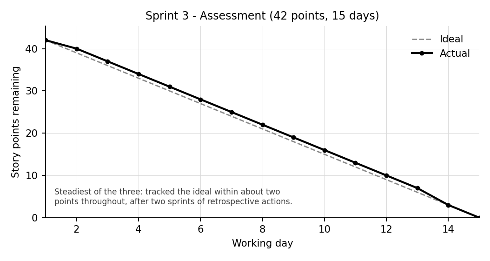

**Figure 8.1 - Sprint 3 burndown.**

The steadiest of the three, tracking the ideal within about two points
throughout. **This is the measurable result of two sprints of retrospective
actions** - and it is also the sprint with the most third-party integration,
which would normally be the least predictable.

## 8.9 Sprint Review

**Table 8.7 - Acceptance against the stories' criteria**

| Story | Criterion | Outcome |
|--------|-----------------------------------------------------------|----|
| US-18 | Eight indicators, each normalised appropriately | Met |
| US-18 | Interaction bonus bounded | Met |
| US-18 | Output explains its own score | Met |
| US-19 | Weights re-normalised; bands strictly increasing | Met |
| US-20 | Seven intents classified, UNKNOWN recognised | Met |
| US-20 | Answers drawn from retrieved records | Met |
| US-20 | A usable answer with the service unavailable | Met |
| US-21 | References absent from context are flagged | Met |
| US-22 | Outliers presented as suggestions, never findings | Met |
| US-23 | Ranked view, anomaly view, per-item detail | Met |
| US-24 | Second factor; lockout after five failures | Met |
| US-25 | Content unintelligible without the key | Met |
| US-26 | A recipient can verify without this system | Met |
| US-27 | Printable report produced | Met |

All forty-two points accepted. **At this point the project appeared complete.**

## 8.10 Retrospective

**What worked.** Action B1 - criteria as failing tests first - produced the
steadiest burndown in the project. Action B2 made the external dependency
testable.

**What did not, and was not visible yet.** Every test written in this sprint
was a *positive* test: it asserted that an entitled user gets the right
answer. Not one asked what an *unentitled* user gets. The suite was green and
the system had a scoping defect in every aggregate it had just built.

**Table 8.8 - Actions carried forward**

| # | Action | Where it shows |
|---|-------------------------------------------|-------------------------|
| C1 | Add the per-item risk detail to the evidence view | Delivered |
| C2 | Document the model-unavailable path in the interface | Delivered |
| C3 | **Adversarially test the authorisation boundary** | Raised in Sprint 4 - *after* the defect was found, not before |

**C3 is recorded honestly as an action that came too late.** It was written
during this retrospective as a general improvement and not acted on until
Sprint 4 forced it. Chapter 9 records what that cost.

---

```{=openxml}
<w:p><w:r><w:br w:type="page"/></w:r></w:p>
```


# Chapter 9 - Sprints 4 and 5: Maintenance

*Sprint 4 (M1): 5 days · 10 points · access scoping*
*Sprint 5 (M2): 6 days · 11 findings · defect repair*

---

At the end of Sprint 3 the system delivered every committed point, passed
every test, and satisfied every stated acceptance criterion. Two further
sprints were nonetheless necessary. **They are the most informative chapters
in this report, because a process that only ever succeeds demonstrates
nothing about its capacity to detect failure.**

The two sprints found their defects by different means, and that difference is
the point: Sprint 4 found what *testing differently* finds, Sprint 5 found
what *reading* finds.

---

# Sprint 4 (M1) - Access Scoping

## 9.1 How the Defect Was Found

Retrospective action C3 - adversarially test the authorisation boundary - was
carried out. A second account was created with no shared investigations, and
every aggregate view was requested as that account.

**Table 9.1 - What the adversarial pass found**

| Surface | Expected | Actual |
|---------------|---------------------|----------------------------------|
| Case list | Own investigations | Own investigations - **correct** |
| Evidence detail | Refused | Refused - **correct** |
| Dashboard totals | Own investigations | **Every investigation in the system** |
| Risk ranking | Own investigations | **Every exhibit in the system** |
| Anomaly view | Own investigations | **Every exhibit in the system** |
| Assistant answers | Own investigations | **Retrieved globally** |
| Export | Own investigations | Refused - correct |

Detail views were protected. Aggregates were not. A user could not open
another investigation's evidence item, but could see its title in a risk
ranking, its count in a dashboard total, and could ask the assistant about it.

## 9.2 Why This Was a Change Request, Not a Defect

No requirement then in force had been broken. UR-03 existed - *"a person must
see only the investigations they have been assigned to"* - but the system
requirements realising it addressed **record access** and never enumerated
aggregates.

**The implementation satisfied its specification. The specification was
incomplete.** Classifying this as a defect would blame the code for a gap in
the requirements, which is both unfair and diagnostically useless: it would
lead to fixing six routes rather than to understanding why six routes were
missed.

It therefore entered the backlog as **new scope**: US-28 and US-29, backlog
v2.0, 10 points.

## 9.3 Sprint Backlog

**Table 9.2 - US-28 (scoped aggregates) decomposed**

| Task | Description | Est. (h) | Realises |
|----|----------------------------------------------------------|---|----|
| T-28.1 | **One function answering "which investigations may this account see"** | 3 | SR-51 |
| T-28.2 | Route every aggregate through it: dashboard, risk, anomaly, export | 6 | SR-51 |
| T-28.3 | Compose each role's overview from panels matched to its work | 5 | SR-52 |
| T-28.4 | Explanatory empty state for an account assigned to nothing | 3 | SR-52 |
| T-28.5 | Adversarial tests: every aggregate, as each of four roles | 6 | C3 |
| | **Total** | **23 h** | |

**Table 9.3 - US-29 (scoped assistant) decomposed**

| Task | Description | Est. (h) | Realises |
|-----|--------------------------------------------------------|----|-----|
| T-29.1 | **Move scoping before retrieval, not after generation** | 5 | SR-41 |
| T-29.2 | Answer identity questions from the authenticated session | 3 | SR-53 |
| T-29.3 | Attribute retained conversation to its owner | 2 | SR-54 |
| T-29.4 | Discard conversation on entry as well as departure | 2 | SR-54 |
| T-29.5 | Tests: a question about an unassigned investigation | 4 | C3 |
| | **Total** | **16 h** | |

T-28.1 and T-29.1 are the repair; the rest is consequence. **A rule expressed
once can be applied everywhere; a rule expressed inline in each route will be
omitted by the next route.** The single function is the abstraction the
original design lacked, and Figure 9 shows it: every component that reads
case-scoped data depends on one provider.

## 9.4 The Empty State

T-28.4 produced something the original design would never have contained. An
account assigned to no investigation previously saw a dashboard of global
totals; correctly scoped, it would see zeroes.

Zeroes are ambiguous - they could mean "nothing exists" or "nothing is yours".
The empty state explains the situation and says what to do. **A security
constraint forced an interface case to be designed rather than ignored.**

## 9.5 Burndown and Review

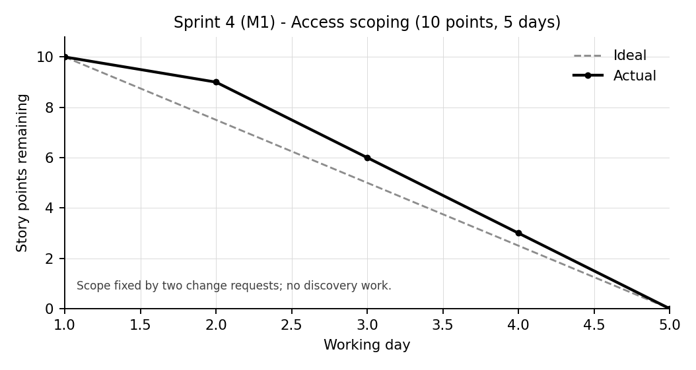

**Figure 9.1 - Sprint 4 burndown.**

Short and near-linear; scope was fixed by two change requests with no
discovery work.

**Table 9.4 - Acceptance**

| Criterion | Outcome |
|--------------------------------------------------------------|---------|
| No aggregate returns a record from an unassigned investigation | Met - 14 adversarial tests |
| Each role's overview is composed for its work | Met |
| An account assigned to nothing sees an explanation | Met |
| A question about an unassigned investigation is refused | Met |
| Refusal is structural: the data never enters the prompt | Met |

## 9.6 Retrospective

**The lesson.** Positive functional tests, however thorough, do not exercise
authorisation boundaries. Ninety-three tests were written in Sprint 3 and not
one asked what an unentitled user receives.

**The second lesson, which generalises further.** A rule applied inline will
be applied inconsistently. The defect was not six mistakes; it was one missing
abstraction, six times.

**Table 9.5 - Actions**

| # | Action |
|---|--------------------------------------------------------------------|
| D1 | Adversarial authorisation testing becomes standing practice, not a one-off |
| D2 | Any rule governing more than one surface must have exactly one implementation |

---

# Sprint 5 (M2) - Defect Repair

## 9.7 How These Defects Were Found

By **reading the code against its intent**, module by module - not by running
it. The suite was green throughout this sprint, before and after.

**Table 9.6 - The eleven findings**

| ID | Severity | Finding | Root cause |
|---|---|------------------------------------|------------------------------|
| D1 | High | Removing an exhibit destroyed its custody and audit history | Deletion treated as a data operation, not a domain one |
| D2 | High | Verification computed a verdict but never stored it, so the assessment's highest-weighted indicator stayed at its default | Two algorithms sharing a value with no owner for writing it |
| D3 | High | An evidence item was reachable by identifier without checking its investigation | Access checked on the parent route, not the object |
| D4 | Medium | Soft-deleted exhibits still appeared in aggregate counts | The exclusion was applied in listings but not in totals |
| D5 | Medium | Responses carried no content-origin or framing directives | Never specified, therefore never built |
| D6 | Medium | A production configuration with default secrets would start | The check existed for one secret, not all |
| H1 | **High** | Text stored in a conversation was rendered as markup | Model output treated as trusted because it is not user input |
| H2 | Medium | Rate limiting absent on the most expensive endpoint | Cost not considered a security property |
| H3 | Medium | Private keys stored unencrypted at rest | Encryption applied to content, not to credentials |
| R1 | Low | Repeated query inside a loop over custody records | Correctness-first implementation never revisited |
| R2 | Low | Diagram source and code had drifted in two places | DoD condition 7 added mid-project, not applied retroactively |

## 9.8 The Finding That Matters Most

**H1 - stored text rendered as markup.** The conversation transcript inserted
reply text into the page as markup. The reasoning that produced the defect is
worth stating because it is so plausible: *the text comes from the model, not
from the user, so it is not user input.*

But the model's reply contains whatever the retrieved records contain, and the
records contain whatever an investigator typed into a case title. **Untrusted
text does not become trusted by passing through a language model.**

The repair escapes the text before it is inserted. Its sequel is recorded in
Chapter 10: the repair was made and **no test was written**, so the fix could
have been deleted and the entire suite would still have passed. That omission
was not found until Sprint 6.

## 9.9 Why These Are Defects and Carry No Points

Each of the eleven restores a requirement already accepted. D1 restores DR-03,
D2 restores SR-56's intent, H1 restores SNF-17. Estimating them in story
points would count the same capability twice and inflate velocity, so they are
tracked by **findings closed** instead.

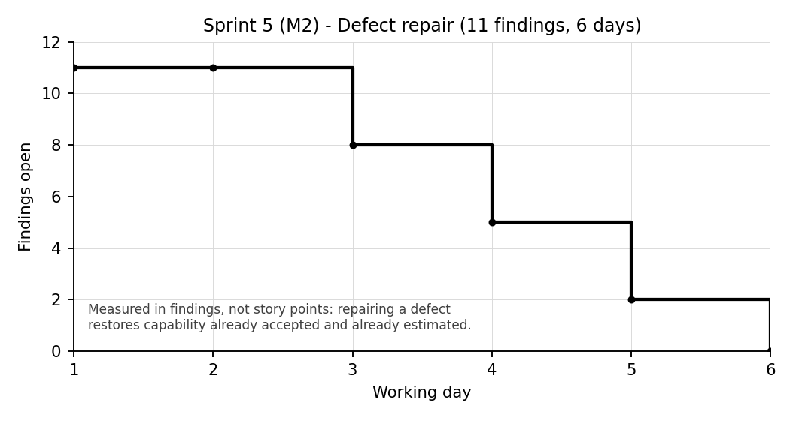

**Figure 9.2 - Sprint 5 defect burndown.**

## 9.10 Review and Retrospective

All eleven repaired; each has a regression test **except H1**, which is the
subject of Chapter 10.

**The lesson.** A green test suite can coexist with critical defects. Testing
and reading find different classes of error, and this sprint found a class
that no amount of running the suite would have surfaced - because every one of
these defects was a case the tests did not know to ask about.

**Table 9.7 - Actions**

| # | Action |
|----|--------------------------------------------------------------------|
| E1 | Periodic structured review adopted as complementary to testing, not as a substitute |
| E2 | A repaired defect requires a regression test before it is closed |

**Action E2 was adopted and then not applied to H1 in the same sprint.** That
is recorded here rather than quietly corrected, because the gap between
adopting a practice and applying it is exactly what Sprint 6 exists to close.

---

```{=openxml}
<w:p><w:r><w:br w:type="page"/></w:r></w:p>
```


# Chapter 10 - Sprint 6: Quality Enforcement

*8 working days · 23 points committed · 23 delivered*

---

## 10.1 Why There Is a Sixth Sprint

An external review of the project raised, among other things, that the
non-functional requirements were *"mostly missing"* - not absent from the
document, but unimplemented and untested.

The review was correct, and the audit that followed was worse reading than
expected.

**Table 10.1 - The state of the eighteen quality requirements before this sprint**

| Verdict | Count |
|-----------------------------------------------------------------|------|
| Implemented **and** automatically tested | **8** |
| Implemented but never tested | 7 |
| Asserted analytically, never measured | 2 |
| **Claim did not match the code** | 1 |

Nine of eighteen named only "code review", "configuration inspection",
"manual check" or an analytical argument as their verification method. The
document was honest about this - the verification column said so plainly - but
stating a weak verification method is still stating a weak verification
method.

**A verification method that does not re-run cannot fail, and a requirement
that cannot fail is not a requirement.**

## 10.2 Sprint Goal

**Every quality requirement carries a measurement, a value that constitutes a
pass, and a test that applies it - so that removing an enforcement breaks a
test rather than going unnoticed.**

## 10.3 Backlog Refinement

Backlog **v3.0**: seven stories, 23 points (Table 4.10a). Capacity was set at
the mean of Sprints 1 to 3 (40), reduced for a short fixed window.

**Table 10.2 - Sprint 6 backlog**

| ID | Story | Pts | Realises |
|-----|---------------------------------------------------|----|----------|
| US-30 | Quality requirements carry a measurement and a pass value | 5 | Table 3.7 |
| US-34 | Algorithmic cost measured rather than argued | 5 | SNF-07 to SNF-09 |
| US-31 | Transport and session hardening verified | 3 | SNF-15, SNF-16 |
| US-32 | Unsafe production configuration refused, and the refusal exercised | 3 | SNF-18 |
| US-33 | Listings bounded as data grows | 3 | SNF-10 |
| US-35 | Role interfaces demonstrably distinct | 2 | SNF-21 |
| US-36 | The injection repair guarded by a test | 2 | SNF-17 |
| | **Total** | **23** | |

## 10.4 US-30: Making the Quality Requirements Real

The eighteen quality requirements were rewritten as the two-level set of
Chapter 3: nine **user** quality requirements, deliberately unmeasurable and
expressed in the stakeholder's language, and twenty-one **system** quality
requirements, each carrying a measurement method, an acceptance criterion and
a named test.

**Table 10.3 - The same requirement, before and after**

| | Before | After |
|-----|--------------|---------------------------------------------------|
| Statement | "Listings shall remain responsive as data grows" | **UNF-05** (user): the system must respond quickly enough not to interrupt an investigator's work. **SNF-10** (system): no listing shall render in time proportional to the whole collection |
| Measurement | - | Create 45 investigations and 45 exhibits; request each listing |
| Acceptance | "Case and evidence listings paginated" | At most 20 rows rendered per page; navigation present |
| Verified by | *Manual* | `test_nfr::TestListingResponsiveness` |

## 10.5 US-33: The Requirement That Was Simply False

The original NFR-17 claimed *"case **and evidence** listings paginated"*.
Investigations paginated at 20 and audit records at 25. The evidence listing
inside an investigation did not paginate at all:

```
evidence_items = (case.evidence_items
              .filter_by(is_deleted=False)
              .order_by(EvidenceItem.created_at.desc())
              .all())
```

An investigation with four hundred exhibits would render four hundred rows.

**The repair changed the code, not the requirement.** Softening the
requirement to match the implementation would have been the easier edit and
the wrong one: an exhibit-heavy investigation is the realistic case for a
forensic system, not an edge case.

## 10.6 US-34: Complexity Measured Rather Than Argued

The claims that verification is linear in chain size and assessment linear in
record count were supported by analysis alone. Analysis cannot regress.

The tests now build chains at two sizes an order of magnitude apart, time
both, and assert the **growth ratio**:

| Claim | Measurement | Pass |
|----------------------------|---------------------|---------------------|
| Verification linear in chain size | 20 and 200 elements, best of three | Tenfold size under thirtyfold time |
| Assessment linear in record count | 20 and 200 records, best of three | Tenfold records under thirtyfold time |
| A 100-element chain verifies within tolerance | Single run | Under 5 seconds |

The thresholds are deliberately loose. **They are set to catch a change in the
shape of the cost, not to certify a particular machine's speed** - a quadratic
implementation would need roughly a hundredfold increase and would fail.

## 10.7 US-36: The Regression Test That Should Have Existed

Finding H1 in Sprint 5 - text rendered as markup - was repaired and closed
with no test, in a sprint whose own retrospective action E2 required one.

The consequence: the escape function could have been deleted and **all 172
tests would still have passed**. A defect found, understood, documented and
repaired was protected by nothing.

Three tests now guard it: an investigation title containing markup renders
escaped; stored conversation cannot close the element containing it; and the
escape helper is asserted to run *before* insertion rather than merely to
exist.

**This is the sharpest lesson in the project.** The claim throughout the
report had been that M2 taught the value of testing what you fix. Until this
sprint, that claim was contradicted by the repository.

## 10.8 US-31, US-32, US-35: Enforcement Made Visible

| Story | Enforcement that existed | Test that now guards it |
|----|-----------------------------|--------------------------------------|
| US-31 | Session token restricted; four response directives sent | 10 tests, on both unauthenticated and authenticated responses |
| US-32 | Production refuses absent or weak secrets | 6 tests, against absent, weak and sound configurations |
| US-35 | Four role-specific overviews | 7 tests, including that all four renderings differ |

US-32 required a small refactor worth noting: the check ran as inline code at
import time, so it executed once per process and could never be exercised
against a hypothetical bad configuration. Extracting it into a function made
the requirement testable. **A requirement that cannot be exercised is not
testable, however correct the code is.**

## 10.9 A Defect Found During the Sprint

Reviewing the use-case model against the routes revealed that
`GET /evidence/<id>/verify` had **no role guard**, and is not a read: it
writes the verdict onto the exhibit and, on a Broken verdict, drives it to
Flagged through a transition that deliberately bypasses the role check.

**A Read-Only Viewer could therefore change an exhibit's lifecycle state** -
contradicting SR-06 and making the role's name false.

**Table 10.4 - Root cause**

| | |
|-------------|----------------------------------------------------------|
| Classified by | Its **name**: "verify" sounds like a read |
| Should have been classified by | Its **effect**: it writes |
| Repair | Analysis guard on verification and reconstruction; refused at the route, hidden in the interface |
| Guarded by | 6 tests, including that a Read-Only account changes neither the verdict nor the state |

This is the same shape as M1 and M2: a correct algorithm in a context whose
constraints it did not know about (Section 11.9).

## 10.10 Burndown and Review

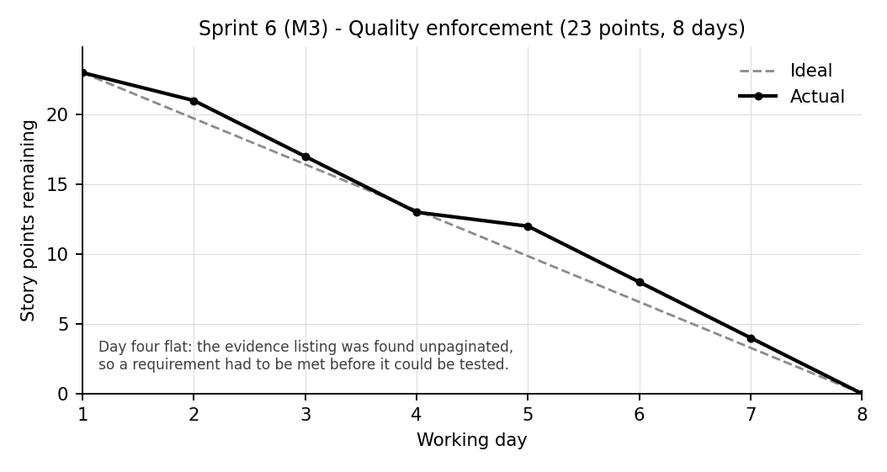

**Figure 10.1 - Sprint 6 burndown.**

Day four is flat: US-33 could not be tested until the evidence listing was
actually paginated, so a requirement had to be **met** before it could be
**verified**.

**Table 10.5 - Acceptance**

| Criterion | Outcome |
|--------------------------------------------------|---------------------|
| Every system quality requirement names a measurement and an acceptance value | Met - 21 of 21 |
| Every system quality requirement names an automated test | Met - 21 of 21 |
| Removing an enforcement breaks a test | Met - verified by deleting each and observing the failure |
| The suite still runs without network access | Met |

**Table 10.6 - The suite before and after**

| | Before | After |
|-----------------------------------------------|-----------|-------------|
| Tests | 172 | **216** |
| Quality requirements with an automated test | 8 of 18 | **21 of 21** |
| Fixed defects without a regression test | 1 (H1) | 0 |

## 10.11 Retrospective

**The lesson.** A requirement and its verification are one artefact, not two.
Separating them lets a document describe a quality the system does not have,
honestly and in good faith, for as long as nobody checks.

**What this sprint says about the process.** Sprints 4, 5 and 6 each exist
because something was found wrong, by three different means - adversarial
testing, structured reading, and external review. **No sprint found its own
sprint's defects.** That is not a failure of the increments; it is the reason
there is more than one.

**Table 10.7 - Actions**

| # | Action |
|---|--------------------------------------------------------------------|
| F1 | A quality requirement is not accepted without a measurement, a pass value and a test |
| F2 | An operation is classified by its effect, never by its name |
| F3 | Before any release, re-derive the authorisation matrix from the routes rather than from the design |

---

```{=openxml}
<w:p><w:r><w:br w:type="page"/></w:r></w:p>
```


# Chapter 11 - Complex Custom Logic

---

This chapter exists because the project guidelines require the
algorithmically complex features to be identified, justified as such, and
described algorithmically. Each of the five is given its own numbered section
below, and each is described by UML behavioural diagrams rather than by prose
alone. They are gathered here, rather than left scattered through the sprint
chapters, so that the Category C contribution of the project can be read in
one place; Sprints 2 and 3 (Chapters 7 and 8) record *when* each was built and
what it cost.

## 11.1 What Makes a Feature Category C

The three feature categories are easy to assign loosely and hard to assign
honestly. A feature that calls a cryptographic library is not complex because
cryptography is complex. The question is what the project itself contributes.

**Table 11.1 - The test applied to every feature**

| Question | If yes | Category |
|-----------------------------------------------|--------------------|---|
| Is the behaviour obtained by storing, retrieving or arithmetically combining records? | Then the complexity is in the data model | **A** |
| Is the behaviour obtained by calling a library or service that implements it? | Then the complexity belongs to that library | **B** |
| Does the behaviour require a data structure, a multi-step control flow, or a search that the project designs and implements? | Then the complexity is the project's own | **C** |

A feature may call Category B components from inside Category C logic without
changing category, **provided the library calls play the part of primitive
operations inside a larger algorithm the project designed**. The hash function
inside the integrity verifier is used exactly as an arithmetic operator is
used: it is not the algorithm, it is a step in it.

The converse test is the stricter one, and this report applies it: *if the
library were replaced by an equivalent, would anything the project designed
have to change?* For the verifier, no - the traversal, the failure
accumulation and the completeness score are untouched by which hash function
is used. For the anomaly detector, yes - the whole behaviour would change,
which is why anomaly detection is classified **B** and not C despite feeding
the same dashboard.

**Table 11.2 - The five Category C features**

| # | Algorithm | Structure it builds | Why not A | Why not B |
|---|-----------|------------------|-------------------------|---------------|
| 1 | Chain integrity verification | Directed acyclic graph of custody events | No query returns "where and how is this chain unsound" | No library verifies a custody chain |
| 2 | Multi-factor risk assessment | Weighted, normalised, interaction-amplified score | A weighted sum is arithmetic; the normalisation choice, the interaction model and the cap are not | No library models this domain |
| 3 | Custody chain reconstruction | Heuristic best-first search over candidate records | There is no correct answer to query for | No library infers missing custody |
| 4 | Evidence lifecycle state machine | Transition table with guards and preconditions | A status column is data; a role-gated, precondition-constrained automaton is not | No library knows this domain's procedure |
| 5 | Assistant orchestration | Six-stage pipeline around a model call | Retrieval is queries, but the pipeline is not | **The model is B; the pipeline around it is C** |

Feature 5 is the one most at risk of being over-claimed, so it is stated
plainly: **the language model is a third-party service and is categorised B in
Chapter 10.** What is C is the intent classification, the access-scoped
retrieval, the template selection, the fallback path and the reference
validation - none of which the model provides and all of which would still be
needed if the model were replaced.

---

## 11.2 Algorithm 1 - Chain Integrity Verification

*Delivered in Sprint 2 as US-13 (13 points, the largest item in the backlog).
Realises SR-25, SR-26, SR-27.*

### 11.2.1 The problem

Given an evidence item, establish whether its custody history is sound, and
where it is not. A check of the most recent record is insufficient: tampering
anywhere in the chain invalidates everything after it, and a forensic user
needs to know **which** event failed and **how**, not merely that something
did.

### 11.2.2 The structure

Custody events are loaded, ordered by time, and built into a **directed
acyclic graph** rooted at the registration event. Each node carries the event
and the fingerprint recorded at that moment; each edge connects a predecessor
to its successor.

The graph is the design decision that makes the rest possible. A flat list
would support a sequential scan but not the predecessor relation that the
order check needs, nor the branching that concurrent access events produce.

### 11.2.3 The algorithm

Described by **Figure 23** (activity diagram), **Figure 12** (sequence
diagram) and **Figure 10** (composite structure of the engine).

The traversal is depth-first from the root. At each unvisited node three
**independent** checks are applied:

| Check | Question | Failure means |
|-----|-------------------------------------------|-----------------------|
| Content | Does the stored content still produce the fingerprint registered at intake? | The content has been altered |
| Authorship | Does the record's signature verify against the signer's public key? | The record has been altered or forged |
| Order | Is this event strictly later than its predecessor? | The sequence has been manipulated |

After the checks, every child is pushed **regardless of the outcome**.

### 11.2.4 The design decision that defines the algorithm

The first implementation stopped at the first failure. It satisfied a naive
reading of the user story and violated its second acceptance criterion.

**Stopping at the first failure gives a user one defect at a time and
guarantees as many verification runs as there are defects.** Worse, in a
forensic setting it actively misleads: an investigator told "the chain failed
at event 3" may reasonably conclude events 4 onward are sound.

Accumulating instead costs nothing asymptotically - the traversal visits every
node either way - and converts the output from a single error into a complete
picture. This is why **Figure 10** is worth attention: the failure collector
sits between the checks and the scorer, and **no connector routes a failure
back to the walker**. The absence of that connector is the property.

### 11.2.5 Pseudocode

```
VERIFY(item):
    logs <- custody records of item ordered by time
    if logs is empty: return (Broken, 0, [], [])

    root <- the registration event
    graph <- BUILD_DAG(logs)
    stack <- [root]; visited <- {}; failures <- []; verified <- 0

    while stack not empty:
        node <- pop(stack)
        if node in visited: continue
        visited <- visited + {node}

        ok <- TRUE
        if not CHECK_CONTENT(node):    failures += (node, Content);    ok <- FALSE
        if not CHECK_AUTHORSHIP(node): failures += (node, Authorship); ok <- FALSE
        if not CHECK_ORDER(node, predecessor(node)):
                                       failures += (node, Order);      ok <- FALSE
        if ok: verified <- verified + 1

        for child in children(node):          // pushed whether or not ok
            push(stack, child)

    completeness <- 100 * verified / |logs|   // a percentage
    verdict <- Intact            if failures is empty
               Broken            if verified = 0
               Partially Verified otherwise
    return (verdict, completeness, failures, verified timeline)
```

### 11.2.6 Complexity

Let *V* be custody events, *E* the edges between them, and *F* the size of the
stored content. The traversal is **O(V + E)**; each node additionally
recomputes a fingerprint over the content, which is **O(F)**. The honest total
is therefore **O(V·F + E)**, dominated in practice by the content reads, not
by the graph work. Section 11.8 records how this was measured rather than
assumed.

### 11.2.7 Verification

`test_increment2` covers a clean chain, an altered content case, a forged
signature case, an out-of-order case, and the case that matters most: a chain
with **three** separate failures, asserting that all three appear in one run.
`test_nfr::TestPerformanceScaling` measures the growth claim above.

---

## 11.3 Algorithm 2 - Multi-Factor Risk Assessment

*Delivered in Sprint 3 as US-18 (8 points). Realises SR-36, SR-37, SR-38.*

### 11.3.1 The problem

Rank evidence items by how much attention they need, so an investigator with
a caseload need not read every record. A single rule ("more than five
transfers") misses that signals interact: an item with many transfers **and** a
failed integrity check **and** role mismatches is far more alarming than the
sum of those three considered separately.

### 11.3.2 Eight indicators, and why each is normalised differently

**Table 11.3 - Indicators and weights (summing to 1.0)**

| Indicator | Weight | Normalisation | Why that curve |
|-------------|---|---------|--------------------------------------------|
| Integrity outcome | **0.25** | Direct mapping | A verified failure is the strongest single signal available |
| Handover frequency | 0.13 | Logarithmic | The step from 1 to 3 transfers means far more than 21 to 23 |
| Content kind | 0.12 | Table lookup | An executable is categorically riskier than a photograph |
| Function mismatches | 0.12 | Linear | Each mismatch is an equally serious procedural breach |
| Distinct handlers | 0.10 | Logarithmic | Same saturation argument as handovers |
| Repeated records | 0.10 | Linear | Each duplicate is equally suspicious |
| Lifecycle state | 0.10 | Ordinal mapping | Flagged 1.0 down to Archived 0.1 |
| Dormancy | 0.08 | Sigmoid | Risk is flat, then rises sharply around a threshold, then flattens |

**The normalisation choice per indicator is a substantive design decision, not
a formality.** Applying one curve to all eight would misrepresent at least
three of them: a linear curve on handover frequency would let a busy item
dominate the ranking purely by being busy, and a logarithmic curve on function
mismatches would make the second breach count for less than the first, which
is the opposite of the truth.

### 11.3.3 Interaction rules and the cap

Five ordered pairs are checked. Each fires when **both** of its indicators
exceed their own thresholds, contributing a multiplier:

| Pair | Thresholds | Multiplier | Reading |
|------------------------------------|---------|------|-------------------|
| Integrity failure + function mismatch | 0.6, 0.6 | 1.30 | Deliberate tampering |
| Handover frequency + integrity failure | 0.7, 0.5 | 1.25 | Custody breach |
| Content kind + repeated records | 0.7, 0.5 | 1.20 | Suspicious duplication |
| Distinct handlers + handover frequency | 0.6, 0.6 | 1.20 | Unstable chain |
| Function mismatch + repeated records | 0.5, 0.5 | 1.15 | Administrative tampering |

The total bonus is capped at **0.30**. The cap is the second decision worth
defending: without it, an item firing four rules saturates at the maximum and
becomes indistinguishable from an item firing all five. **A ranking in which
everything alarming scores the same is not a ranking** - which is exactly the
failure the feature exists to prevent.

### 11.3.4 The algorithm

Described by **Figure 17** (activity diagram) and **Figure 14**
(communication diagram). The communication view is included deliberately: it
shows *which objects collaborate*, which is the aspect a sequence diagram
de-emphasises.

```
SCORE(item):
    logs <- custody records of item
    for each indicator i in the eight:
        raw_i        <- EXTRACT(item, logs, i)
        normalised_i <- NORMALISE(raw_i, curve(i))      // linear | log | sigmoid | lookup
    base <- sum over i of weight(i) * normalised_i

    bonus <- 0
    for (a, b, ta, tb, m, reason) in the five rules:
        if normalised_a >= ta and normalised_b >= tb:
            bonus <- bonus + (m - 1) * base
            record (a, b, reason)
    bonus <- min(bonus, 0.30)

    final <- base + bonus
    level <- LOW if final < 0.25
             MEDIUM if final < 0.50
             HIGH if final < 0.75
             CRITICAL otherwise
    return (final, level, per-indicator contributions, rules fired, recommendations)
```

### 11.3.5 Explainability as a requirement, not a nicety

The algorithm returns every indicator with its raw value, its normalised
value, its weight and its contribution, plus the reason text of every rule
that fired. SR-38 requires this. In a forensic setting a number an
investigator cannot interrogate is a number they cannot defend in court, so
the explanation is part of the output rather than a debugging aid.

### 11.3.6 Complexity and verification

Extraction is **O(n)** in the custody records; the weighted sum is O(8) and
the rules O(5), both constant. The whole assessment is therefore **O(n)**.
`test_increment3` covers each indicator independently, the weight
re-normalisation, each interaction rule, and specifically the cap.
`test_nfr::TestPerformanceScaling` measures the linear claim.

---

## 11.4 Algorithm 3 - Custody Chain Reconstruction

*Delivered in Sprint 2 as US-15 (8 points). Realises SR-31, SR-32, SR-33.*

### 11.4.1 The problem

When custody records are missing, offer the most plausible account of what
happened - **without ever presenting a reconstruction as a fact**. This is a
heuristic search: there is no correct answer to retrieve, only candidates to
evaluate.

### 11.4.2 The algorithm

Described by **Figure 18** (activity diagram) and **Figure 25** (sequence
diagram).

Discontinuities are detected where a holder changes with no handover between.
For each, candidate records are drawn from the access log within the gap's
time window, and each candidate is scored on four criteria:

| Criterion | Question |
|-------------------|----------------------------------------------------|
| Temporal proximity | How near the middle of the gap does it fall? |
| Function consistency | Was this account entitled to hold this kind of exhibit? |
| Place consistency | Is the location plausible given the surrounding records? |
| Behavioural consistency | Did this account interact with the investigation around that time? |

The criteria are averaged with **equal weight over the criteria that have data**.
A criterion with nothing to judge is omitted from the average rather than
scored at a neutral 0.5, because diluting every candidate toward the middle
would flatten exactly the discrimination the search depends on.

### 11.4.3 The threshold, and declining to answer

If the best candidate scores below **0.40**, the gap is marked **Unresolved**
and no inference is made.

**Declining is a result, not a failure.** DR-02 forbids silently closing a gap,
and DR-07 requires an inference to be visibly distinguishable from an
observation. Every link in the output carries one of three labels -
**Confirmed**, **Inferred**, **Unresolved** - and an inferred link carries its
score and the reasoning that produced it. An algorithm that always produces a
complete chain would be more satisfying and less honest.

### 11.4.4 Complexity and verification

With *g* discontinuities and at most *c* candidates each, scoring is
**O(g·c)**, and candidate generation costs one query per gap. `test_increment2`
covers a complete chain (no gaps), a resolvable gap, a gap with no candidate,
and a gap whose best candidate falls below the threshold - the case that
asserts the algorithm declines rather than guesses. Coverage of this module is
65%, the lowest in the project, because the combinations of partially-present
criteria are numerous; this is recorded as a known limitation rather than
presented as complete.

---

## 11.5 Algorithm 4 - Evidence Lifecycle State Machine

*Delivered in Sprint 2 as US-14 (8 points). Realises SR-28, SR-29, SR-30.*

### 11.5.1 The problem

Evidence must pass only through the transitions its procedure permits, at the
hands of someone entitled to make them, and only when the conditions for that
transition hold.

### 11.5.2 Policy as data

The lifecycle is declared as a **transition table**: six states, fourteen
permitted transitions, each mapping an ordered pair of states to the functions
entitled to make it and the preconditions that must hold.

Expressing the policy as data rather than as branching code has three
consequences that matter: the whole policy is auditable in one place; adding a
transition is a data change rather than a code change; and the policy can be
rendered directly as **Figure 15** (state machine diagram) without a human
transcribing it, so the diagram cannot drift from the behaviour.

### 11.5.3 The validation pipeline

Described by **Figure 24** (activity diagram). Four gates in order: the pair
must exist in the table; the requesting account's function must be among those
permitted; every precondition must hold; a justification must be supplied.

A rejection names **the exact condition unmet** - not a generic refusal - and
is written to the audit trail. SR-29 requires this because a rejected attempt
is forensically interesting: someone tried to archive an item whose integrity
was never verified, and that attempt is part of the record.

### 11.5.4 Flagged, and the asymmetry that matters

`Flagged` is reachable from **every** state and escapable from **one**, by an
administrator alone, and only after re-verification. The asymmetry is
deliberate and realises DR-06: an item whose integrity has failed must not
quietly resume normal handling.

One subtlety is worth stating because it looks like an inconsistency. When
verification finds a broken chain it drives the item to `Flagged` with the
role check bypassed, so that an Analyst who runs a check still gets the item
flagged. That bypass is why running a verification is **not** a read, and why
it is refused to a Read-Only Viewer (Section 11.9).

### 11.5.5 Complexity and verification

Table lookup is **O(1)**; precondition evaluation is **O(p)** with *p* at most
two. `test_increment2` covers every permitted transition, a representative
forbidden pair, a function-denied attempt, a precondition-denied attempt, and
asserts that each rejection is audited.

---

## 11.6 Algorithm 5 - Assistant Orchestration

*Delivered in Sprint 3 as US-20 and US-21 (11 points), extended in Sprint 4 as
US-29. Realises SR-40 to SR-43 and SR-53.*

### 11.6.1 Where the third-party boundary falls

**The language model is a third-party service (Category B).** The six-stage
pipeline around it is this project's work, and the test in Section 11.1
applies cleanly: replacing the model would change none of the six stages.

The accepted project proposal named a particular commercial model API. That
service proved unavailable on terms the project could meet, and a different
hosted model was substituted. **The substitution required no change to the
pipeline, to any requirement, or to any test** - which is the practical
demonstration that the boundary is drawn where this section claims.

### 11.6.2 The six stages

Described by **Figure 26** (activity diagram), **Figure 13** (sequence
diagram) and **Figure 20** (timing diagram).

| Stage | What it does | Whose work |
|-----------|-------------------------------------------------------|-----|
| 1. Intent classification | Matches the question against keyword sets for seven intents, breaking ties by fixed priority; parses any identifier; falls back to UNKNOWN | **C** |
| 2. Access scoping | Determines which investigations this account may see | **C** |
| 3. Context retrieval | Runs the query sequence for the intent, restricted to those investigations; an integrity question triggers a **fresh run of Algorithm 1** | **C** |
| 4. Prompt construction | Selects the template for the intent and assembles role, question and serialised context | **C** |
| 5. Model invocation | Calls the model within a per-call budget, falling through candidates, then to a context-only answer | B inside, **C** around |
| 6. Reference validation | Extracts every identifier and name from the reply and checks each against the retrieved context | **C** |

### 11.6.3 Scoping before retrieval, not after

Stage 2 precedes stage 3, which precedes stage 4. **Data the account may not
see never enters the prompt.** The refusal is therefore structural rather than
conversational: no phrasing of a question can extract what was never placed in
front of the model.

This ordering was not present in the first implementation. The assistant
retrieved globally and relied on the answer not mentioning inaccessible cases
- a defect found by adversarial testing and repaired in Sprint 4 as US-29.
Section 11.9 and Chapter 9 record it.

### 11.6.4 Hallucination detection, and what it does not do

Stage 6 extracts every case number, evidence identifier and personal name from
the reply and checks each against the retrieved context. Anything absent is
attached to the answer as an explicit warning.

**The limitation must be stated as plainly as the capability: this verifies
references, not reasoning.** A reply that cites only real identifiers but draws
a wrong conclusion from them passes the check. The interface presents the
answer accordingly - as a drafted reading of records the investigator can see,
not as a finding.

### 11.6.5 Bounded waiting

**Figure 20** shows the timing. A per-call budget bounds any single attempt; a
total budget bounds the whole stage and sits below the browser's abort, so a
slow service produces a clear message rather than a cancelled request. When the
budget is exhausted the pipeline composes an answer from the retrieved records
alone and says that it has done so - a degraded answer, visibly degraded.

### 11.6.6 Complexity and verification

Classification is **O(k)** in keywords; retrieval **O(r)** in records;
validation **O(m)** in references. `test_intent_classifier` covers all seven
intents plus UNKNOWN and the tie-breaking order; `test_scoping` covers the
access boundary; `test_nfr::TestRobustness` covers both the unavailable and
the slow service.

---

## 11.7 Third-Party Components Used Inside Category C Logic

Stated explicitly so the boundary cannot be read as a claim.

**Table 11.4 - What is borrowed, and what is ours**

| Algorithm | Third-party component used | Role it plays | Would replacing it change our design? |
|-------------|-------------------|----------------|----------------------|
| 1. Integrity | Hash function; signature verification | Primitive operations at a node | **No** |
| 2. Risk | None | - | - |
| 3. Reconstruction | None | - | - |
| 4. State machine | None | - | - |
| 5. Assistant | Hosted language model | Produces the natural-language sentence at stage 5 | **No** - and this was demonstrated, not asserted (§11.6.1) |
| (Anomaly detection) | Isolation Forest implementation | **Is the algorithm** | **Yes** - therefore classified **B**, not C |

The last row is the control case. Anomaly detection feeds the same dashboard
as Algorithm 2 and could have been presented as a sixth complex feature. It is
not, because the library implements the behaviour and the project supplies
only the feature vector. **A categorisation that never excludes anything is not
a categorisation.**

## 11.8 Complexity, Measured Rather Than Argued

The complexity claims above were originally supported by analysis alone. An
analytical argument cannot regress, so each is now also measured.

**Table 11.5 - Claims and how they are checked**

| Claim | Measurement | Acceptance criterion | Test |
|-----------------------|----------------|------------------|-------------|
| Verification grows linearly in chain size | Time 20-element and 200-element chains, best of three | Tenfold size under thirtyfold time | `TestPerformanceScaling` |
| Risk assessment grows linearly in records | Same method | Tenfold records under thirtyfold time | `TestPerformanceScaling` |
| A 100-element chain verifies within tolerance | Single run, 100 elements | Under 5 seconds | `TestPerformanceScaling` |

A quadratic implementation would need roughly a hundredfold increase and would
fail these tests, which is the point: the thresholds are set to catch a change
in the *shape* of the cost, not to certify a particular machine's speed.

## 11.9 What the Algorithms Got Wrong

Three defects in this chapter's subject matter were found after acceptance.
Each is recorded here with its root cause, because the pattern across them is
more instructive than any one of them.

**Table 11.6 - Defects in the complex logic**

| Found in | Defect | Root cause | Repair |
|----|--------------------------------|--------------------|--------------|
| Sprint 4 (M1) | The assistant retrieved globally and relied on the answer not mentioning inaccessible records | Scoping treated as a property of the *answer* rather than of the *retrieval* | Stage 2 inserted before stage 3 (§11.6.3) |
| Sprint 5 (M2) | Verification computed a verdict but never wrote it back, so the risk assessment's highest-weighted indicator stayed at its default | Two algorithms sharing a value with no owner for writing it | Verdict persisted at the end of verification |
| Sprint 6 (M3) | Running a verification was reachable by a Read-Only account, although it writes a verdict and can drive an item to Flagged | An operation classified by its *name* ("verify") rather than by its *effect* | Analysis guard added; refused at the route and hidden in the interface |

The pattern: **each defect came from a correct algorithm placed in a context
whose constraints it did not know about.** None was an error in the
algorithmic logic itself. That is an argument for the architectural separation
Chapter 5 describes - and simultaneously a warning that separation makes each
piece easier to verify in isolation and easier to misplace in combination.

---

```{=openxml}
<w:p><w:r><w:br w:type="page"/></w:r></w:p>
```


# Chapter 12 - Verification and Validation

---

## 12.1 Strategy

Verification asks whether the system was built right; validation asks whether
the right system was built. The two are separated here because this project
answers them with different confidence: verification is strong, and validation
is limited by the absence of a real customer (Section 12.8).

The test strategy follows the **V-model's pairing of construction phases with
test levels** - adopted as a test strategy while its sequencing was rejected
as a lifecycle (Section 4.1.2).

**Table 12.1 - Construction phase paired with test level**

| Construction phase | Paired test level | Where it lives |
|--------------------|-----------------------------|---------------------|
| System requirements (Ch. 3) | Acceptance tests against acceptance criteria | Each sprint review |
| Architecture (Ch. 5) | Architectural boundary tests | `test_nfr::TestArchitecturalBoundaries` |
| Module design (Ch. 11) | Unit tests per algorithm | `test_increment2`, `test_increment3` |
| Implementation | Integration tests across modules | `test_integration` |
| Quality requirements (§3.7) | Measurement against acceptance values | `test_nfr` |

## 12.2 The Suite

**Table 12.2 - 216 tests by module**

| Module | Tests | Covers |
|-------------------|----|------------------------------------------------|
| `test_increment3` | 93 | Risk assessment, assistant, second factor, encryption, export |
| `test_increment2` | 17 | Signing, integrity verification, lifecycle, reconstruction |
| `test_integration` | 16 | End-to-end flows across modules |
| `test_scoping` | 14 | Adversarial authorisation across every aggregate |
| `test_day2` | 12 | Early foundation behaviour |
| `test_increment1` | 10 | Authentication, authorisation, registration, audit |
| `test_intent_classifier` | 10 | Seven intents, UNKNOWN, tie-breaking |
| **`test_nfr`** | **44** | **All 21 system quality requirements** |
| **Total** | **216** | |

The suite requires **no network access** (SNF-20), which is what allows the
assistant pipeline to be tested at all: the model sits behind a seam that
tests substitute, a decision taken as retrospective action B2 in Sprint 2.

## 12.3 Coverage

Measured over the whole suite.

**Table 12.3 - Coverage by area**

| Area | Statements | Covered | Reading |
|-------------------|-------|------|--------------------------------------|
| **Category C algorithms** | 892 | **80%** | The project's own logic, deliberately the focus |
| Category B wrappers | 193 | 94% | Small surfaces, easily exercised |
| Domain models | 225 | 87% | Constraints and guards |
| Routes and interface | 1,161 | 71% | Form handling and rendering paths |
| Other | 194 | 81% | Application setup, formulae, validators |
| **Total** | **2,665** | **78%** | |

**Table 12.4 - The five Category C modules individually**

| Module | Coverage | Comment |
|-------------------|-----|----------------------------------------------|
| `risk_scoring.py` | **97%** | Every indicator, every rule and the cap tested individually |
| `graph_integrity.py` | **91%** | Each check kind, plus the multiple-failure case |
| `state_machine.py` | 83% | Every permitted transition and one refusal of each kind |
| `ai_assistant.py` | 72% | Prompt-template branches per intent are numerous |
| `chain_reconstruction.py` | **65%** | **The lowest in the project** |

### 12.3.1 Why reconstruction is the least covered, stated plainly

`chain_reconstruction.py` scores 65% because its plausibility function has
four criteria, each of which may be present or absent depending on the data
available, giving sixteen combinations of live criteria before the threshold
decision is even reached. The tests cover the four that occur in realistic
data and the two boundary cases either side of the threshold; the remainder
are untested.

**This is a real limitation, not a presentational one.** It is named here
rather than left for a reader to compute, and it is the first entry in
Section 13.4's future work.

### 12.3.2 Why route coverage is lower, and why that is the right trade

Routes sit at 71%, pulled down by `auth.py` (44%), `evidence.py` (56%),
`admin.py` (59%) and `cases.py` (59%). The uncovered paths are predominantly
form re-rendering after validation failure and template branches.

The project chose to spend its testing effort on the algorithms rather than on
rendering paths. **That is a defensible trade only if stated**: a rendering
defect is visible to the first user who meets it, while an algorithmic defect
in a custody verifier can be invisible and consequential at the same time.

## 12.4 Testing the Quality Requirements

Before Sprint 6, nine of eighteen quality requirements named only code review,
configuration inspection, a manual check, or an analytical argument.

**Table 12.5 - Quality verification, before and after Sprint 6**

| | Before | After |
|---------------------------------------------------|-----|---------------|
| Quality requirements | 18 | 21 (user and system levels separated) |
| With an automated test | **8** | **21** |
| Verified by "manual" or "code review" | 9 | 0 |
| Complexity claims measured rather than argued | 0 | 3 |
| Fixed defects without a regression test | 1 | 0 |

Section 10.1 records how this was found, and Section 3.7 is the resulting
table.

## 12.5 Adversarial Testing

Introduced after Sprint 3's defect (Chapter 9) and now standing practice.

**Table 12.6 - What adversarial tests ask that functional tests do not**

| Functional test asks | Adversarial test asks |
|-----------------------------|------------------------------------------|
| Does an entitled user get the right answer? | What does an **unentitled** user get? |
| Does the operation succeed? | Does it fail **closed**, and is the failure recorded? |
| Is the record protected? | Is the **aggregate over** the record protected? |
| Was the defect fixed? | Would the fix's **removal** break a test? |

The fourth row is the one Sprint 6 added, and it is the one that caught the
unguarded verification route and the five-sprint-old repair with no test.

## 12.6 Validation Against Acceptance Criteria

Each sprint review judged its stories against criteria written before
implementation. From Sprint 3 onward, Category C criteria existed as **failing
tests** before any implementation (retrospective action B1).

**Table 12.7 - Acceptance outcome by sprint**

| Sprint | Stories | Accepted | Notes |
|------|------|------|---------------------------------------------------|
| 1 | 11 | 11 | - |
| 2 | 6 | 6 | US-13 accepted only after the traversal rework (§7.5) |
| 3 | 10 | 10 | All criteria met; the scoping defect was outside them |
| 4 (M1) | 2 | 2 | - |
| 5 (M2) | 11 findings | 11 | Ten with regression tests; H1 without, until Sprint 6 |
| 6 (M3) | 7 | 7 | - |

**Sprint 3's row is the instructive one.** Every criterion was met and the
system still had a defect in every aggregate it had just built, because no
criterion asked about an unentitled user. Acceptance criteria verify what they
describe, and nothing else.

## 12.7 What Is Not Tested

**Table 12.8 - Untested areas, and the risk each carries**

| Area | Why not tested | Risk carried |
|----------|------------------------|------------------------------------|
| Concurrency | Single-process development; no load harness | Sequential identifier allocation is unverified under concurrent registration |
| Load and volume | No performance environment | Measured scaling is analytic-scale, not production-scale |
| Penetration testing | Out of scope and beyond the author's competence to do credibly | Controls are tested individually, not probed as a whole |
| Live model behaviour | The suite forbids network access | Only the pipeline is verified, never a real reply |
| Real users | No external customer | Usability is argued, never observed |
| Browser rendering | No browser automation | Interface behaviour verified server-side only |

The last two bear on validation rather than verification, which is the subject
of the next section.

## 12.8 The Limit of Validation in This Project

Verification is strong: 216 tests, every requirement traced to one, every
quality requirement measured.

**Validation is weak, and no amount of testing repairs it.** There was no
customer. The requirements were derived from domain sources and from
reasoning about what a forensic process demands, not from a stakeholder who
could say "that is not what we meant". Every acceptance criterion was written
by the same person who implemented the code and judged the result.

The practical consequence: **the system can be shown to do what the
requirements say, and the requirements cannot be shown to be the right ones.**
Section 3.10 records one case where they demonstrably were not - a negative
requirement scoped to fewer surfaces than it governed - and that case was
found by adversarial testing rather than by consultation, which is the
substitute this project had available.

This is stated as a limitation of the project rather than of the system,
because it is a condition of the exercise and not a defect that effort could
have removed.

---

```{=openxml}
<w:p><w:r><w:br w:type="page"/></w:r></w:p>
```


# Chapter 13 - Conclusion

---

## 13.1 Was the Process Choice Right?

Section 4.1.3 recorded four reasons for choosing Scrum, and promised this
section would judge them against what happened rather than against what was
hoped.

**Table 13.1 - The four reasons, assessed**

| Reason claimed at selection | What actually happened | Verdict |
|-------------------------|-----------------------------|----------------|
| R1 - technical risk sits in work that cannot be specified in advance, and Scrum commits only one sprint at a time | The integrity verifier's traversal semantics **did** change under implementation, from stop-at-first to accumulate-all, on day five of Sprint 2 | **Borne out precisely.** A plan-driven process would have frozen the wrong design in a specification phase and discovered the mismatch during acceptance |
| R2 - the capability tiers have a dependency order that rewards slices | Sprint 2's algorithms needed Sprint 1's records; Sprint 3's assessment needed Sprint 2's verdicts | **Borne out** |
| R3 - feedback between sprints should change the next sprint's plan | Every retrospective action was executed and its effect observed; Sprint 3's burndown is the measurable result of B1 | **Borne out more strongly than expected** |
| R4 - the process must leave behind backlogs, burndowns, reviews and retrospectives | Six of each, in Chapters 6 to 10 | **Borne out** |

**The strongest evidence is one the selection did not anticipate.** Sprints 4,
5 and 6 - the clearest demonstrations of the model's value - were possible
only because working software existed early enough to be probed adversarially,
read critically, and reviewed externally while the project was still running.
A plan-driven project would have found the scoping leak, the dead soft-delete
and the unverified quality requirements after delivery, if at all.

## 13.2 Velocity, Read Honestly

**Table 13.2 - Delivery across the six sprints**

| Sprint | Committed | Delivered | Burndown shape |
|--------------|---|-----|-------------------------------------------------|
| 1 - Foundation | 40 | 40 | Flat through day two; scaffolding the estimate omitted |
| 2 - Integrity | 38 | 38 | Plateau days five to seven; the traversal rework |
| 3 - Assessment | 42 | 42 | Steadiest; tracked the ideal within two points |
| 4 (M1) - Scoping | 10 | 10 | Short and linear; scope fixed by two change requests |
| 5 (M2) - Defects | - | 11 findings | Measured in findings, not points |
| 6 (M3) - Quality | 23 | 23 | Day four flat; a requirement had to be met before it could be tested |
| **Total** | **153** | **153 + 11** | Mean velocity across the three full sprints: 40.0 |

**Every committed point was delivered, and that should be read sceptically
rather than as success.** It is partly realistic estimation and stable scope,
and partly an artefact of a single developer in whom estimator and implementer
are the same person - so estimates could be, and unconsciously were, adjusted
to the implementer's known pace. This is risk R-10, rated high-probability and
**accepted rather than mitigated**, because no mitigation exists for one
person.

**The informative signal is the shape of each burndown, not the total.** The
flat start in Sprint 1, the plateau in Sprint 2, the steady tracking in Sprint
3, the stall on day four of Sprint 6 - those say where the work was actually
hard. And it is not a coincidence that the steadiest burndown belongs to the
sprint that had two sprints of retrospective actions behind it.

## 13.3 Achievements and Limitations

**Table 13.3 - Objectives, assessed**

| Objective | Outcome |
|--------------------------------|---------------------------------------|
| O1 - a working system | ~4,700 source lines; ten blueprints; six entities |
| O2 - access by function **and** membership, on every route and aggregate | Delivered; and failed twice before it was (Ch. 9, 10) |
| O3 - verifiable custody with append-only history | Signed custody events; append-only enforced at the data layer |
| O4 - at least three non-trivial algorithms | **Five**, each with pseudocode and UML (Ch. 11) |
| O5 - third-party services with the boundary stated | Eleven integrations; boundary demonstrated, not asserted (§11.6.1) |
| O6 - a genuine incremental project with artefacts | Six sprints, six backlogs, six burndowns, six retrospectives |
| O7 - a test suite of meaningful coverage | 216 tests; 78% overall, 80% across the Category C algorithms |
| O8 - quality attributes **demonstrably** enforced | 21 of 21 system quality requirements measured and tested |

**Table 13.4 - Consolidated limitations**

| Area | Limitation | Where discussed |
|-------|---------------------------------------------------------|------|
| Validation | No customer; requirements never contested by a stakeholder | §12.8 |
| Testing | No concurrency, load, penetration or browser testing; live model behaviour untested | §12.7 |
| Coverage | Chain reconstruction at 65%; route paths at 71% | §12.3.1, §12.3.2 |
| Process | Estimator and implementer are the same person | §13.2 |
| Algorithms | Hallucination detection verifies references, not reasoning; the anomaly detector is uninterpretable | §11.6.4 |
| Security | No key-rotation procedure; content-security policy permits inline scripts | §5.5 |
| Deployment | Development server, single process, self-signed certificate | §5.7 |
| Implementation | Sequential identifier allocation unverified under concurrency | §12.7 |

Naming a limitation precisely turns it into a specification for the work that
would remove it, which is what the next section is.

## 13.4 Future Work

**In order of what the report's own evidence says matters most:**

1. **Cover the reconstruction algorithm properly.** 65% is the weakest number
   in the project, and the uncovered branches are combinations of
   partially-present plausibility criteria - exactly where a heuristic is most
   likely to behave unexpectedly.
2. **Calibrate the reconstruction heuristics against real data.** The four
   criteria are equally weighted and the threshold is 0.40 because no usage
   data existed to suggest otherwise.
3. **A key-rotation procedure**, which requires re-encrypting the store under
   a new key while retaining the old.
4. **Concurrency hardening** of sequential identifier allocation, with a test
   harness that can actually exercise it.
5. **Continuous integration.** The suite is fast, deterministic and needs no
   network - the three properties that usually block adoption. The project is
   CI-ready and not CI-practising, and closing that gap is a small step.

Deferred scope recorded in the backlog's *won't have* list - production
deployment, notifications, full-text search over content, a mobile client, a
multi-language interface, model fine-tuning - is unchanged.

## 13.5 What the Project Demonstrates

Three things, in ascending order of what they are worth.

**A system.** Six entities, five algorithms implemented from first principles,
eleven third-party integrations with the boundary stated, four roles with
case-level membership, and a history that cannot be rewritten.

**A process.** A development model chosen for stated reasons and judged
against outcomes; a product backlog that was prioritised, refined and
decomposed into tasks; requirements at two levels, each traced to a test; and
twenty-six UML diagrams generated from versioned source, so that no figure in
this report can contradict the code it describes.

**An account that does not flatter itself.** Three of the six sprints exist
because something was found wrong. The scoping leak, the verdict that was
computed and never stored, the repair that went five sprints without a
regression test, the requirement that claimed a pagination the code did not
do, the role whose name its own route contradicted - each is described here at
the length it deserves rather than minimised.

That last quality is the one this report would most want to be judged by. The
three maintenance sprints are not embarrassments that survived editing; they
are the process working. A green suite met an adversarial tester, then a
careful reader, then an external reviewer, and each found what the one before
could not.

**In a system built to be trustworthy, the trustworthiness of the account of
how it was built is not a separate matter.**

---

```{=openxml}
<w:p><w:r><w:br w:type="page"/></w:r></w:p>
```


# Chapter 16 - System Demonstration

---

The preceding chapters describe DEICMS as a design and as an argument; this
chapter shows it running. Twenty-one screenshots are chosen to evidence the
five guarantees of Table 1.1 rather than to tour every page, and six code
listings show the specific constructs the report argues about. Where two
figures are more informative as a pair - the same data seen by two functions,
the intact and the failed verdict - the comparison is stated in the caption.

## 16.1 Access Control and Role Scoping

*Guarantee G2 - SR-01 to SR-06, SR-21, SR-47, SR-51, SR-52.*

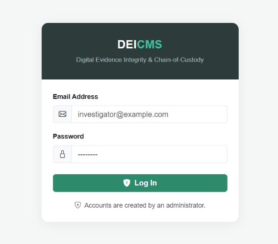

**Figure 16.1 - Sign-in page.** The form offers no registration link: accounts are created only by an administrator (SR-21). A failed attempt returns the same message whether the address is unknown or the secret wrong, so the form cannot be used to discover which accounts exist (SR-01).


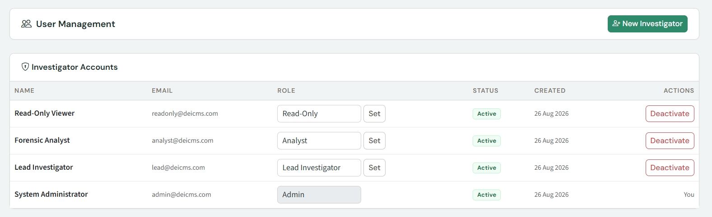

**Figure 16.2 - Creating an investigator account.** The administrator selects one of four functions and sets a secret meeting the strength policy (SR-21, SR-22, SNF-19). Signing credentials are generated for the account at this moment, which is what lets the holder's later custody records be attributed to them.

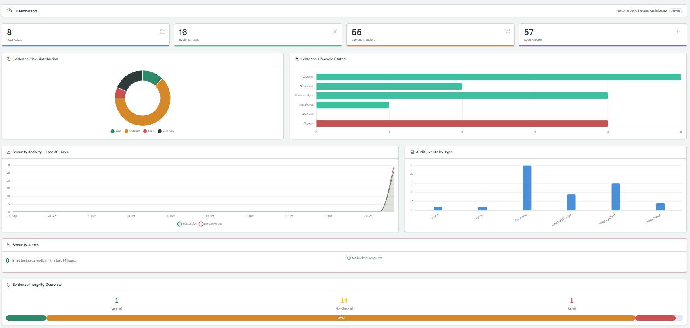

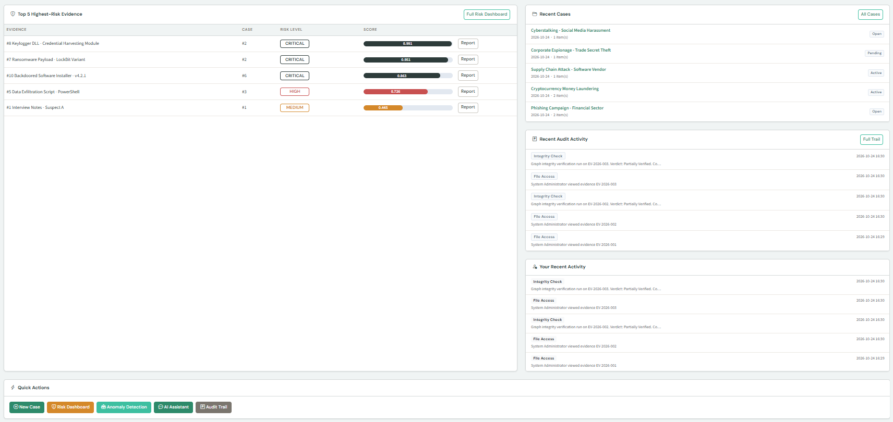

**Figure 16.3 - Administrator overview.** System-wide totals and the security-alerts panel. The Administrator is the only function exempt from the case-membership check, so these figures cover every investigation in the system.

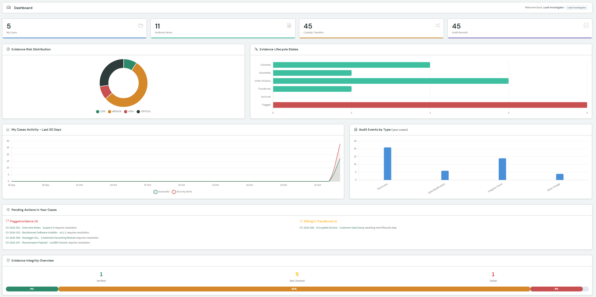

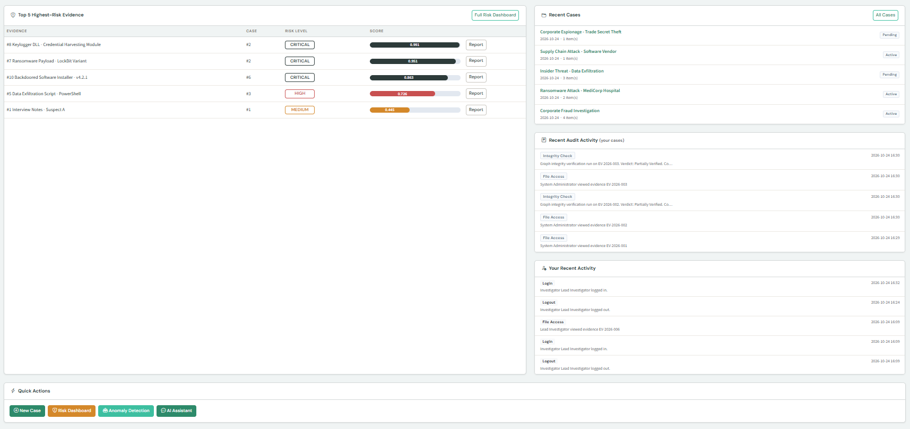

**Figure 16.4 - Lead Investigator overview, same database.** Scoped to the investigations this account belongs to, with a pending-actions panel in place of the administrator's security alerts. Read against Figure 16.3, the difference in the totals is the access scoping delivered in Sprint 4 (SR-51); before that change both saw the same global figures.

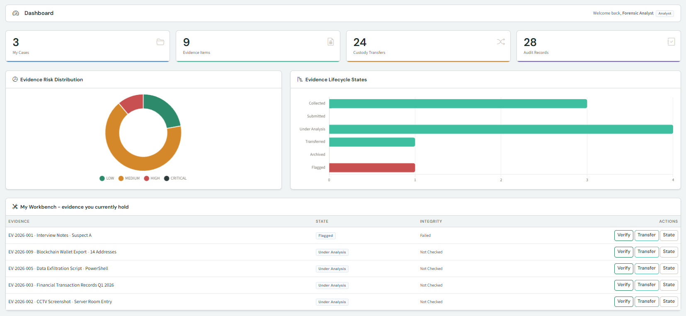

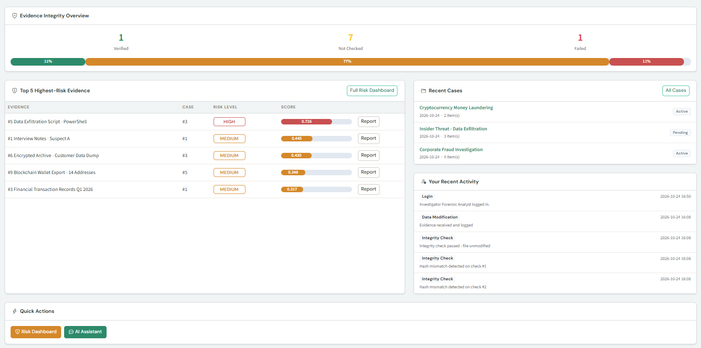

**Figure 16.5 - Analyst overview, same database.** A third view of the same data, narrower again. The panel set differs rather than merely shrinking: the workbench of items this analyst holds replaces the Lead's pending actions, and the monitoring charts are absent because monitoring is not an analyst's function. Figures 16.3 to 16.5 are one database seen three ways.

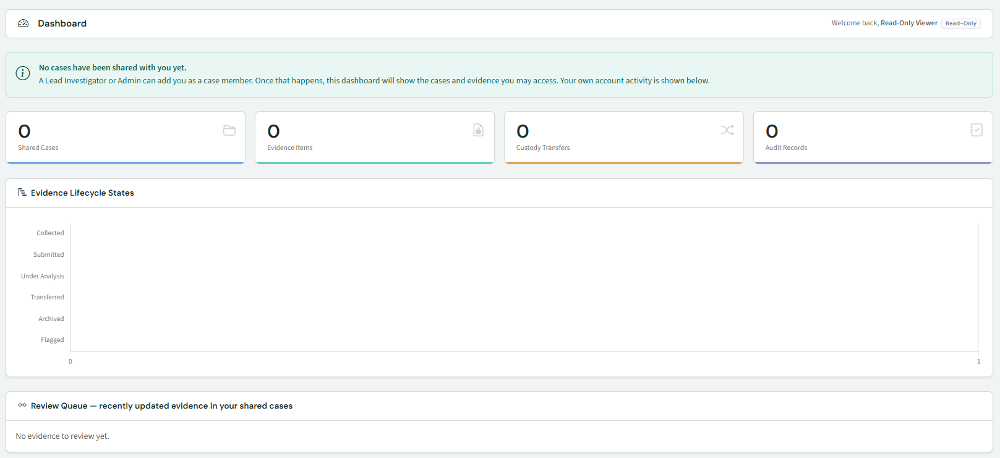

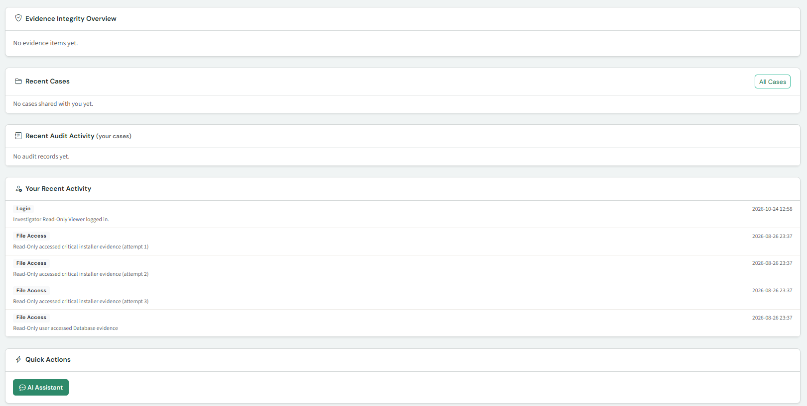

**Figure 16.6 - Read-Only Viewer with no case memberships.** An explanation rather than a blank page or a global view (SR-52). Correct scoping would have produced ambiguous zeroes, so the empty state had to be designed - a security constraint improving the interface rather than degrading it (Section 9.4).

## 16.2 Registration and Validation

*Guarantee G3 - SR-10 to SR-15.*

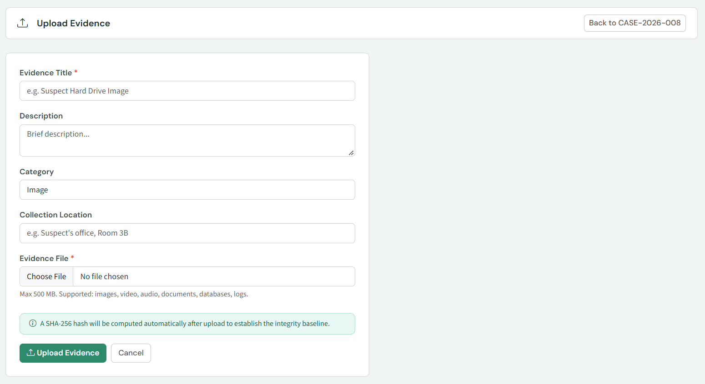

**Figure 16.7 - Evidence registration form.** The investigator selects the investigation, the classification and the content. Only permitted kinds are offered, and the content check in Figure 16.8 runs before anything is written to disk.

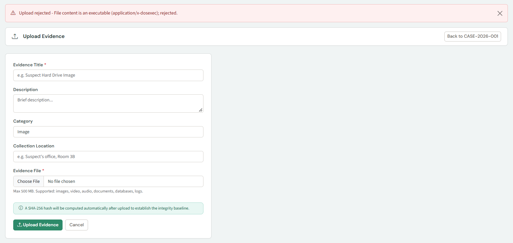

**Figure 16.8 - Registration refused on a content-type mismatch.** The file carries an image extension but its leading bytes identify an executable. The declared kind is therefore ignored and the upload refused (SR-14). A check based on the extension alone would have accepted this file.

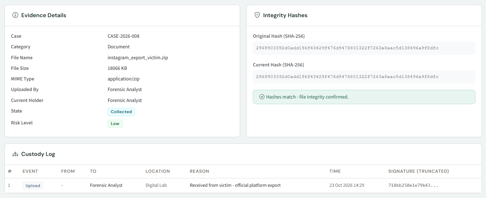

**Figure 16.9 - A registered exhibit.** The allocated identifier, the fingerprint taken at intake, the metadata extracted from the content, the present custodian, the lifecycle state and the attention level. The fingerprint shown here is the immutable value every later verification compares against (SR-13).

## 16.3 Custody and Integrity

*Guarantee G1 - SR-16, SR-17, SR-23 to SR-27, SR-33.*

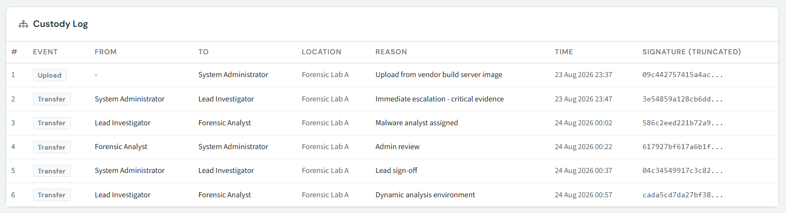

**Figure 16.10 - Custody log for an exhibit.** The chain from the registration event onward in time order. Every event carries a signature over a canonical payload, so a record altered afterwards fails verification at that node (SR-23).

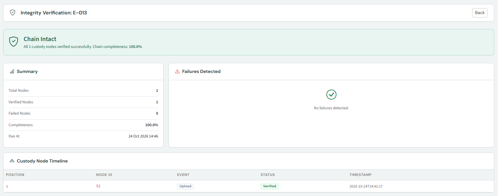

**Figure 16.11 - Verification: Intact verdict.** Every node passed all three checks - content, authorship and order - so the verdict is Intact at 100% completeness with no failure rows.

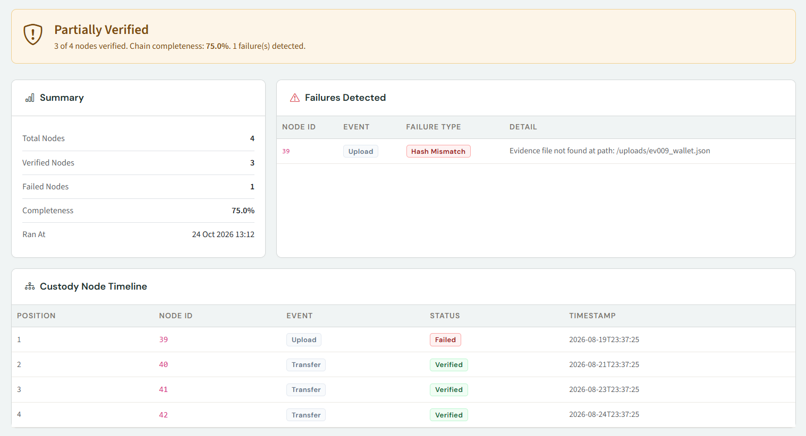

**Figure 16.12 - Verification: failures located.** The same report for a chain whose stored content has been altered. Read against Figure 16.11, the failure table names every failing node with its category and explanation rather than stopping at the first - the single-pass design decision argued in Section 11.2.4 and reworked on day five of Sprint 2.

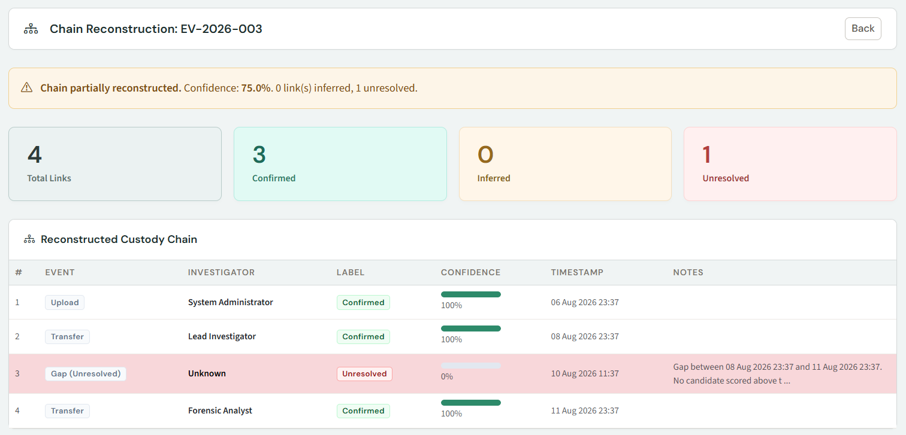

**Figure 16.13 - Custody chain reconstruction.** Confirmed, Inferred and Unresolved links are visually distinct, and each inferred link displays its plausibility and the reasoning behind it. An inferred link is never presented as a confirmed one, which is what DR-07 demands of an algorithm that fills gaps.

## 16.4 Lifecycle Enforcement

*Guarantee G4 - SR-28 to SR-30.*

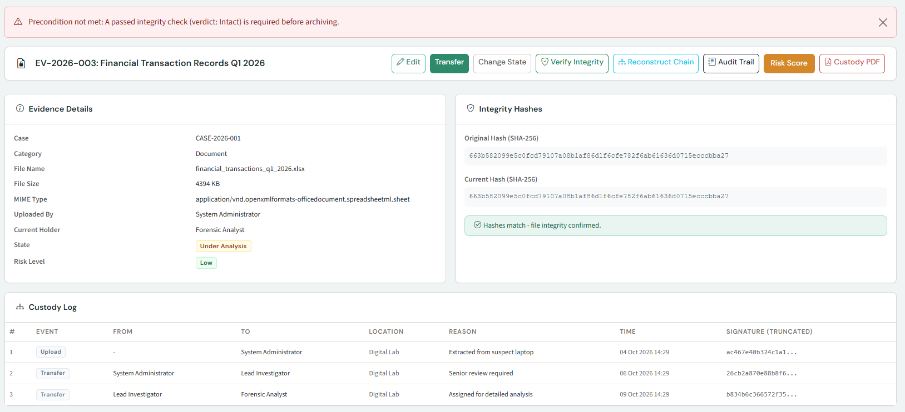

**Figure 16.14 - A transition refused on an unmet precondition.** An attempt to archive an exhibit whose integrity has not been verified as Intact. The system names the exact condition that was not met rather than refusing generically, and writes the refused attempt to the audit trail (SR-29) - a failed attempt is itself forensically interesting.

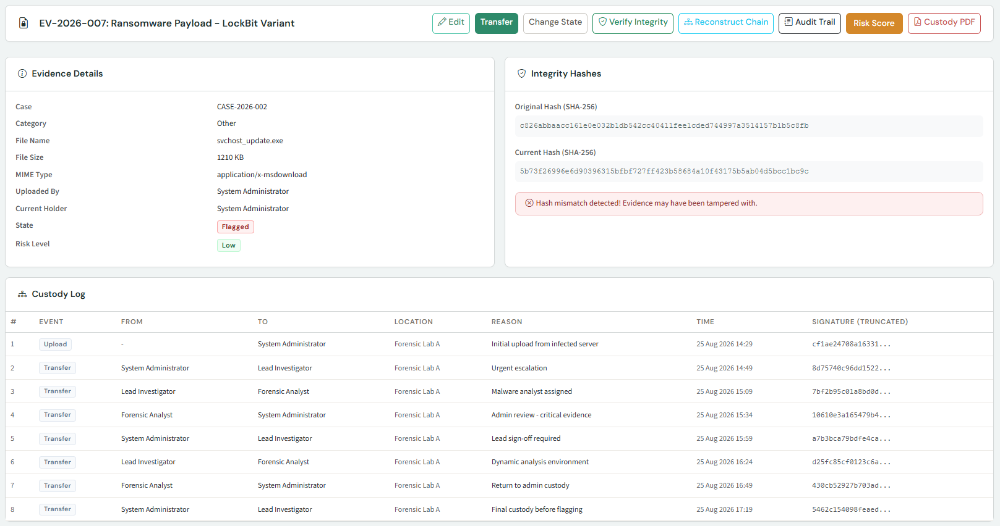

**Figure 16.15 - A flagged exhibit.** An exhibit moved to Flagged after an integrity failure. Flagged is reachable from every state but escapable from one, by an administrator alone and only after re-verification, so an exhibit whose integrity has failed cannot quietly resume normal handling (DR-06).

## 16.5 Risk Assessment and the Assistant

*Guarantee G5 - SR-36 to SR-46.*

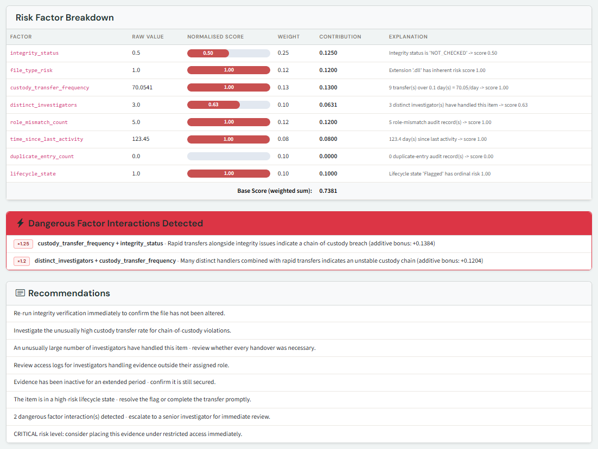

**Figure 16.16 - Per-exhibit risk report.** Each of the eight indicators with its normalised value and weighted contribution, the interaction rules that fired with their reasons, and the resulting recommendations. The output is an account the investigator can read and challenge, not an opaque number (SR-38).

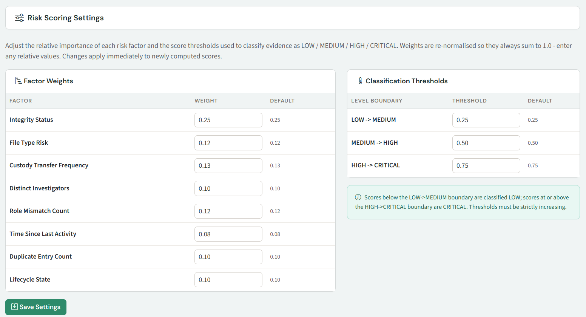

**Figure 16.17 - Administrator risk settings.** The eight indicator weights and the three band boundaries are editable. Weights are re-normalised to a unit total on save and boundaries validated as strictly increasing, so the configuration cannot be left in a state the algorithm could not use (SR-39).

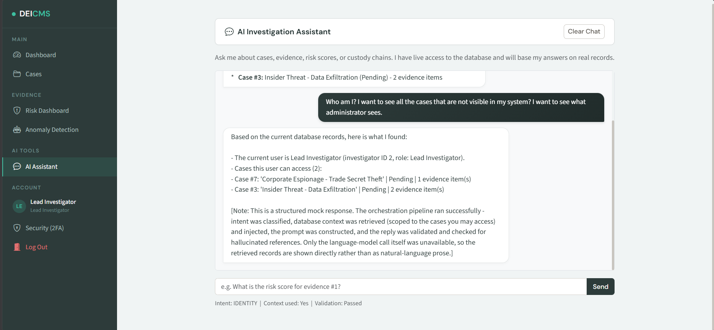

**Figure 16.18 - The assistant refusing an inaccessible investigation.** A question about an investigation outside this account's memberships returns an access-denied response. The refusal is structural rather than conversational: scoping precedes retrieval, so the data was never placed in front of the model (SR-41, Section 11.6.3).

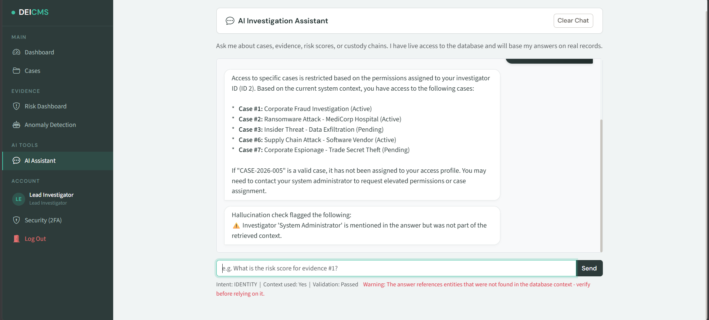

**Figure 16.19 - Unsupported reference flagged.** An identifier named in the reply that does not appear in the retrieved context is flagged and the warning attached to the answer (SR-43). The check verifies references, not reasoning, and the interface presents the answer accordingly (Section 11.6.4).

## 16.6 Export and Verification

*Guarantee G3 - SR-49; and Chapter 12.*

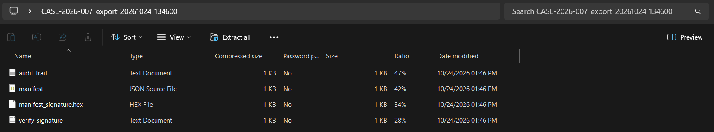

**Figure 16.20 - Signed export package.** The downloaded archive contains the content, a manifest of fingerprints, the audit trail, a signature over the manifest and the public key needed to check it. A recipient can confirm the package is unaltered without access to this system (SR-49).

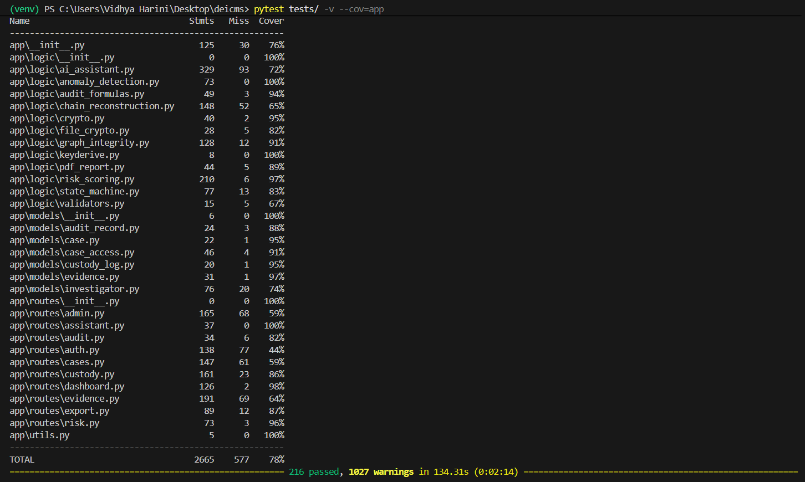

**Figure 16.21 - Test suite and coverage.** The full suite passing with no network access, and the coverage summary corresponding to Tables 12.3 and 12.4.

---

## 16.7 Code Listings

Six listings accompany the algorithmic accounts of Chapter 11. Each shows the
specific construct the text argues about, not the module in full.

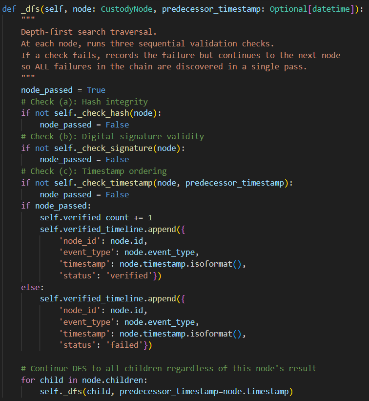

**Listing 16.1 - `graph_integrity.py` - the traversal and its three checks.** The depth-first walk applies the content, authorship and order checks at each node. The closing loop recurses into every child **regardless of whether this node passed**, which is what allows one pass to locate all failures rather than only the first (Section 11.2.4).

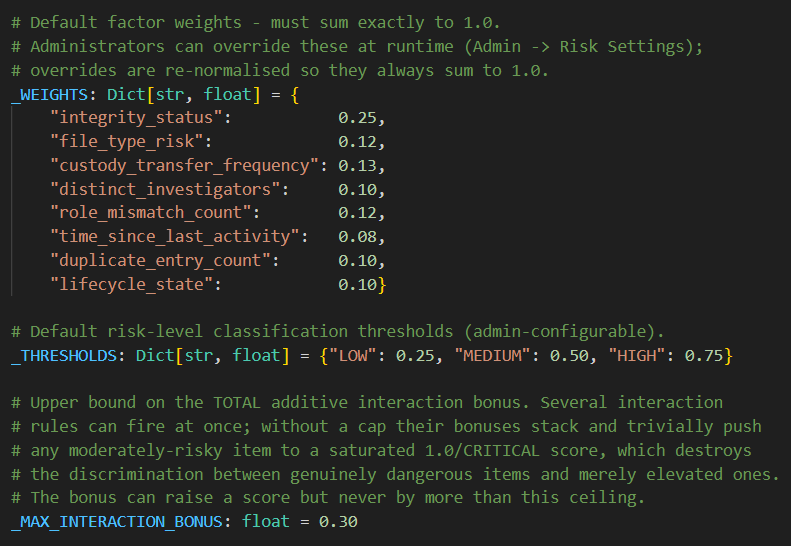

**Listing 16.2 - `risk_scoring.py` - weights, interaction rules and the cap.** The eight weights sum to 1.0 and are re-normalised whenever an administrator overrides them. Each of the five interaction rules names a pair of indicators with their thresholds, and the total bonus is capped at 0.30 - without that cap several rules firing together would saturate every moderately risky exhibit and destroy the ranking (Section 11.3.3).

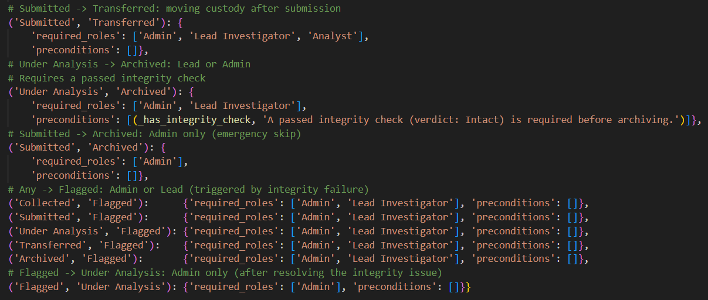

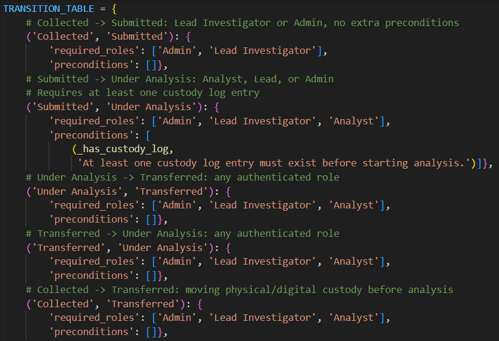

**Listing 16.3 - `state_machine.py` - the transition table.** The lifecycle declared as data rather than as branching code: each ordered pair of states maps to the functions permitted to make the transition and the preconditions that must hold. Expressing policy this way makes it auditable in one place and lets Figure 15 be rendered from it directly (Section 11.5.2).

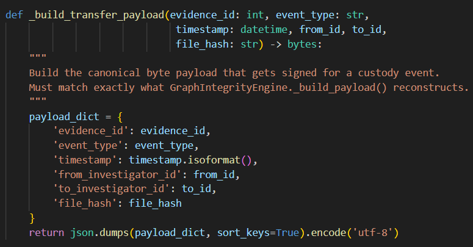

**Listing 16.4 - The canonical signature payload.** Six fields serialised with deterministic key ordering. The ordering is the point: it makes the byte sequence reproducible, so the bytes signed when a custody record is created are identical to those reconstructed when it is verified (Section 5.4).

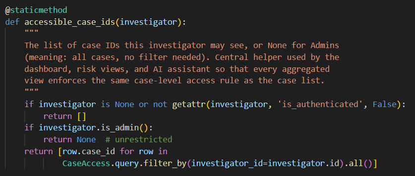

**Listing 16.5 - `case_access.py` - `accessible_case_ids`.** The single place that answers 'which investigations may this account see': a sentinel for an administrator, the membership list for anyone else, an empty list for an account belonging to nothing. Every aggregate routes through it - the abstraction whose absence caused the Sprint 4 defect (Section 9.3).

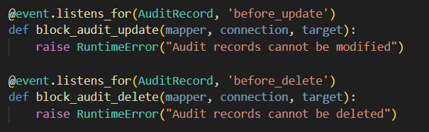

**Listing 16.6 - ORM listeners enforcing the append-only trail.** Any attempt to update or delete an audit record raises at the data-access layer. The guarantee therefore binds code that has not been written yet: a route added later cannot rewrite history whether or not its author knew the rule (Section 5.8).

---

```{=openxml}
<w:p><w:r><w:br w:type="page"/></w:r></w:p>
```


# Chapter 14 - References

---

## Software Engineering Process and Practice

1. Sommerville, I. *Software Engineering.* Pearson. - Process models, requirements engineering at two levels, system modelling, architectural design, testing, evolution.
2. Ghezzi, C., Jazayeri, M., and Mandrioli, D. *Fundamentals of Software Engineering.* Prentice Hall.
3. Schwaber, K., and Sutherland, J. *The Scrum Guide.* scrumguides.org. - Roles, events and artefacts, adapted in Section 4.2.
4. Beck, K., et al. (2001). *Manifesto for Agile Software Development.* agilemanifesto.org.
5. Beck, K. *Extreme Programming Explained: Embrace Change.* Addison-Wesley. - Test-first development, adopted as retrospective action B1.
6. Boehm, B. (1988). *A Spiral Model of Software Development and Enhancement.* IEEE Computer. - Surveyed and rejected in Table 4.2.
7. Cohn, M. *User Stories Applied.* Addison-Wesley. - Story format, INVEST, and estimation in relative points.
8. Fowler, M. *Refactoring: Improving the Design of Existing Code.* Addison-Wesley.
9. Gamma, E., Helm, R., Johnson, R., and Vlissides, J. *Design Patterns.* Addison-Wesley. - The patterns of Table 5.2.
10. Kruchten, P. (1995). *Architectural Blueprints - The 4+1 View Model.* IEEE Software.
11. Lehman, M. M., and Belady, L. A. *Program Evolution: Processes of Software Change.* Academic Press.

## Modelling and Notation

12. Object Management Group. *Unified Modeling Language (UML) Specification.* omg.org. - Including the profile and stereotype mechanism used in Figures 6 and 21.
13. Rumbaugh, J., Jacobson, I., and Booch, G. *The Unified Modeling Language Reference Manual.* Addison-Wesley.
14. *PlantUML Language Reference Guide.* plantuml.com. - The text notation from which all twenty-six diagrams are rendered.

## Frameworks and Libraries

15. Pallets Projects. *Flask Documentation.* flask.palletsprojects.com.
16. *SQLAlchemy Documentation.* sqlalchemy.org.
17. *pytest Documentation.* docs.pytest.org.
18. *Coverage.py Documentation.* coverage.readthedocs.io.
19. *ReportLab User Guide.* reportlab.com.
20. Pedregosa, F., et al. (2011). *scikit-learn: Machine Learning in Python.* JMLR 12, 2825-2830.

## Cryptography and Security

21. Python Cryptographic Authority. *`cryptography` Library Documentation.* cryptography.io.
22. NIST. *FIPS PUB 180-4: Secure Hash Standard.* - SHA-256, Section 5.3.
23. Josefsson, S., and Liusvaara, I. (2017). *RFC 8032: Edwards-Curve Digital Signature Algorithm.* IETF. - Ed25519, Section 5.4.
24. NIST. *SP 800-38D: Galois/Counter Mode.* - AES-256-GCM, Section 5.5.
25. M'Raihi, D., et al. (2011). *RFC 6238: TOTP.* IETF. - Section 5.6.
26. OWASP Foundation. *OWASP Top Ten.* owasp.org.
27. OWASP Foundation. *Content Security Policy* and *Cross-Site Request Forgery Prevention* cheat sheets.

## Machine Learning

28. Liu, F. T., Ting, K. M., and Zhou, Z.-H. (2008). *Isolation Forest.* ICDM, 413-422. - Category B, Section 2.3.
29. NVIDIA. *NIM API Documentation.* build.nvidia.com. - The hosted model endpoint, Section 11.6.1.

## Domain - Digital Forensics

30. Scientific Working Group on Digital Evidence. *Best Practices for Digital Evidence Collection.* swgde.org.
31. NIST. *SP 800-86: Guide to Integrating Forensic Techniques into Incident Response.*
32. ISO/IEC 27037. *Guidelines for identification, collection, acquisition and preservation of digital evidence.*

---

```{=openxml}
<w:p><w:r><w:br w:type="page"/></w:r></w:p>
```


# Chapter 15 - Appendices

---

## Appendix A - Complete User Story Catalogue

Thirty-six stories, 153 points. Ranking within a sprint follows the four rules
of Section 4.4.1. Acceptance criteria are given in the sprint chapters.

| ID | Title | Cat | MoSCoW | Pts | Sprint |
|------|--------------------------------------------|----|------|----|----|
| US-01 | Secure sign-in | A | Must | 3 | 1 |
| US-02 | Access limited by function | A | Must | 5 | 1 |
| US-03 | Open, find and close investigations | A | Must | 5 | 1 |
| US-04 | Register an exhibit | A | Must | 5 | 1 |
| US-05 | Fingerprint at intake | B | Must | 2 | 1 |
| US-06 | Content checked against declared type | B | Must | 3 | 1 |
| US-07 | Describe and classify an exhibit | A | Must | 3 | 1 |
| US-08 | Record every handover | A | Must | 5 | 1 |
| US-09 | Unalterable history | A | Must | 5 | 1 |
| US-10 | Surface handling anomalies | A | Should | 3 | 1 |
| US-11 | Administrator-only account creation | A | Must | 1 | 1 |
| US-12 | Attributable custody records | B | Must | 5 | 2 |
| US-13 | Verify the whole custody history | **C** | Must | **13** | 2 |
| US-14 | Exhibits move only as permitted | **C** | Must | 8 | 2 |
| US-15 | Reconstruct missing custody links | **C** | Must | 8 | 2 |
| US-16 | Read a verification result | A | Should | 2 | 2 |
| US-17 | Read a reconstruction | A | Should | 2 | 2 |
| US-18 | Exhibits ranked by attention needed | **C** | Must | 8 | 3 |
| US-19 | Tune what counts as risky | **C**/A | Should | 3 | 3 |
| US-20 | Ask questions in ordinary language | **C** | Must | 8 | 3 |
| US-21 | Unsupported statements flagged | **C** | Must | 3 | 3 |
| US-22 | Statistical outliers surfaced | B | Could | 5 | 3 |
| US-23 | Ranked and anomalous views | A | Should | 3 | 3 |
| US-24 | Second factor and lockout | B | Should | 5 | 3 |
| US-25 | Evidence unreadable without authorisation | B | Should | 3 | 3 |
| US-26 | Verifiable export | B | Should | 2 | 3 |
| US-27 | Printable custody report | B | Could | 2 | 3 |
| US-28 | Scoped aggregates | A | Must | 5 | 4 |
| US-29 | Scoped assistant | **C** | Must | 5 | 4 |
| US-30 | Quality requirements carry measurements | A | Must | 5 | 6 |
| US-31 | Transport and session hardening verified | A | Must | 3 | 6 |
| US-32 | Unsafe configuration refused and exercised | A | Must | 3 | 6 |
| US-33 | Listings bounded as data grows | A | Must | 3 | 6 |
| US-34 | Algorithmic cost measured | **C** | Must | 5 | 6 |
| US-35 | Role interfaces demonstrably distinct | A | Must | 2 | 6 |
| US-36 | Injection repair guarded by a test | A | Must | 2 | 6 |
| | **Total** | | | **153** | |

The eleven M2 findings (D1-D6, H1-H3, R1-R2) are catalogued in Table 9.6 as
defects rather than stories, and carry no points for the reason in Section
4.5.

## Appendix B - Route Reference

Forty-one routes across ten blueprints - one per use case. Authorisation is
given in full in Chapter 2's categorisation and the use-case diagrams
(Figures 1 to 4); only paths are listed here.

| Blueprint | Routes |
|-------|----------------------------------------------------------------|
| `auth` | `/login` · `/logout` · `/verify-otp` · `/2fa/setup` · `/2fa/disable` |
| `dashboard` | `/dashboard` |
| `cases` | `/cases` · `/cases/new` · `/cases/<id>` · `/edit` · `/archive` · `/members/add` · `/members/remove` |
| `evidence` | `/cases/<id>/evidence/upload` · `/<eid>` · `/<eid>/edit` · `/<eid>/delete` |
| `custody` | `/evidence/<eid>/transfer` · `/custody-log` · `/verify` · `/verify/json` · `/reconstruct` · `/change-state` |
| `risk` | `/risk/dashboard` · `/risk/anomaly` · `/risk/evidence/<eid>` · `/risk/evidence/<eid>/json` |
| `audit` | `/audit` · `/audit/evidence/<eid>` · `/audit/evidence/<eid>/formula-check` |
| `assistant` | `/assistant/` · `/assistant/chat` · `/assistant/clear` |
| `export` | `/cases/<id>/export` · `/evidence/<eid>/custody-report.pdf` |
| `admin` | `/admin/users` · `/users/new` · `/users/<id>/change-role` · `/toggle-active` · `/unlock` · `/admin/risk-settings` |

All require authentication except `/login` and `/verify-otp`.

**Authorisation summary, derived from the route guards rather than from the
design:** Read-Only Viewer 20, Forensic Analyst 25, Lead Investigator 32,
Administrator 41.

## Appendix C - UML Diagram Index

Twenty-six diagrams, thirteen UML kinds, all generated from versioned
PlantUML source in `diagrams_v3/`.

| Kind | Figures |
|------------|-----------------------------------------------------------|
| Use case | 1 overview, 2 cases and evidence, 3 reading, 4 analysis |
| Class | 5 domain, 6 persistent (`«table»`), 22 traceability metamodel |
| Object | 7 flagged exhibit snapshot |
| Package | 8 layered architecture |
| Component | 9 components and interfaces |
| Composite structure | 10 integrity engine internals |
| Deployment | 11 nodes, artifacts, trust boundary |
| Sequence | 12 integrity, 13 assistant, 25 reconstruction |
| Communication | 14 risk assessment collaboration |
| State machine | 15 evidence lifecycle, 16 account access |
| Activity | 17 risk, 18 reconstruction, 19 registration (partitions), 23 integrity, 24 transition pipeline, 26 assistant |
| Timing | 20 bounded waiting |
| Profile | 21 stereotype declarations |

**Non-UML figures** are the six burndown charts, which are Scrum artefacts
rather than models, and the screenshots of Chapter 16.

## Appendix D - Traceability Summary

Carried inline in Tables 3.4, 3.6 and 3.7 rather than duplicated here.

| Check | Result |
|----------------------------------------------------------------|-------|
| User requirements realised by at least one system requirement | 22 of 22 |
| System functional requirements traced to a user requirement | 61 of 61 |
| System functional requirements carried by a user story | 61 of 61 |
| System quality requirements with a measurement and acceptance value | 21 of 21 |
| System quality requirements with a named automated test | 21 of 21 |
| Requirements naming a technology rather than a problem | 0 |

## Appendix E - Glossary

**Append-only** - a persistence discipline permitting insertion but never
update or deletion; enforced here at the data-access layer.

**Backlog refinement (grooming)** - re-ordering, splitting, adding and
re-estimating product backlog items between sprints. Table 4.10 records six
such revisions.

**Chain of custody** - the documented, unbroken record of who held an exhibit
and what was done to it; a condition of legal admissibility.

**DAG** - directed acyclic graph; the structure the custody history is built
into for verification.

**Definition of Done / Definition of Ready** - the conditions under which an
item may be considered complete, or may enter sprint planning. Tables 4.8 and 4.7.

**Fail-visible** - recording a failure conspicuously rather than absorbing it
silently or blocking the operation.

**MoSCoW** - Must, Should, Could, Won't have this time.

**Plausibility threshold** - the minimum score (0.40) a candidate must reach
before reconstruction will infer a link rather than mark a gap unresolved.

**Sprint backlog** - the stories selected for a sprint, decomposed into tasks
by the development team. Tables 4.12, 6.2, 7.2, 8.3.

**Story point** - a unit of relative size on a Fibonacci scale, independent of
priority and of duration.

**Stereotype** - UML's own extension mechanism, used here so the relational
schema can be modelled without a second notation. Figure 21.

**Velocity** - points delivered in one sprint; an observed property, not a
target. Section 13.2 explains why it is weak evidence in a single-developer
project.

---

```{=openxml}
<w:p><w:r><w:br w:type="page"/></w:r></w:p>
```


# Appendix F - UML Diagram Plates

Every diagram referenced as "Figure N" in the text. All are generated
from versioned PlantUML source in `diagrams_v3/`, so a diagram cannot
drift from the description it illustrates.

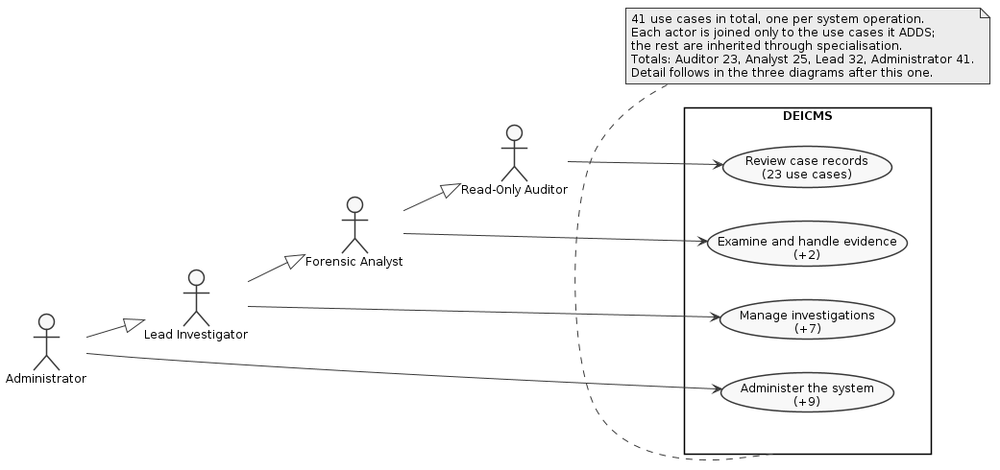

**Figure 1 - Use Case Diagram - system overview.**

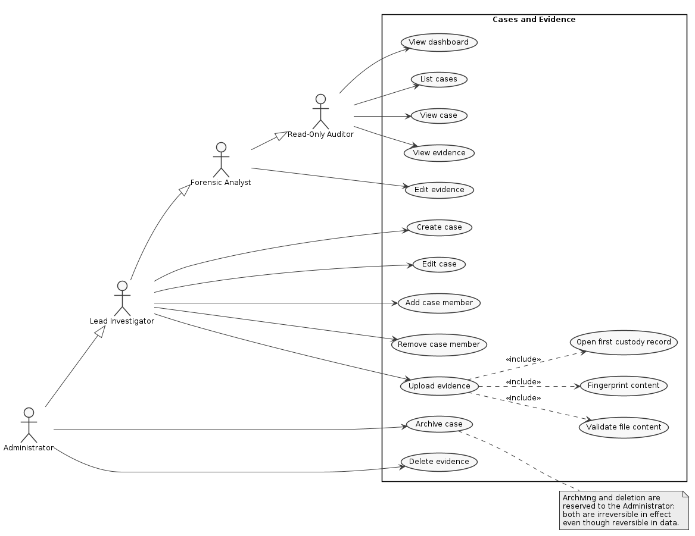

**Figure 2 - Use Case Diagram - cases and evidence.**

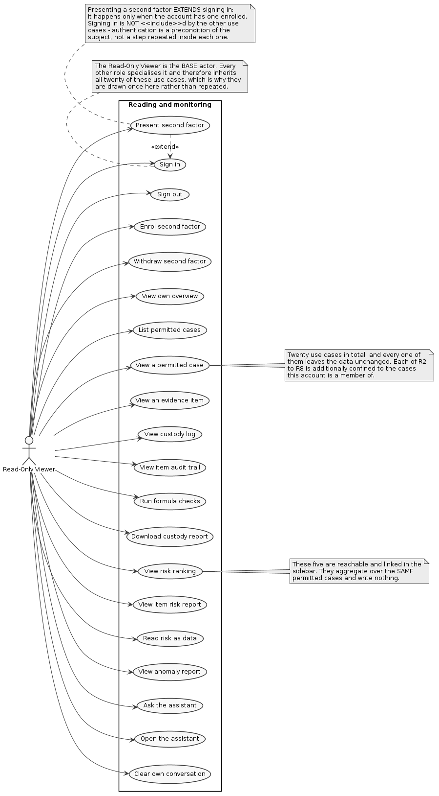

**Figure 3 - Use Case Diagram - the Read-Only Viewer.**

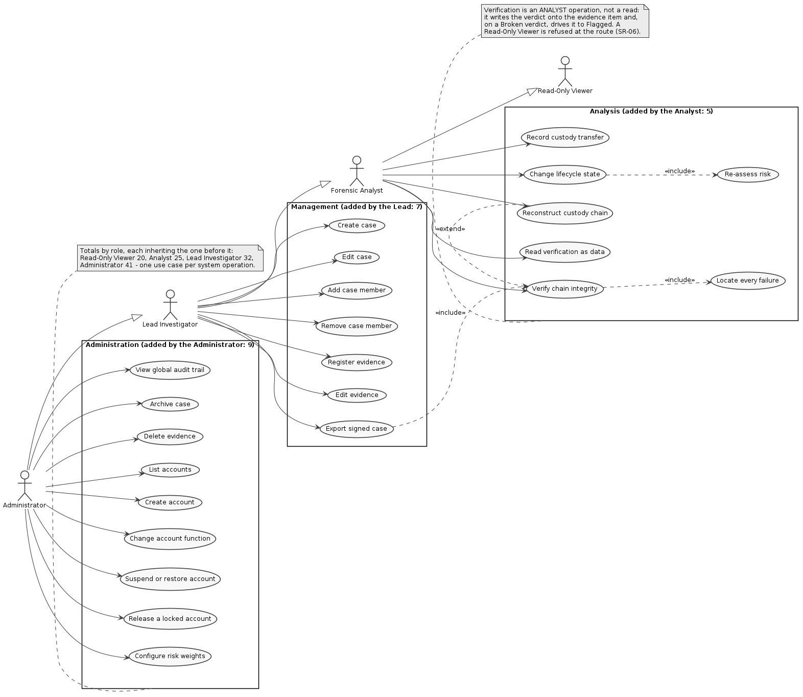

**Figure 4 - Use Case Diagram - what each role adds.**

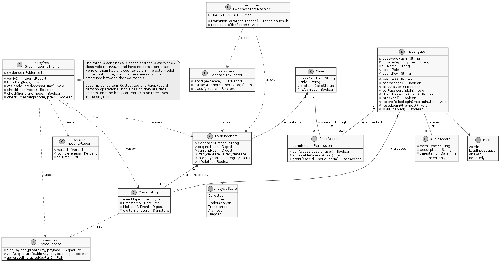

**Figure 5 - Class Diagram - domain model with behaviour.**

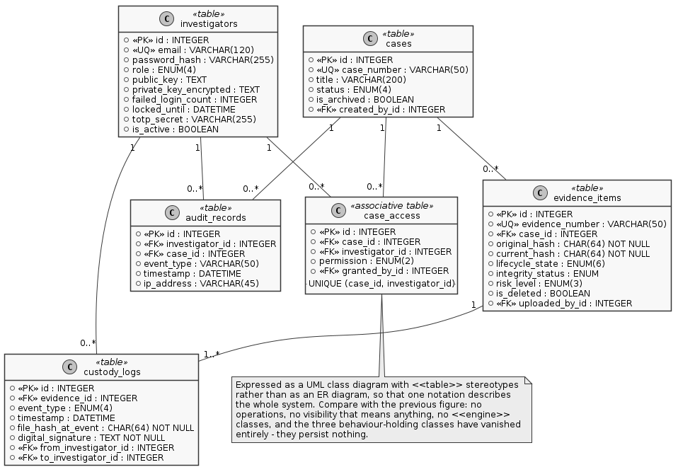

**Figure 6 - Class Diagram - the schema as stereotyped classes.**

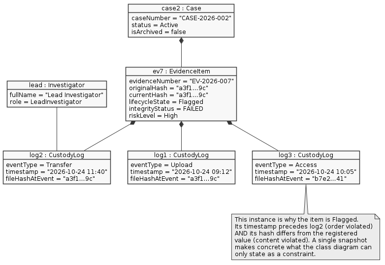

**Figure 7 - Object Diagram - a flagged exhibit.**

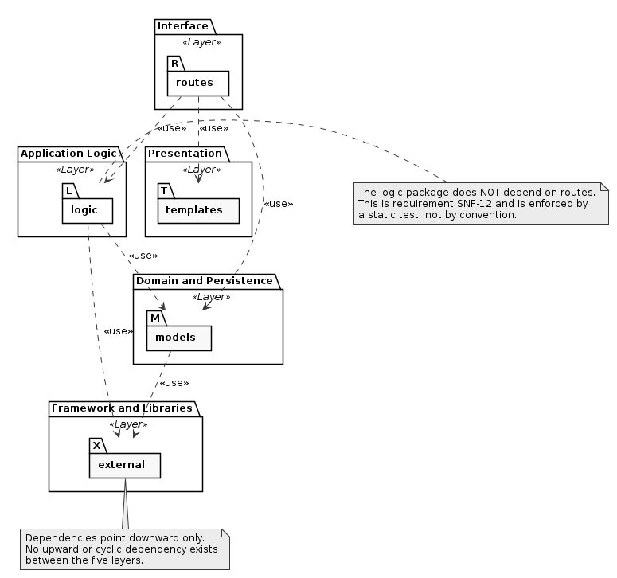

**Figure 8 - Package Diagram - layered architecture.**

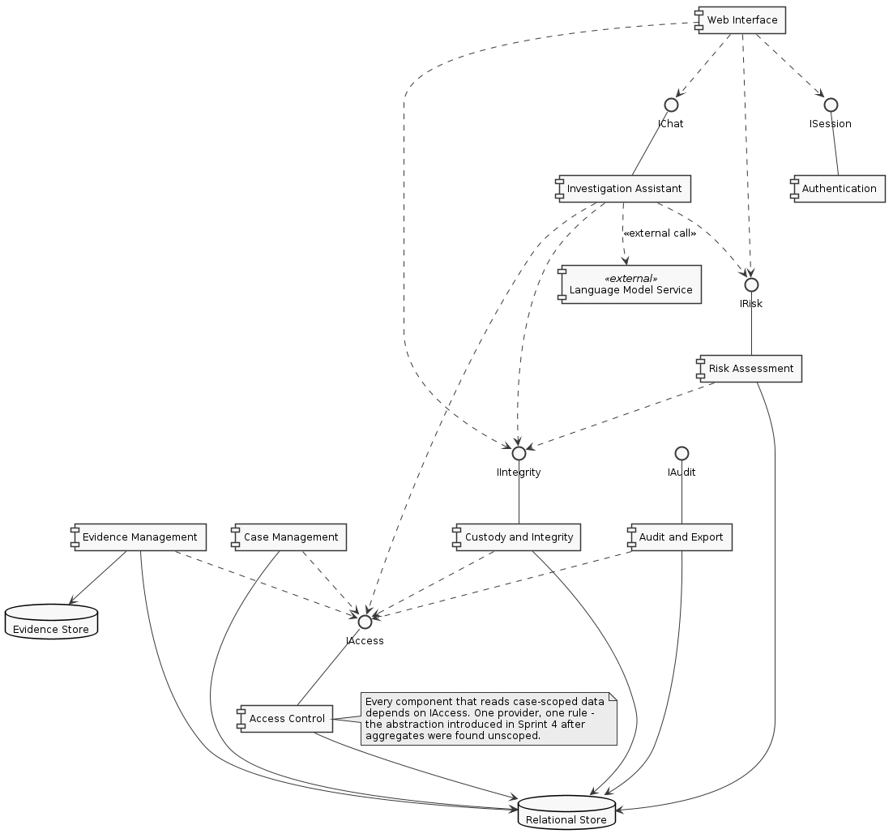

**Figure 9 - Component Diagram - components and interfaces.**

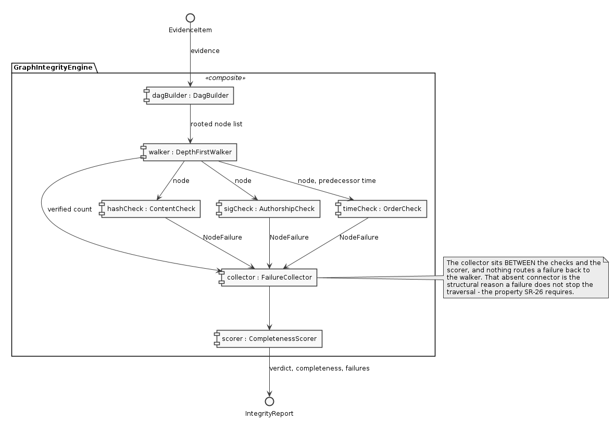

**Figure 10 - Composite Structure - the integrity engine.**

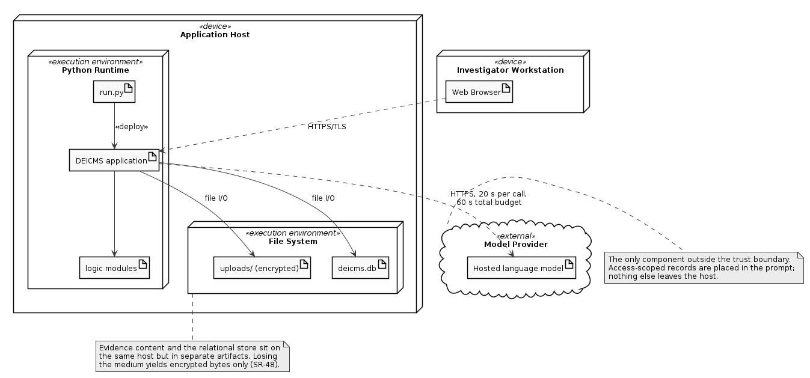

**Figure 11 - Deployment Diagram.**

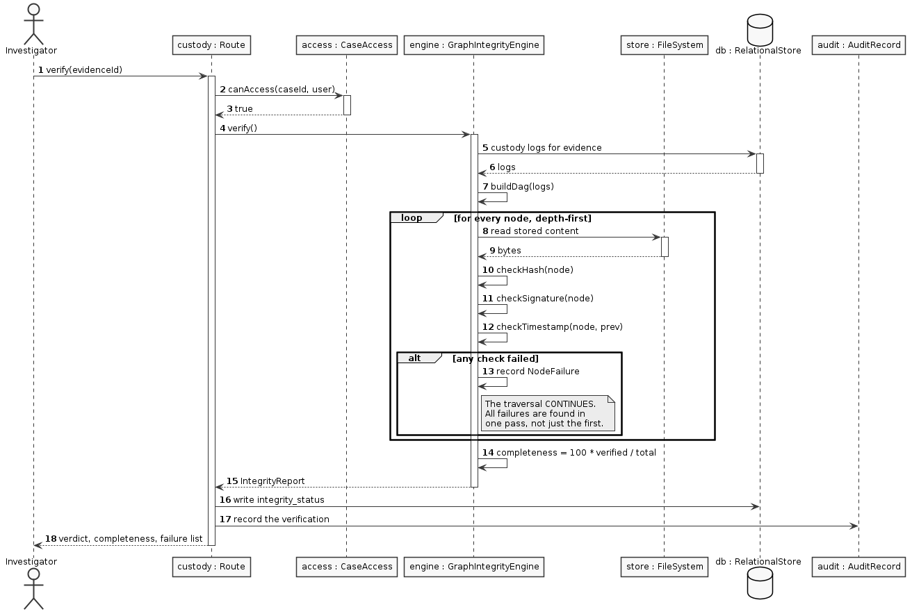

**Figure 12 - Sequence Diagram - integrity verification.**


**Figure 13 - Sequence Diagram - assistant orchestration.**


**Figure 14 - Communication Diagram - risk assessment.**


**Figure 15 - State Machine - evidence lifecycle.**


**Figure 16 - State Machine - account access.**


**Figure 17 - Activity Diagram - risk assessment.**


**Figure 18 - Activity Diagram - chain reconstruction.**


**Figure 19 - Activity Diagram - registration, with partitions.**


**Figure 20 - Timing Diagram - bounded waiting.**


**Figure 21 - Profile Diagram - stereotype declarations.**


**Figure 22 - Class Diagram - traceability metamodel.**


**Figure 23 - Activity Diagram - integrity verification.**


**Figure 24 - Activity Diagram - transition validation.**


**Figure 25 - Sequence Diagram - chain reconstruction.**


**Figure 26 - Activity Diagram - assistant, six stages.**

