# Chapter 16 - System Demonstration

---

The preceding chapters describe DEICMS as a design and as an argument; this
chapter shows it running. Twenty-one screenshots are chosen to evidence the
five guarantees of Table 1.1 rather than to tour every page, and six code
listings show the specific constructs the report argues about. Where two
figures are more informative as a pair - the same data seen by two functions,
the intact and the failed verdict - the comparison is stated in the caption.

## 16.1 Access Control and Role Scoping

*Guarantee G2 - SR-01 to SR-06, SR-21, SR-47, SR-51, SR-52.*

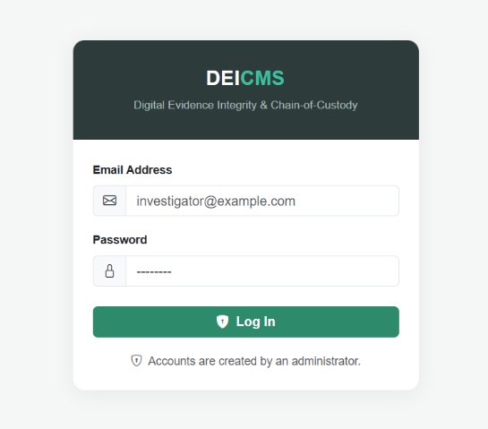

**Figure 16.1 - Sign-in page.** The form offers no registration link: accounts are created only by an administrator (SR-21). A failed attempt returns the same message whether the address is unknown or the secret wrong, so the form cannot be used to discover which accounts exist (SR-01).

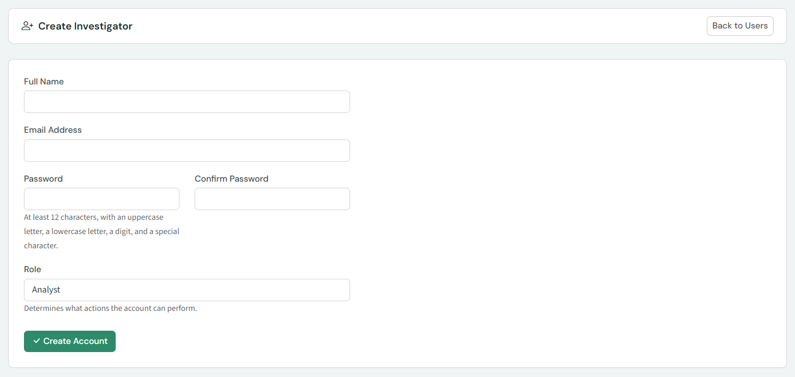

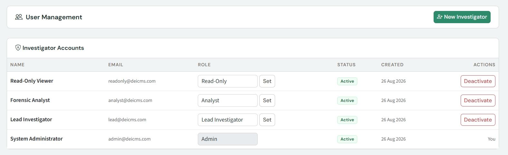

**Figure 16.2 - Creating an investigator account.** The administrator selects one of four functions and sets a secret meeting the strength policy (SR-21, SR-22, SNF-19). Signing credentials are generated for the account at this moment, which is what lets the holder's later custody records be attributed to them.

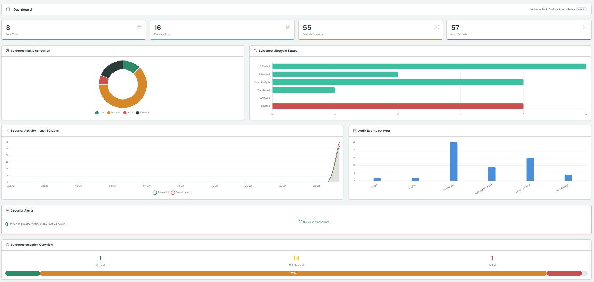

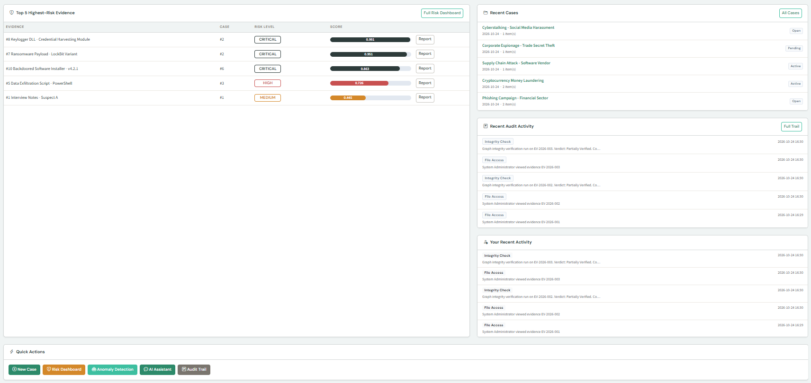

**Figure 16.3 - Administrator overview.** System-wide totals and the security-alerts panel. The Administrator is the only function exempt from the case-membership check, so these figures cover every investigation in the system.

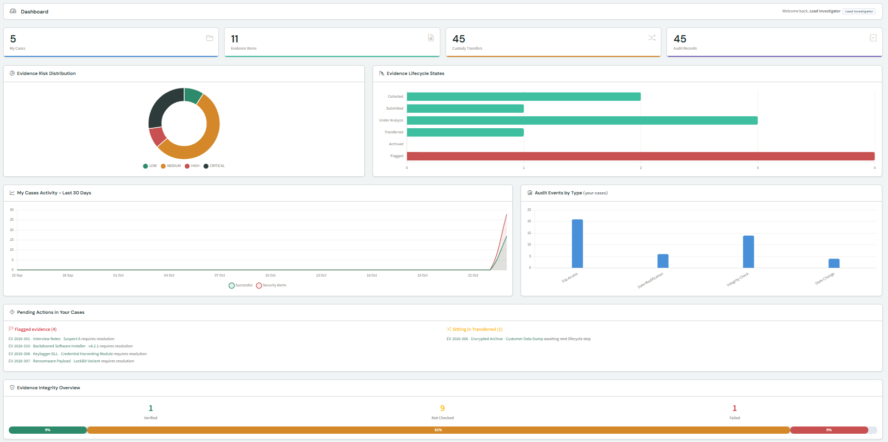

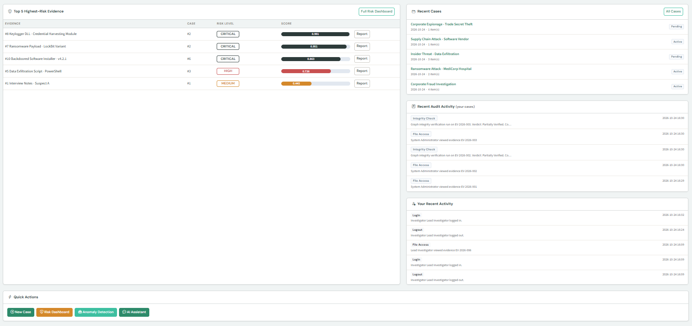

**Figure 16.4 - Lead Investigator overview, same database.** Scoped to the investigations this account belongs to, with a pending-actions panel in place of the administrator's security alerts. Read against Figure 16.3, the difference in the totals is the access scoping delivered in Sprint 4 (SR-51); before that change both saw the same global figures.

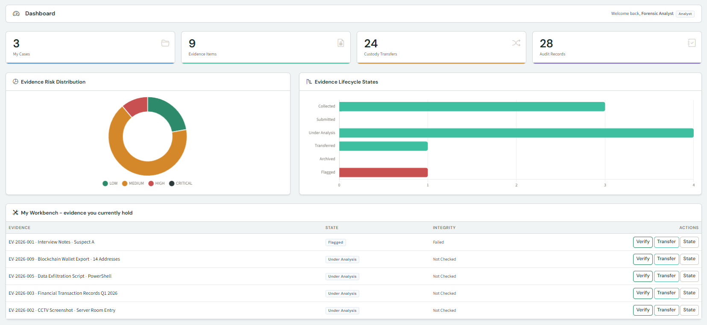

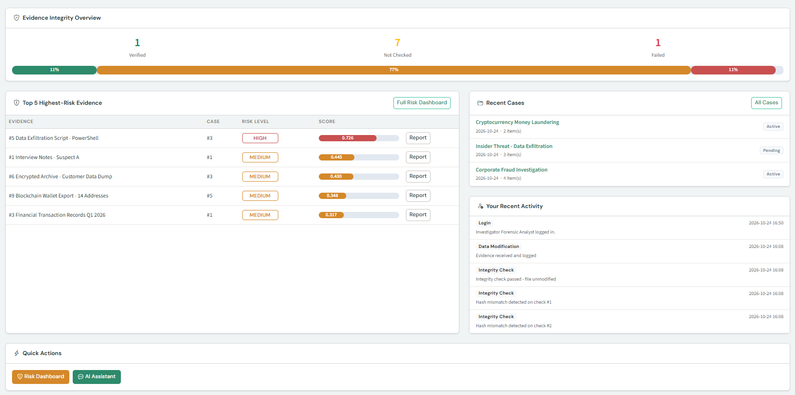

**Figure 16.5 - Analyst overview, same database.** A third view of the same data, narrower again. The panel set differs rather than merely shrinking: the workbench of items this analyst holds replaces the Lead's pending actions, and the monitoring charts are absent because monitoring is not an analyst's function. Figures 16.3 to 16.5 are one database seen three ways.

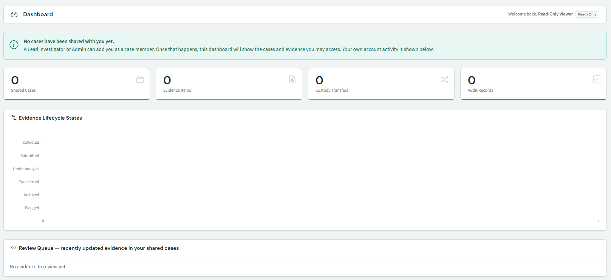

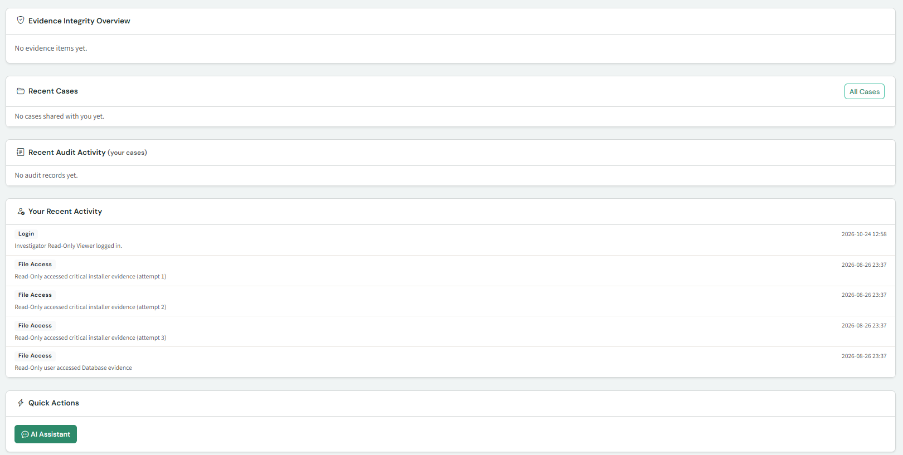

**Figure 16.6 - Read-Only Viewer with no case memberships.** An explanation rather than a blank page or a global view (SR-52). Correct scoping would have produced ambiguous zeroes, so the empty state had to be designed - a security constraint improving the interface rather than degrading it (Section 9.4).

## 16.2 Registration and Validation

*Guarantee G3 - SR-10 to SR-15.*

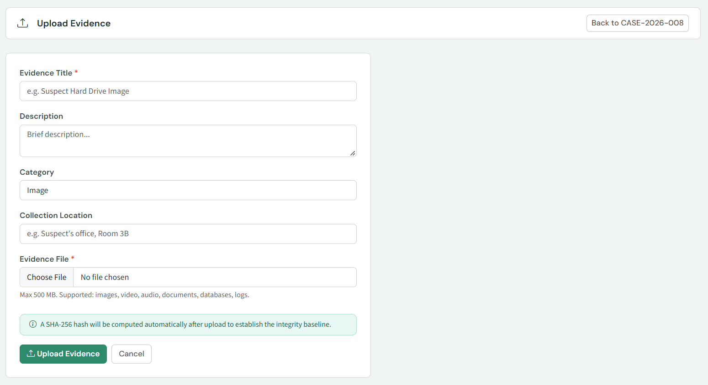

**Figure 16.7 - Evidence registration form.** The investigator selects the investigation, the classification and the content. Only permitted kinds are offered, and the content check in Figure 16.8 runs before anything is written to disk.

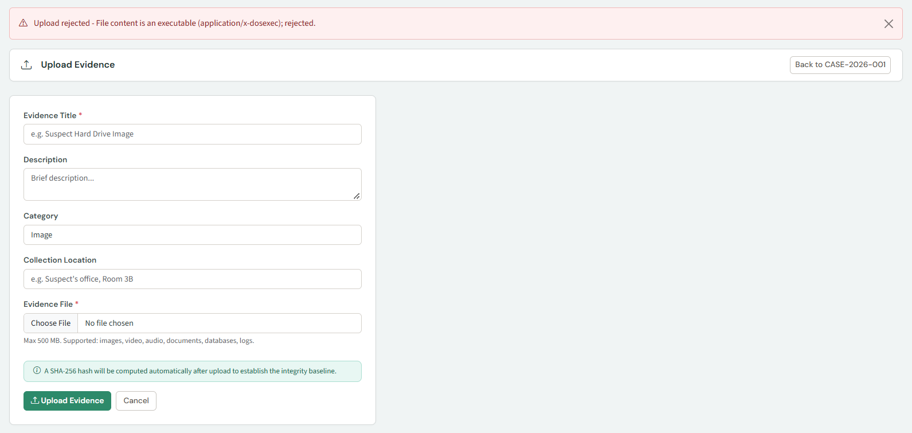

**Figure 16.8 - Registration refused on a content-type mismatch.** The file carries an image extension but its leading bytes identify an executable. The declared kind is therefore ignored and the upload refused (SR-14). A check based on the extension alone would have accepted this file.

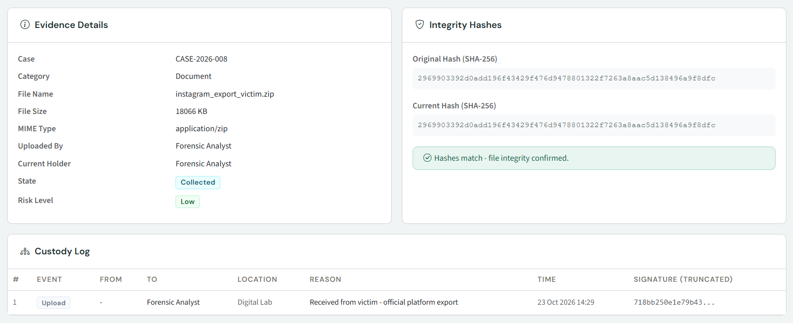

**Figure 16.9 - A registered exhibit.** The allocated identifier, the fingerprint taken at intake, the metadata extracted from the content, the present custodian, the lifecycle state and the attention level. The fingerprint shown here is the immutable value every later verification compares against (SR-13).

## 16.3 Custody and Integrity

*Guarantee G1 - SR-16, SR-17, SR-23 to SR-27, SR-33.*

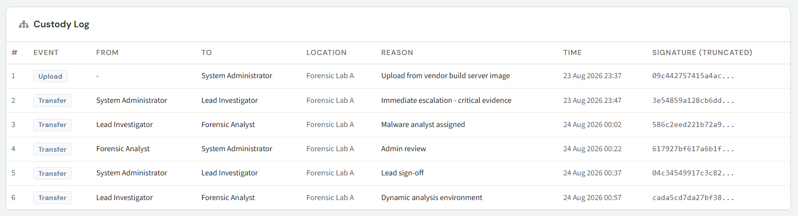

**Figure 16.10 - Custody log for an exhibit.** The chain from the registration event onward in time order. Every event carries a signature over a canonical payload, so a record altered afterwards fails verification at that node (SR-23).

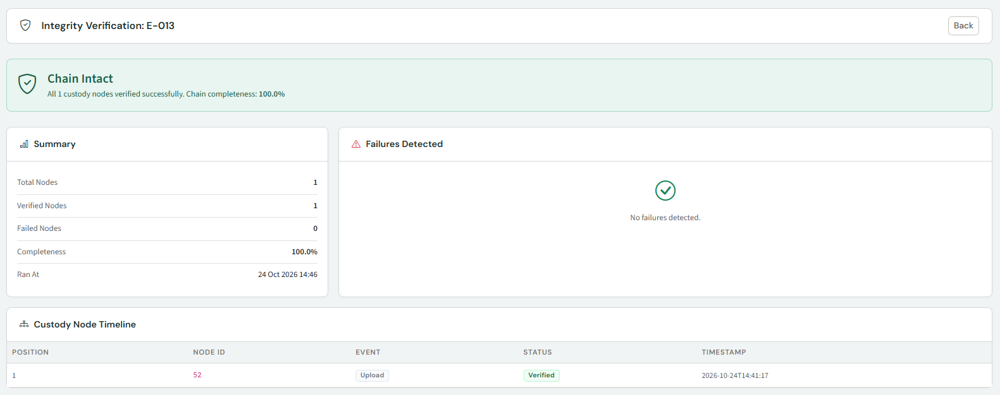

**Figure 16.11 - Verification: Intact verdict.** Every node passed all three checks - content, authorship and order - so the verdict is Intact at 100% completeness with no failure rows.

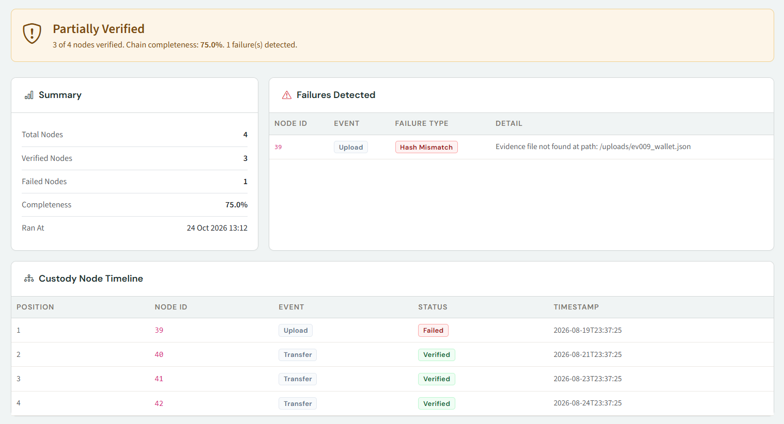

**Figure 16.12 - Verification: failures located.** The same report for a chain whose stored content has been altered. Read against Figure 16.11, the failure table names every failing node with its category and explanation rather than stopping at the first - the single-pass design decision argued in Section 11.2.4 and reworked on day five of Sprint 2.

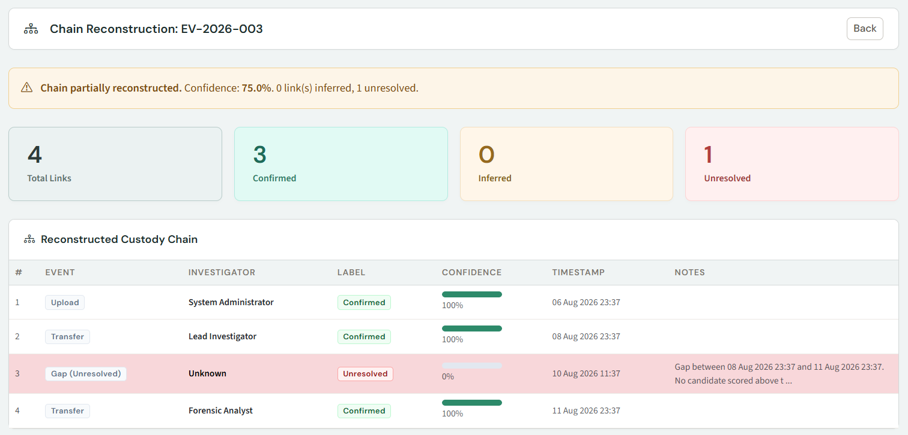

**Figure 16.13 - Custody chain reconstruction.** Confirmed, Inferred and Unresolved links are visually distinct, and each inferred link displays its plausibility and the reasoning behind it. An inferred link is never presented as a confirmed one, which is what DR-07 demands of an algorithm that fills gaps.

## 16.4 Lifecycle Enforcement

*Guarantee G4 - SR-28 to SR-30.*

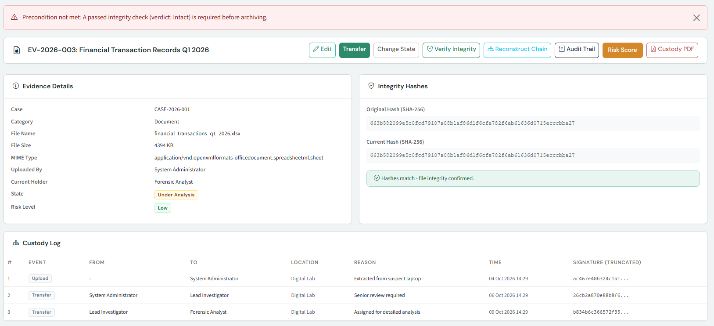

**Figure 16.14 - A transition refused on an unmet precondition.** An attempt to archive an exhibit whose integrity has not been verified as Intact. The system names the exact condition that was not met rather than refusing generically, and writes the refused attempt to the audit trail (SR-29) - a failed attempt is itself forensically interesting.

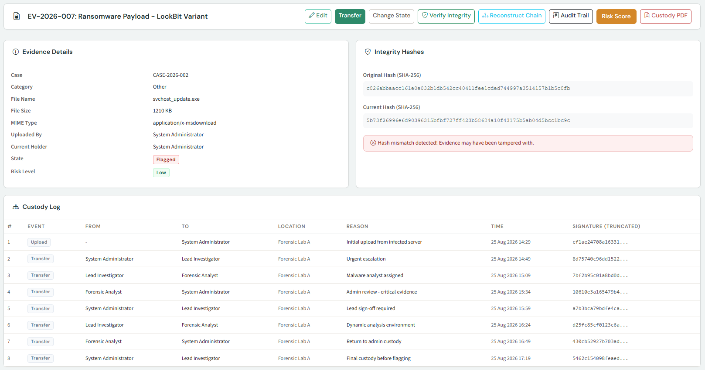

**Figure 16.15 - A flagged exhibit.** An exhibit moved to Flagged after an integrity failure. Flagged is reachable from every state but escapable from one, by an administrator alone and only after re-verification, so an exhibit whose integrity has failed cannot quietly resume normal handling (DR-06).

## 16.5 Risk Assessment and the Assistant

*Guarantee G5 - SR-36 to SR-46.*

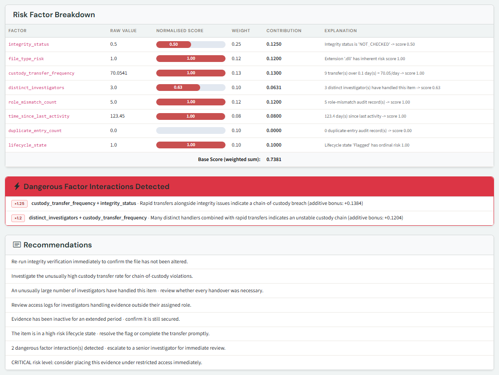

**Figure 16.16 - Per-exhibit risk report.** Each of the eight indicators with its normalized value and weighted contribution, the interaction rules that fired with their reasons, and the resulting recommendations. The output is an account the investigator can read and challenge, not an opaque number (SR-38).

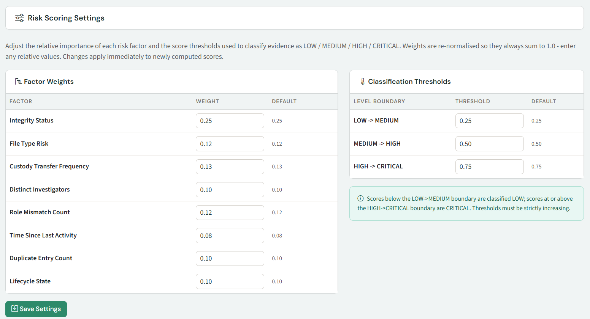

**Figure 16.17 - Administrator risk settings.** The eight indicator weights and the three band boundaries are editable. Weights are re-normalized to a unit total on save and boundaries validated as strictly increasing, so the configuration cannot be left in a state the algorithm could not use (SR-39).

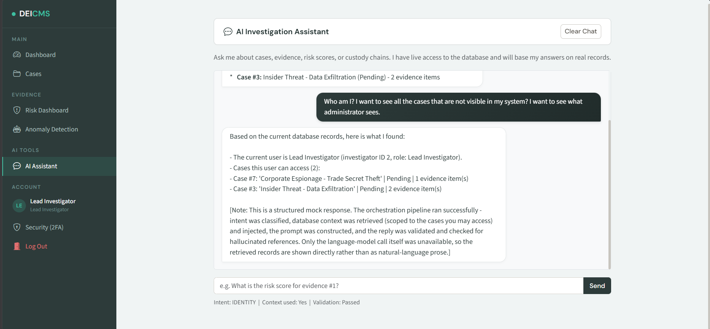

**Figure 16.18 - The assistant refusing an inaccessible investigation.** A question about an investigation outside this account's memberships returns an access-denied response. The refusal is structural rather than conversational: scoping precedes retrieval, so the data was never placed in front of the model (SR-41, Section 11.6.3).

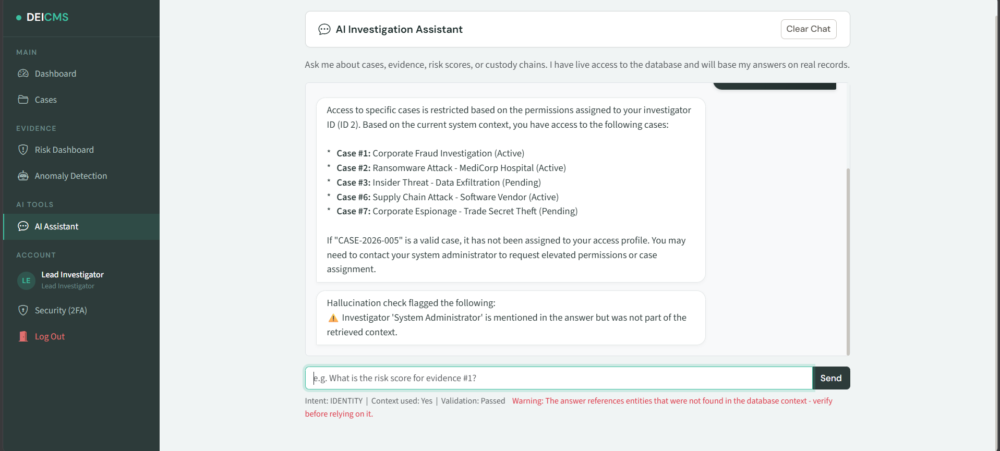

**Figure 16.19 - Unsupported reference flagged.** An identifier named in the reply that does not appear in the retrieved context is flagged and the warning attached to the answer (SR-43). The check verifies references, not reasoning, and the interface presents the answer accordingly (Section 11.6.4).

## 16.6 Export and Verification

*Guarantee G3 - SR-49; and Chapter 12.*

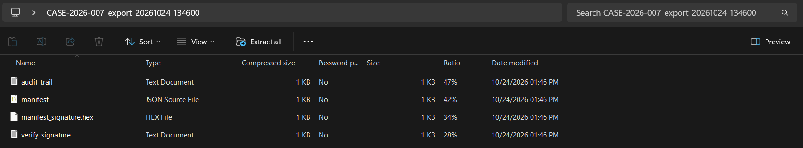

**Figure 16.20 - Signed export package.** The downloaded archive contains the content, a manifest of fingerprints, the audit trail, a signature over the manifest and the public key needed to check it. A recipient can confirm the package is unaltered without access to this system (SR-49).

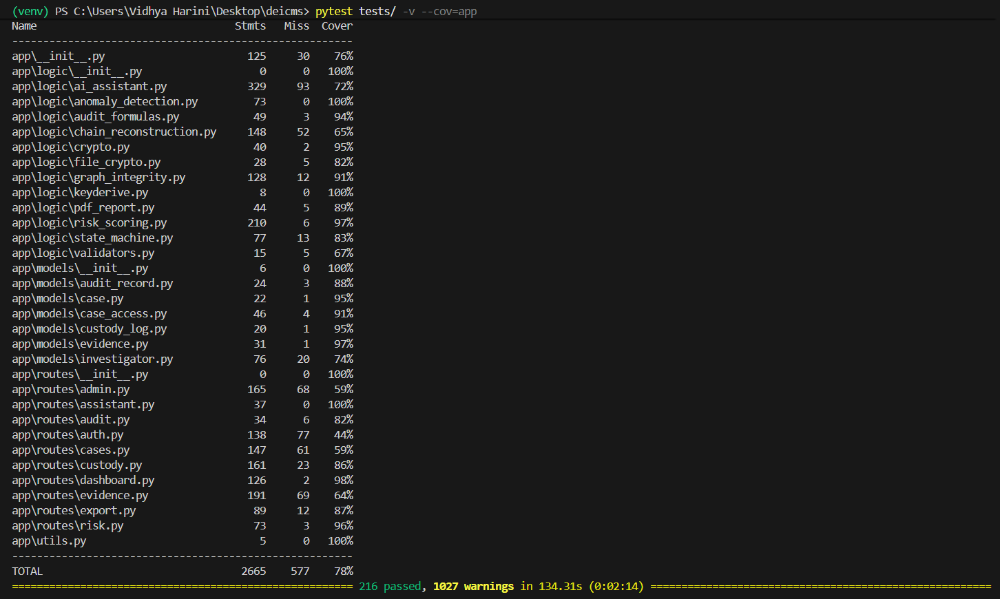

**Figure 16.21 - Test suite and coverage.** The full suite passing with no network access, and the coverage summary corresponding to Tables 12.3 and 12.4.

---

## 16.7 Code Listings

Six listings accompany the algorithmic accounts of Chapter 11. Each shows the
specific construct the text argues about, not the module in full.

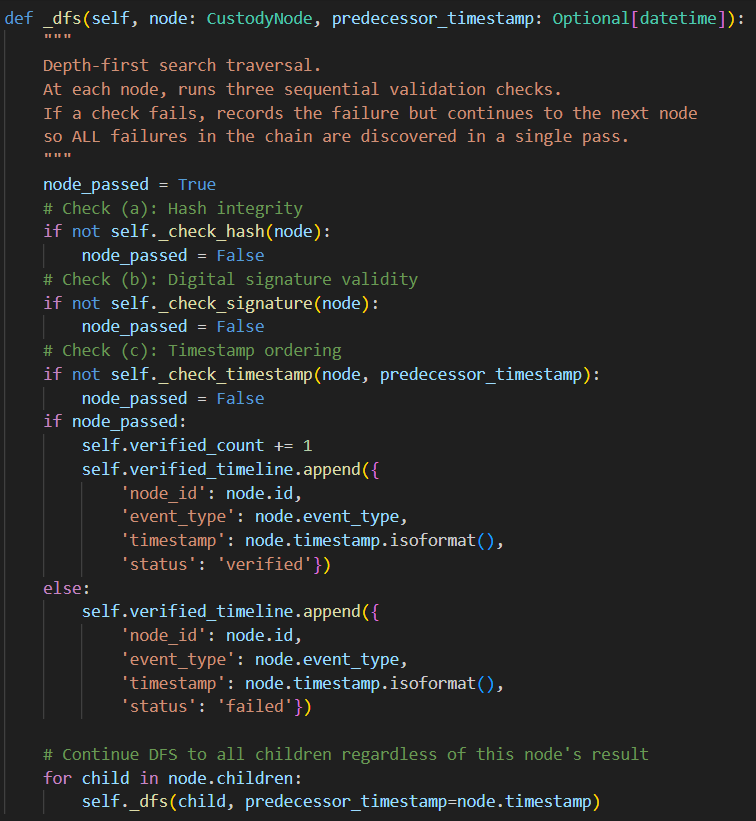

**Listing 16.1 - `graph_integrity.py` - the traversal and its three checks.** The depth-first walk applies the content, authorship and order checks at each node. The closing loop recurses into every child **regardless of whether this node passed**, which is what allows one pass to locate all failures rather than only the first (Section 11.2.4).

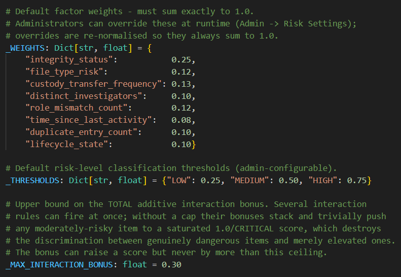

**Listing 16.2 - `risk_scoring.py` - weights, interaction rules and the cap.** The eight weights sum to 1.0 and are re-normalized whenever an administrator overrides them. Each of the five interaction rules names a pair of indicators with their thresholds, and the total bonus is capped at 0.30 - without that cap several rules firing together would saturate every moderately risky exhibit and destroy the ranking (Section 11.3.3).

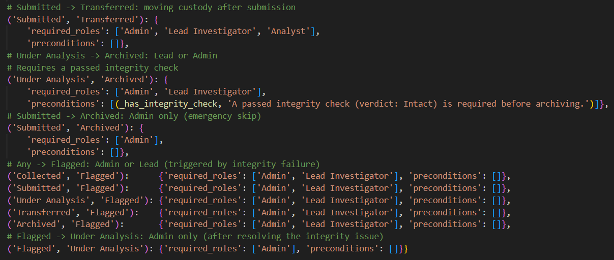

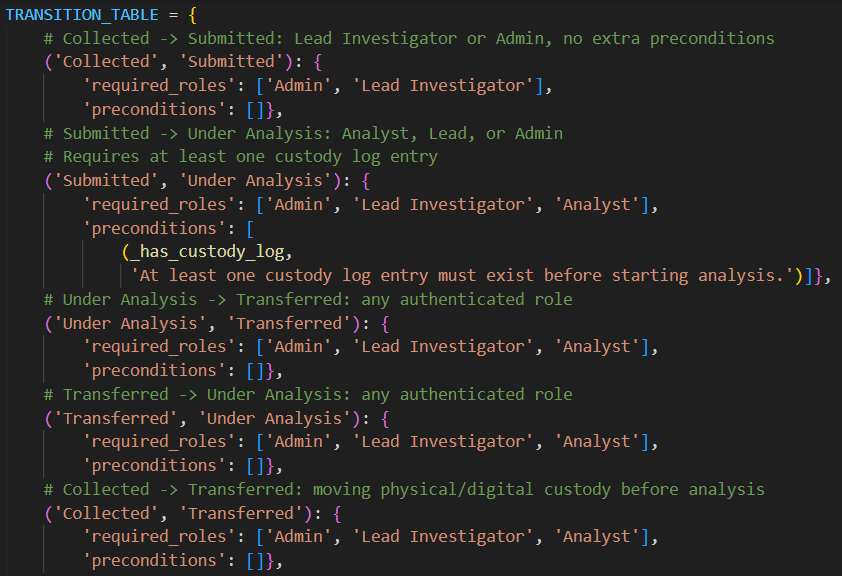

**Listing 16.3 - `state_machine.py` - the transition table.** The lifecycle declared as data rather than as branching code: each ordered pair of states maps to the functions permitted to make the transition and the preconditions that must hold. Expressing policy this way makes it auditable in one place and lets Figure 15 be rendered from it directly (Section 11.5.2).

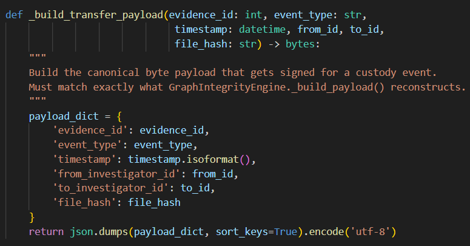

**Listing 16.4 - The canonical signature payload.** Six fields serialized with deterministic key ordering. The ordering is the point: it makes the byte sequence reproducible, so the bytes signed when a custody record is created are identical to those reconstructed when it is verified (Section 5.4).

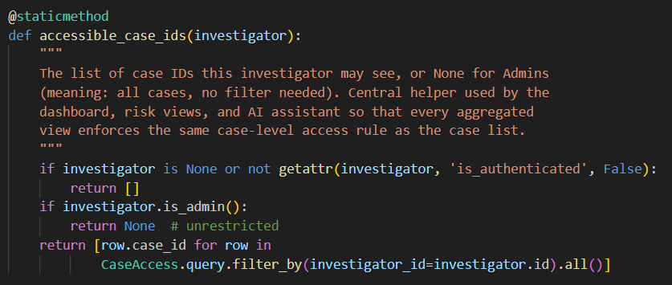

**Listing 16.5 - `case_access.py` - `accessible_case_ids`.** The single place that answers 'which investigations may this account see': a sentinel for an administrator, the membership list for anyone else, an empty list for an account belonging to nothing. Every aggregate routes through it - the abstraction whose absence caused the Sprint 4 defect (Section 9.3).

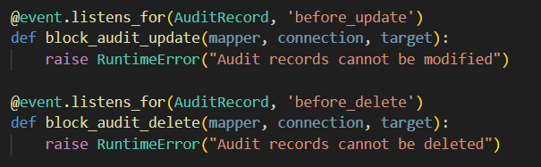

**Listing 16.6 - ORM listeners enforcing the append-only trail.** Any attempt to update or delete an audit record raises at the data-access layer. The guarantee therefore binds code that has not been written yet: a route added later cannot rewrite history whether or not its author knew the rule (Section 5.8).

---

\newpage
